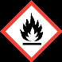
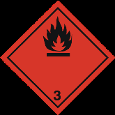

# PINTURA EPOXI POLIAMIDA BLANCO 13243

> **Documento fuente:** FDS 10 - pintura-epoxi-poliamida-blanco-13243-10012925-10344427-hoja-de-seguridad-pdf.pdf
> **Fabricante:** Pintuco
> **Versión / fecha:** 16/05/2018 Revisión: 15/08/2018 Versión: 2 (sustituye a 1)
> **Páginas:** 13

## Mapa de secciones FDS

| # | Sección | Página | Estado |
|---|---|---|---|
| 1 | IDENTIFICACION DEL PRODUCTO | 1 | OK |
| 2 | IDENTIFICACION DEL PELIGRO O PELIGROS | 1 | OK |
| 3 | Identificación de los peligros | 8 | OK |
| 4 | PRIMEROS AUXILIOS | 2 | OK |
| 5 | MEDIDAS DE LUCHA CONTRA INCENDIOS | 3 | OK |
| 6 | MEDIDAS QUE DEBEN TOMARSE EN CASO DE VERTIDO ACCIDENTAL | 3 | OK |
| 7 | MANIPULACION Y ALMACENAMIENTO | 3 | OK |
| 8 | CONTROLES DE EXPOSICION/PROTECCION PERSONAL | 4 | OK |
| 9 | PROPIEDADES FISICAS Y QUIMICAS Y CARACTERISTICAS DE SEGURIDAD | 5 | OK |
| 10 | ESTABILIDAD Y REACTIVIDAD | 6 | OK |
| 11 | INFORMACION TOXICOLOGICA | 7 | OK |
| 12 | INFORMACION ECOTOXICOLOGICA | 8 | OK |
| 13 | INFORMACION RELATIVA A LA ELIMINACION DE LOS PRODUCTOS | 10 | OK |
| 14 | INFORMACION RELATIVA AL TRANSPORTE | 10 | OK |
| 15 | INFORMACION SOBRE LA REGLAMENTACION | 11 | OK |
| 16 | OTRAS INFORMACIONES | 12 | OK |

---

### Página 1

PINTURA EPOXI POLIAMIDA BLANCO 13243
10012925-10344427
Ficha de datos de seguridad
según Decreto 1496 de 2018
## 1. IDENTIFICACION DEL PRODUCTO

1.1
Identificador SGA del producto:
PINTURA EPOXI POLIAMIDA BLANCO 13243
10012925-10344427
1.2
Uso recomendado del producto químico y restricciones:
Usos pertinentes: Pintura. Uso exclusivo usuario profesional.
Usos desaconsejados: Todo aquel uso no especificado en este epígrafe ni en el epígrafe 7.3
1.3
Datos sobre el proveedor:
Pintuco
Autopista Medellín Bogotá Km 37 Vía Belén Rionegro Km 1
054040 Rionegro - Antioquia - Colombia
Tfno.: 57 4 569 81 00
contacto@pintuco.com
http://www.pintuco.com
1.4
Número de teléfono para emergencias:
57 4 561 22 23
## 2. IDENTIFICACION DEL PELIGRO O PELIGROS

2.1
Clasificación de la sustancia o de la mezcla:
SGA:
La clasificación del producto se ha realizado conforme con al decreto 1496 de 2018, por el cual se adopta el Sistema Globalmente
Armonizado de Clasificación y Etiquetado de Productos Químicos y se dictan otras disposiciones en materia de seguridad química.
Irrit. Cut. 2: Irritación cutánea, categoría 2, H315
Les. Oc. 1: Lesiones oculares graves, Categoría 1, H318
Liq. Infl. 3: Líquidos inflamables, Categoría 3, H226
Sens. Cut. 1: Sensibilización cutánea, Categoría 1, H317
Tox. Agud. 4: Toxicidad aguda por contacto con la piel, Categoría 4, H312
Tox. Agud. 4: Toxicidad aguda por inhalación, Categoría 4, H332
Tox. Agud. 5: Toxicidad aguda por ingestión, Categoría 5, H303
2.2
Elementos de las etiquetas del SGA, incluidos los consejos de prudencia:
SGA:
Peligro
Indicaciones de peligro:
Irrit. Cut. 2: H315 - Provoca irritación cutánea
Les. Oc. 1: H318 - Provoca lesiones oculares graves
Liq. Infl. 3: H226 - Líquido y vapores inflamables
Sens. Cut. 1: H317 - Puede provocar una reacción cutánea alérgica
Tox. Agud. 4: H312 - Nocivo en contacto con la piel
Tox. Agud. 4: H332 - Nocivo si se inhala
Tox. Agud. 5: H303 - Puede ser nocivo en caso de ingestión
Consejos de prudencia:
P210: Mantener alejado del calor, superficies calientes, chispas llamas al descubierto y otras fuentes de ignición. No fumar
P280: Usar guantes/ropa de protección/equipo de protección para los ojos/la cara
P302+P352: EN CASO DE CONTACTO CON LA PIEL: Lavar con abundante agua
P304+P340: EN CASO DE INHALACIÓN: Transportar a la persona al aire libre y mantenerla en una posición que le facilite la
respiración
P305+P351+P338: EN CASO DE CONTACTO CON LOS OJOS: Enjuagar con agua cuidadosamente durante varios minutos. Quitar
las lentes de contacto cuando estén presentes y pueda hacerse con facilidad. Proseguir con el lavado
P308+P313: EN CASO DE exposición demostrada o supuesta: consultar a un médico
P370+P378: En caso de incendio: Utilizar extintor de polvo ABC para la extinción
P501: Eliminar el contenido/recipiente de acuerdo con la normativa sobre residuos peligrosos o envases y residuos de envases
respectivamente
Sustancias que contribuyen a la clasificación
Copolimero epoxy epicloridrina/Bisfenol A (700 < MW < 1100)
Página 1/13
Emisión: 16/05/2018            Revisión: 15/08/2018            Versión: 2 (sustituye a 1)
- CONTINÚA EN LA SIGUIENTE PÁGINA -

#### Tabla 1 (página 1, sección 2)

|  | SECCIÓN 1: IDENTIFICACIÓN DEL PRODUCTO|
|---|---|
| 1.1 Identificador SGA del producto: PINTURA EPOXI POLIAMIDA BLANCO 13243 10012925-10344427 1.2 Uso recomendado del producto químico y restricciones: Usos pertinentes: Pintura. Uso exclusivo usuario profesional. Usos desaconsejados: Todo aquel uso no especificado en este epígrafe ni en el epígrafe 7.3 1.3 Datos sobre el proveedor: Pintuco Autopista Medellín Bogotá Km 37 Vía Belén Rionegro Km 1 054040 Rionegro - Antioquia - Colombia Tfno.: 57 4 569 81 00 contacto@pintuco.com http://www.pintuco.com 1.4 Número de teléfono para emergencias: 57 4 561 22 23 | |

#### Tabla 2 (página 1, sección 2)

|  | SECCIÓN 2: IDENTIFICACIÓN DEL PELIGRO O PELIGROS|
|---|---|
| 2.1 Clasificación de la sustancia o de la mezcla: SGA: La clasificación del producto se ha realizado conforme con al decreto 1496 de 2018, por el cual se adopta el Sistema Globalmente Armonizado de Clasificación y Etiquetado de Productos Químicos y se dictan otras disposiciones en materia de seguridad química. Irrit. Cut. 2: Irritación cutánea, categoría 2, H315 Les. Oc. 1: Lesiones oculares graves, Categoría 1, H318 Liq. Infl. 3: Líquidos inflamables, Categoría 3, H226 Sens. Cut. 1: Sensibilización cutánea, Categoría 1, H317 Tox. Agud. 4: Toxicidad aguda por contacto con la piel, Categoría 4, H312 Tox. Agud. 4: Toxicidad aguda por inhalación, Categoría 4, H332 Tox. Agud. 5: Toxicidad aguda por ingestión, Categoría 5, H303 2.2 Elementos de las etiquetas del SGA, incluidos los consejos de prudencia: SGA: Peligro Indicaciones de peligro: Irrit. Cut. 2: H315 - Provoca irritación cutánea Les. Oc. 1: H318 - Provoca lesiones oculares graves Liq. Infl. 3: H226 - Líquido y vapores inflamables Sens. Cut. 1: H317 - Puede provocar una reacción cutánea alérgica Tox. Agud. 4: H312 - Nocivo en contacto con la piel Tox. Agud. 4: H332 - Nocivo si se inhala Tox. Agud. 5: H303 - Puede ser nocivo en caso de ingestión Consejos de prudencia: P210: Mantener alejado del calor, superficies calientes, chispas llamas al descubierto y otras fuentes de ignición. No fumar P280: Usar guantes/ropa de protección/equipo de protección para los ojos/la cara P302+P352: EN CASO DE CONTACTO CON LA PIEL: Lavar con abundante agua P304+P340: EN CASO DE INHALACIÓN: Transportar a la persona al aire libre y mantenerla en una posición que le facilite la respiración P305+P351+P338: EN CASO DE CONTACTO CON LOS OJOS: Enjuagar con agua cuidadosamente durante varios minutos. Quitar las lentes de contacto cuando estén presentes y pueda hacerse con facilidad. Proseguir con el lavado P308+P313: EN CASO DE exposición demostrada o supuesta: consultar a un médico P370+P378: En caso de incendio: Utilizar extintor de polvo ABC para la extinción P501: Eliminar el contenido/recipiente de acuerdo con la normativa sobre residuos peligrosos o envases y residuos de envases respectivamente Sustancias que contribuyen a la clasificación Copolimero epoxy epicloridrina/Bisfenol A (700 < MW < 1100) | |

*Imagen técnica — documento: FDS 10 - pintura-epoxi-poliamida-blanco-13243-10012925-10344427-hoja-de-seguridad-pdf.pdf.pdf, página 1, sección: 2.*

*Imagen técnica — documento: FDS 10 - pintura-epoxi-poliamida-blanco-13243-10012925-10344427-hoja-de-seguridad-pdf.pdf.pdf, página 1, sección: 2.*

*Imagen técnica — documento: FDS 10 - pintura-epoxi-poliamida-blanco-13243-10012925-10344427-hoja-de-seguridad-pdf.pdf.pdf, página 1, sección: 2.*

*Imagen técnica — documento: FDS 10 - pintura-epoxi-poliamida-blanco-13243-10012925-10344427-hoja-de-seguridad-pdf.pdf.pdf, página 1, sección: 2.*

*Imagen técnica — documento: FDS 10 - pintura-epoxi-poliamida-blanco-13243-10012925-10344427-hoja-de-seguridad-pdf.pdf.pdf, página 1, sección: 2.*

### Página 2

PINTURA EPOXI POLIAMIDA BLANCO 13243
10012925-10344427
Ficha de datos de seguridad
según Decreto 1496 de 2018
## 2. IDENTIFICACION DEL PELIGRO O PELIGROS (CONTINUA)

2.3
Otros peligros que no conducen a una clasificación:
No relevante
## 3. COMPOSICION/INFORMACION SOBRE LOS COMPONENTES

3.1
Sustancias:
No aplicable
3.2
Mezclas:
Descripción química: Mezcla a base de productos químicos
Componentes:
De acuerdo al Decreto 1496 de 2018, el producto presenta:
Identificación
Nombre químico/clasificación
Concentración
CAS:
25036-25-3
Copolimero epoxy epicloridrina/Bisfenol A (700 < MW < 1100)
10 - <25 %
CAS: 13463-67-7
Dioxido de titanio
2.5 - <10 %
CAS: 1330-20-7
Xileno
2.5 - <10 %
CAS:
111-76-2
2-butoxietanol
2.5 - <10 %
CAS:
108-38-3
m-xileno
2.5 - <10 %
CAS: 78-83-1
2-metilpropan-1-ol
2.5 - <10 %
CAS: 106-42-3
p-xileno
1 - <2.5 %
CAS: 95-47-6
o-xileno
1 - <2.5 %
CAS:
100-41-4
Etilbenceno
<1 %
Para ampliar información sobre la peligrosidad de la sustancias consultar las secciones 8, 11, 12, 15 y 16. La clasificación respecto
Carcinogenicidad de las sustancias se ha establecido en función de las monografías de la IARC adecuandola al sistema de
clasificación SGA, para información sobre la clasificación IARC consulte la sección 11.
## 4. PRIMEROS AUXILIOS

4.1
Descripción de los primeros auxilios necesarios:
Los síntomas como consecuencia de una intoxicación pueden presentarse con posterioridad a la exposición, por lo que, en caso de
duda, exposición directa al producto químico o persistencia del malestar solicitar atención médica, mostrándole la FDS de este
producto.
Por inhalación:
Sacar al afectado del lugar de exposición, suministrarle aire limpio y mantenerlo en reposo. En casos graves como parada
cardiorespiratoria, se aplicarán técnicas de respiración artificial (respiración boca a boca, masaje cardíaco, suministro de
oxígeno,etc.) requiriendo asistencia médica inmediata.
Por contacto con la piel:
Quitar la ropa y los zapatos contaminados, aclarar la piel o duchar al afectado si procede con abundante agua fría y jabón neutro. En
caso de afección importante acudir al médico. Si el producto produce quemaduras o congelación, no se debe quitar la ropa debido a
que podría empeorar la lesión producida si esta se encuentra pegada a la piel. En el caso de formarse ampollas en la piel, éstas
nunca deben reventarse ya que aumentaría el riesgo de infección.
Por contacto con los ojos:
Enjuagar los ojos con abundante agua a temperatura ambiente al menos durante 15 minutos. Evitar que el afectado se frote o cierre
los ojos. En el caso de que el accidentado use lentes de contacto, éstas deben retirarse siempre que no estén pegadas a los ojos,
de otro modo podría producirse un daño adicional. En todos los casos, después del lavado, se debe acudir al médico lo más
rápidamente posible con la FDS del producto.
Página 2/13
Emisión: 16/05/2018            Revisión: 15/08/2018            Versión: 2 (sustituye a 1)
- CONTINÚA EN LA SIGUIENTE PÁGINA -

#### Tabla 1 (página 2, sección 4)

|  | SECCIÓN 2: IDENTIFICACIÓN DEL PELIGRO O PELIGROS (continúa)|
|---|---|
| 2.3 Otros peligros que no conducen a una clasificación: No relevante | |

#### Tabla 2 (página 2, sección 4)

|  | SECCIÓN 3: COMPOSICIÓN/INFORMACIÓN SOBRE LOS COMPONENTES|
|---|---|
| 3.1 Sustancias: No aplicable 3.2 Mezclas: Descripción química: Mezcla a base de productos químicos Componentes: De acuerdo al Decreto 1496 de 2018, el producto presenta: Identificación Nombre químico/clasificación Concentración CAS: 25036-25-3 Copolimero epoxy epicloridrina/Bisfenol A (700 < MW < 1100) 10 - <25 % Dioxido de titanio 2.5 - <10 % CAS: 13463-67-7 Xileno 2.5 - <10 % CAS: 1330-20-7 2-butoxietanol 2.5 - <10 % CAS: 111-76-2 m-xileno 2.5 - <10 % CAS: 108-38-3 2-metilpropan-1-ol 2.5 - <10 % CAS: 78-83-1 p-xileno 1 - <2.5 % CAS: 106-42-3 o-xileno 1 - <2.5 % CAS: 95-47-6 Etilbenceno <1 % CAS: 100-41-4 Para ampliar información sobre la peligrosidad de la sustancias consultar las secciones 8, 11, 12, 15 y 16. La clasificación respecto Carcinogenicidad de las sustancias se ha establecido en función de las monografías de la IARC adecuandola al sistema de clasificación SGA, para información sobre la clasificación IARC consulte la sección 11. | |

#### Tabla 3 (página 2, sección 4)

| Identificación | Nombre químico/clasificación | Concentración|
|---|---|---|
| CAS: 25036-25-3 | Copolimero epoxy epicloridrina/Bisfenol A (700 < MW < 1100) | 10 - <25 %|
| CAS: 13463-67-7 | Dioxido de titanio | 2.5 - <10 %|
| CAS: 1330-20-7 | Xileno | 2.5 - <10 %|
| CAS: 111-76-2 | 2-butoxietanol | 2.5 - <10 %|
| CAS: 108-38-3 | m-xileno | 2.5 - <10 %|
| CAS: 78-83-1 | 2-metilpropan-1-ol | 2.5 - <10 %|
| CAS: 106-42-3 | p-xileno | 1 - <2.5 %|
| CAS: 95-47-6 | o-xileno | 1 - <2.5 %|
| CAS: 100-41-4 | Etilbenceno | <1 %|

#### Tabla 4 (página 2, sección 4)

|  | SECCIÓN 4: PRIMEROS AUXILIOS|
|---|---|
| 4.1 Descripción de los primeros auxilios necesarios: Los síntomas como consecuencia de una intoxicación pueden presentarse con posterioridad a la exposición, por lo que, en caso de duda, exposición directa al producto químico o persistencia del malestar solicitar atención médica, mostrándole la FDS de este producto. Por inhalación: Sacar al afectado del lugar de exposición, suministrarle aire limpio y mantenerlo en reposo. En casos graves como parada cardiorespiratoria, se aplicarán técnicas de respiración artificial (respiración boca a boca, masaje cardíaco, suministro de oxígeno,etc.) requiriendo asistencia médica inmediata. Por contacto con la piel: Quitar la ropa y los zapatos contaminados, aclarar la piel o duchar al afectado si procede con abundante agua fría y jabón neutro. En caso de afección importante acudir al médico. Si el producto produce quemaduras o congelación, no se debe quitar la ropa debido a que podría empeorar la lesión producida si esta se encuentra pegada a la piel. En el caso de formarse ampollas en la piel, éstas nunca deben reventarse ya que aumentaría el riesgo de infección. Por contacto con los ojos: Enjuagar los ojos con abundante agua a temperatura ambiente al menos durante 15 minutos. Evitar que el afectado se frote o cierre los ojos. En el caso de que el accidentado use lentes de contacto, éstas deben retirarse siempre que no estén pegadas a los ojos, de otro modo podría producirse un daño adicional. En todos los casos, después del lavado, se debe acudir al médico lo más rápidamente posible con la FDS del producto. | |

### Página 3

PINTURA EPOXI POLIAMIDA BLANCO 13243
10012925-10344427
Ficha de datos de seguridad
según Decreto 1496 de 2018
## 4. PRIMEROS AUXILIOS (CONTINUA)

Por ingestión/aspiración:
No inducir al vómito, en el caso de que se produzca mantener inclinada la cabeza hacia delante para evitar la aspiración. Mantener
al afectado en reposo. Enjuagar la boca y la garganta, ya que existe la posibilidad de que hayan sido afectadas en la ingestión.
4.2
Síntomas/efectos más importantes, agudos o retardados:
Los efectos agudos y retardados son los indicados en las secciones 2 y 11.
4.3
Indicación de la necesidad de recibir atención médica inmediata y, en su caso, de tratamiento especial:
No relevante
## 5. MEDIDAS DE LUCHA CONTRA INCENDIOS

5.1
Medios de extinción apropiados:
Emplear preferentemente extintores de polvo polivalente (polvo ABC), alternativamente utilizar espuma física o extintores de dióxido
de carbono (CO2). NO SE RECOMIENDA emplear agua a chorro como agente de extinción.
5.2
Peligros específicos del producto químico:
Como consecuencia de la combustión o descomposición térmica se generan subproductos de reacción que pueden resultar
altamente tóxicos y, consecuentemente, pueden presentar un riesgo elevado para la salud.
5.3
Medidas especiales que deben tomar los equipos de lucha contra incendios:
En función de la magnitud del incendio puede hacerse necesario el uso de ropa protectora completa y equipo de respiración
autónomo. Disponer de un mínimo de instalaciones de emergencia o elementos de actuación (mantas ignífugas, botiquín portátil,...).
Disposiciones adicionales:
Actuar conforme el Plan de Emergencia Interior y las Fichas Informativas sobre actuación ante accidentes y otras emergencias.
Suprimir cualquier fuente de ignición. En caso de incendio, refrigerar los recipientes y tanques de almacenamiento de productos
susceptibles a inflamación, explosión como consecuencia de elevadas temperaturas. Evitar el vertido de los productos empleados en
la extinción del incendio al medio acuático.
## 6. MEDIDAS QUE DEBEN TOMARSE EN CASO DE VERTIDO ACCIDENTAL

6.1
Precauciones personales, equipo protector y procedimiento de emergencia:
Aislar las fugas siempre y cuando no suponga un riesgo adicional para las personas que desempeñen esta función. Evacuar la zona
y mantener a las personas sin protección alejadas. Ante el contacto potencial con el producto derramado se hace obligatorio el uso
de elementos de protección personal (ver sección 8). Evitar de manera prioritaria la formación de mezclas vapor-aire inflamables, ya
sea mediante ventilación o el uso de un agente inertizante. Suprimir cualquier fuente de ignición. Eliminar las cargas electroestáticas
mediante la interconexión de todas las superficies conductoras sobre las que se puede formar electricidad estática, y estando a su
vez el conjunto conectado a tierra.
6.2
Precauciones relativas al medio ambiente:
Producto no clasificado como peligroso para el medioambiente. Mantener el producto alejado de los desagües y de las aguas
superficiales y subterráneas.
6.3
Métodos y materiales para la contención y limpieza de vertidos:
Se recomienda:
Absorber el vertido mediante arena o absorbente inerte y trasladarlo a un lugar seguro. No absorber en serrín u otros absorbentes
combustibles. Para cualquier consideración relativa a la eliminación consultar la sección 13.
6.4
Referencias a otras secciones:
Ver secciones 8 y 13.
## 7. MANIPULACION Y ALMACENAMIENTO

7.1
Precauciones que se deben tomar para garantizar una manipulación segura:
A.- Precauciones generales
Cumplir con la legislación vigente en materia de prevención de riesgos laborales. Mantener los recipientes herméticamente
cerrados. Controlar los derrames y residuos, eliminándolos con métodos seguros (sección 6). Evitar el vertido libre desde el
recipiente. Mantener orden y limpieza donde se manipulen productos peligrosos.
B.- Recomendaciones técnicas para la prevención de incendios y explosiones.
Página 3/13
Emisión: 16/05/2018            Revisión: 15/08/2018            Versión: 2 (sustituye a 1)
- CONTINÚA EN LA SIGUIENTE PÁGINA -

#### Tabla 1 (página 3, sección 7)

|  | SECCIÓN 4: PRIMEROS AUXILIOS (continúa)|
|---|---|
| Por ingestión/aspiración: No inducir al vómito, en el caso de que se produzca mantener inclinada la cabeza hacia delante para evitar la aspiración. Mantener al afectado en reposo. Enjuagar la boca y la garganta, ya que existe la posibilidad de que hayan sido afectadas en la ingestión. 4.2 Síntomas/efectos más importantes, agudos o retardados: Los efectos agudos y retardados son los indicados en las secciones 2 y 11. 4.3 Indicación de la necesidad de recibir atención médica inmediata y, en su caso, de tratamiento especial: No relevante | |

#### Tabla 2 (página 3, sección 7)

|  | SECCIÓN 5: MEDIDAS DE LUCHA CONTRA INCENDIOS|
|---|---|
| 5.1 Medios de extinción apropiados: Emplear preferentemente extintores de polvo polivalente (polvo ABC), alternativamente utilizar espuma física o extintores de dióxido de carbono (CO2). NO SE RECOMIENDA emplear agua a chorro como agente de extinción. 5.2 Peligros específicos del producto químico: Como consecuencia de la combustión o descomposición térmica se generan subproductos de reacción que pueden resultar altamente tóxicos y, consecuentemente, pueden presentar un riesgo elevado para la salud. 5.3 Medidas especiales que deben tomar los equipos de lucha contra incendios: En función de la magnitud del incendio puede hacerse necesario el uso de ropa protectora completa y equipo de respiración autónomo. Disponer de un mínimo de instalaciones de emergencia o elementos de actuación (mantas ignífugas, botiquín portátil,...). Disposiciones adicionales: Actuar conforme el Plan de Emergencia Interior y las Fichas Informativas sobre actuación ante accidentes y otras emergencias. Suprimir cualquier fuente de ignición. En caso de incendio, refrigerar los recipientes y tanques de almacenamiento de productos susceptibles a inflamación, explosión como consecuencia de elevadas temperaturas. Evitar el vertido de los productos empleados en la extinción del incendio al medio acuático. | |

#### Tabla 3 (página 3, sección 7)

|  | SECCIÓN 6: MEDIDAS QUE DEBEN TOMARSE EN CASO DE VERTIDO ACCIDENTAL|
|---|---|
| 6.1 Precauciones personales, equipo protector y procedimiento de emergencia: Aislar las fugas siempre y cuando no suponga un riesgo adicional para las personas que desempeñen esta función. Evacuar la zona y mantener a las personas sin protección alejadas. Ante el contacto potencial con el producto derramado se hace obligatorio el uso de elementos de protección personal (ver sección 8). Evitar de manera prioritaria la formación de mezclas vapor-aire inflamables, ya sea mediante ventilación o el uso de un agente inertizante. Suprimir cualquier fuente de ignición. Eliminar las cargas electroestáticas mediante la interconexión de todas las superficies conductoras sobre las que se puede formar electricidad estática, y estando a su vez el conjunto conectado a tierra. 6.2 Precauciones relativas al medio ambiente: Producto no clasificado como peligroso para el medioambiente. Mantener el producto alejado de los desagües y de las aguas superficiales y subterráneas. 6.3 Métodos y materiales para la contención y limpieza de vertidos: Se recomienda: Absorber el vertido mediante arena o absorbente inerte y trasladarlo a un lugar seguro. No absorber en serrín u otros absorbentes combustibles. Para cualquier consideración relativa a la eliminación consultar la sección 13. 6.4 Referencias a otras secciones: Ver secciones 8 y 13. | |

#### Tabla 4 (página 3, sección 7)

|  | SECCIÓN 7: MANIPULACIÓN Y ALMACENAMIENTO|
|---|---|
| 7.1 Precauciones que se deben tomar para garantizar una manipulación segura: A.- Precauciones generales Cumplir con la legislación vigente en materia de prevención de riesgos laborales. Mantener los recipientes herméticamente cerrados. Controlar los derrames y residuos, eliminándolos con métodos seguros (sección 6). Evitar el vertido libre desde el recipiente. Mantener orden y limpieza donde se manipulen productos peligrosos. B.- Recomendaciones técnicas para la prevención de incendios y explosiones. | |

### Página 4

PINTURA EPOXI POLIAMIDA BLANCO 13243
10012925-10344427
Ficha de datos de seguridad
según Decreto 1496 de 2018
## 7. MANIPULACION Y ALMACENAMIENTO (CONTINUA)

Trasvasar en lugares bien ventilados, preferentemente mediante extracción localizada. Controlar totalmente los focos de ignición
(teléfonos móviles, chispas,…) y ventilar en las operaciones de limpieza. Evitar la existencia de atmósferas peligrosas en el
interior de recipientes, aplicando en lo posible sistemas de inertización. Trasvasar a velocidades lentas para evitar la generación
de cargas electroestáticas. Ante la posibilidad de existencia de cargas electroestáticas: asegurar una perfecta conexión
equipotencial, utilizar siempre tomas de tierras, no emplear ropa de trabajo de fibras acrílicas, empleando preferiblemente ropa de
algodón y calzado conductor. Cumplir con los requisitos esenciales de seguridad para equipos  y con las disposiciones mínimas
para la protección de la seguridad y salud de los trabajadores. Consultar la sección 10 sobre condiciones y materias que deben
evitarse.
C.- Recomendaciones técnicas para prevenir riesgos ergonómicos y toxicológicos.
Para control de exposición consultar la sección 8. No comer, beber ni fumar en las zonas de trabajo; lavarse las manos después
de cada utilización, y despojarse de prendas de vestir y equipos de protección contaminados antes de entrar en las zonas para
comer.
D.- Recomendaciones técnicas para prevenir riesgos medioambientales
Se recomienda disponer de material absorbente en las proximidades del producto (ver epígrafe 6.3)
7.2
Condiciones de almacenamiento seguro, incluidas cualesquiera incompatibilidades:
A.- Medidas técnicas de almacenamiento
B.- Condiciones generales de almacenamiento.
Evitar fuentes de calor, radiación, electricidad estática y el contacto con alimentos. Para información adicional ver epígrafe 10.5
7.3
Usos específicos finales:
Salvo las indicaciones ya especificadas no es preciso realizar ninguna recomendación especial en cuanto a los usos de este
producto.
Tª mínima:
5 ºC
Tª máxima:
30 ºC
Tiempo máximo:
18 meses
## 8. CONTROLES DE EXPOSICION/PROTECCION PERSONAL

8.1
Parámetros de control:
Sustancias cuyos valores límite de exposición profesional han de controlarse en el ambiente de trabajo (ACGIH):
Identificación
Valores límite ambientales
Dioxido de titanio
TLV-TWA
10 mg/m³
CAS: 13463-67-7
TLV-STEL
Xileno
TLV-TWA
100 ppm
CAS: 1330-20-7
TLV-STEL
150 ppm
2-butoxietanol
TLV-TWA
20 ppm
CAS: 111-76-2
TLV-STEL
2-metilpropan-1-ol
TLV-TWA
50 ppm
CAS: 78-83-1
TLV-STEL
Etilbenceno
TLV-TWA
20 ppm
CAS: 100-41-4
TLV-STEL
8.2
Controles técnicos apropiados:
A.- Medidas de protección individual, como equipo de protección personal (EPP)
Como medida de prevención se recomienda la utilización de equipos de protección individual básicos. Para más información
sobre los equipos de protección individual (almacenamiento, uso, limpieza, mantenimiento, clase de protección,…) consultar el
folleto informativo facilitado por el fabricante del EPP. Las indicaciones contenidas en este punto se refieren al producto puro. Las
medidas de protección para el producto diluido podrán variar en función de su grado de dilución, uso, método de aplicación, etc.
Para determinar la obligación de instalación de duchas de emergencia y/o lavaojos en los almacenes se tendrá en cuenta la
normativa referente al almacenamiento de productos químicos aplicable en cada caso. Para más información ver epígrafes 7.1 y
7.2.
Toda la información aquí incluida es una recomendación siendo necesario su concreción por parte de los servicios de prevención
de riesgos laborales al desconocer las medidas de prevención adicionales que la empresa pudiese disponer.
B.- Protección respiratoria.
Página 4/13
Emisión: 16/05/2018            Revisión: 15/08/2018            Versión: 2 (sustituye a 1)
- CONTINÚA EN LA SIGUIENTE PÁGINA -

#### Tabla 1 (página 4, sección 8)

|  | SECCIÓN 7: MANIPULACIÓN Y ALMACENAMIENTO (continúa)|
|---|---|
| Trasvasar en lugares bien ventilados, preferentemente mediante extracción localizada. Controlar totalmente los focos de ignición (teléfonos móviles, chispas,…) y ventilar en las operaciones de limpieza. Evitar la existencia de atmósferas peligrosas en el interior de recipientes, aplicando en lo posible sistemas de inertización. Trasvasar a velocidades lentas para evitar la generación de cargas electroestáticas. Ante la posibilidad de existencia de cargas electroestáticas: asegurar una perfecta conexión equipotencial, utilizar siempre tomas de tierras, no emplear ropa de trabajo de fibras acrílicas, empleando preferiblemente ropa de algodón y calzado conductor. Cumplir con los requisitos esenciales de seguridad para equipos y con las disposiciones mínimas para la protección de la seguridad y salud de los trabajadores. Consultar la sección 10 sobre condiciones y materias que deben evitarse. C.- Recomendaciones técnicas para prevenir riesgos ergonómicos y toxicológicos. Para control de exposición consultar la sección 8. No comer, beber ni fumar en las zonas de trabajo; lavarse las manos después de cada utilización, y despojarse de prendas de vestir y equipos de protección contaminados antes de entrar en las zonas para comer. D.- Recomendaciones técnicas para prevenir riesgos medioambientales Se recomienda disponer de material absorbente en las proximidades del producto (ver epígrafe 6.3) 7.2 Condiciones de almacenamiento seguro, incluidas cualesquiera incompatibilidades: A.- Medidas técnicas de almacenamiento Tª mínima: 5 ºC Tª máxima: 30 ºC Tiempo máximo: 18 meses B.- Condiciones generales de almacenamiento. Evitar fuentes de calor, radiación, electricidad estática y el contacto con alimentos. Para información adicional ver epígrafe 10.5 7.3 Usos específicos finales: Salvo las indicaciones ya especificadas no es preciso realizar ninguna recomendación especial en cuanto a los usos de este producto. | |

#### Tabla 2 (página 4, sección 8)

|  | SECCIÓN 8: CONTROLES DE EXPOSICIÓN/PROTECCIÓN PERSONAL|
|---|---|
| 8.1 Parámetros de control: Sustancias cuyos valores límite de exposición profesional han de controlarse en el ambiente de trabajo (ACGIH): Identificación Valores límite ambientales Dioxido de titanio TLV-TWA 10 mg/m³ CAS: 13463-67-7 TLV-STEL Xileno TLV-TWA 100 ppm CAS: 1330-20-7 TLV-STEL 150 ppm 2-butoxietanol TLV-TWA 20 ppm CAS: 111-76-2 TLV-STEL 2-metilpropan-1-ol TLV-TWA 50 ppm CAS: 78-83-1 TLV-STEL Etilbenceno TLV-TWA 20 ppm CAS: 100-41-4 TLV-STEL 8 .2 C ontroles técnicos apropiados: A.- Medidas de protección individual, como equipo de protección personal (EPP) Como medida de prevención se recomienda la utilización de equipos de protección individual básicos. Para más información sobre los equipos de protección individual (almacenamiento, uso, limpieza, mantenimiento, clase de protección,…) consultar el folleto informativo facilitado por el fabricante del EPP. Las indicaciones contenidas en este punto se refieren al producto puro. Las medidas de protección para el producto diluido podrán variar en función de su grado de dilución, uso, método de aplicación, etc. Para determinar la obligación de instalación de duchas de emergencia y/o lavaojos en los almacenes se tendrá en cuenta la normativa referente al almacenamiento de productos químicos aplicable en cada caso. Para más información ver epígrafes 7.1 y 7.2. Toda la información aquí incluida es una recomendación siendo necesario su concreción por parte de los servicios de prevención de riesgos laborales al desconocer las medidas de prevención adicionales que la empresa pudiese disponer. B.- Protección respiratoria. | |

#### Tabla 3 (página 4, sección 8)

| Identificación | Valores límite ambientales |  | |
|---|---|---|---|
| Dioxido de titanio CAS: 13463-67-7 | TLV-TWA |  | 10 mg/m³|
|  | TLV-STEL |  | |
| Xileno CAS: 1330-20-7 | TLV-TWA | 100 ppm | |
|  | TLV-STEL | 150 ppm | |
| 2-butoxietanol CAS: 111-76-2 | TLV-TWA | 20 ppm | |
|  | TLV-STEL |  | |
| 2-metilpropan-1-ol CAS: 78-83-1 | TLV-TWA | 50 ppm | |
|  | TLV-STEL |  | |
| Etilbenceno CAS: 100-41-4 | TLV-TWA | 20 ppm | |
|  | TLV-STEL |  | |

### Página 5

PINTURA EPOXI POLIAMIDA BLANCO 13243
10012925-10344427
Ficha de datos de seguridad
según Decreto 1496 de 2018
## 8. CONTROLES DE EXPOSICION/PROTECCION PERSONAL (CONTINUA)

Pictograma
EPP
Observaciones
Proteccion
obligatoria del las
vias respiratorias
Máscara con filtros para gases y vapores
Reemplazar cuando se detecte olor o sabor del contaminante en el interior de la
máscara o adaptador facial. Cuando el contaminante no tiene buenas propiedades
de aviso se recomienda el uso de equipos aislantes.
C.- Protección específica de las manos.
Pictograma
EPP
Observaciones
Proteccion
obligatoria de la
manos
Guantes de protección química
El tiempo de paso (Breakthrough Time) indicado por el fabricante ha de ser superior
al del tiempo de uso del producto. No emplear cremas protectoras despues del
contacto del producto con la piel.
Dado que el producto es una mezcla de diferentes materiales, la resistencia del material de los guantes no se puede calcular de
antemano con total fiabilidad y por lo tanto tiene que ser controlados antes de su aplicación.
D.- Protección ocular y facial
Pictograma
EPP
Observaciones
Proteccion
obligatoria de la cara
Gafas de seguridad
Limpiar a diario y desinfectar periódicamente de acuerdo a las instrucciones del
fabricante. Se recomienda su uso en caso de riesgo de salpicaduras.
E.- Protección corporal
Pictograma
EPP
Observaciones
Proteccion
obligatoria del
cuerpo
Prenda de protección frente a riesgos químicos,
antiestática e ignífuga
Uso exclusivo en el trabajo. Limpiar periódicamente de acuerdo a las instrucciones
del fabricante.
Proteccion
obligatoria de los
pies
Calzado de seguridad contra riesgo químico, con
propiedades antiestáticas y resistencia al calor
Reemplazar las botas ante cualquier indicio de deterioro.
F.- Medidas complementarias de emergencia
Medida de emergencia
Normas
Medida de emergencia
Normas
Ducha de emergencia
ANSI Z358-1
ISO 3864-1:2002
Lavaojos
DIN 12 899
ISO 3864-1:2002
Controles de la exposición del medio ambiente:
En virtud de la legislación comunitaria de protección del medio ambiente se recomienda evitar el vertido tanto del producto como de
su envase al medio ambiente. Para información adicional ver epígrafe 7.1.D
## 9. PROPIEDADES FISICAS Y QUIMICAS Y CARACTERISTICAS DE SEGURIDAD

9.1
Información de propiedades físicas y químicas básicas:
Para completar la información ver la ficha técnica/hoja de especificaciones del producto.
Aspecto físico:
Estado físico a 20 ºC:
Líquido
Aspecto:
Característico
Color:
Característico
*No relevante debido a la naturaleza del producto, no aportando información característica de su peligrosidad.
Página 5/13
Emisión: 16/05/2018            Revisión: 15/08/2018            Versión: 2 (sustituye a 1)
- CONTINÚA EN LA SIGUIENTE PÁGINA -

#### Tabla 1 (página 5, sección 9)

|  | SECCIÓN 8: CONTROLES DE EXPOSICIÓN/PROTECCIÓN PERSONAL (continúa)|
|---|---|
| Pictograma EPP Observaciones Máscara con filtros para gases y vapores Reemplazar cuando se detecte olor o sabor del contaminante en el interior de la máscara o adaptador facial. Cuando el contaminante no tiene buenas propiedades de aviso se recomienda el uso de equipos aislantes. Proteccion obligatoria del las vias respiratorias C.- Protección específica de las manos. Pictograma EPP Observaciones Guantes de protección química El tiempo de paso (Breakthrough Time) indicado por el fabricante ha de ser superior al del tiempo de uso del producto. No emplear cremas protectoras despues del contacto del producto con la piel. Proteccion obligatoria de la manos Dado que el producto es una mezcla de diferentes materiales, la resistencia del material de los guantes no se puede calcular de antemano con total fiabilidad y por lo tanto tiene que ser controlados antes de su aplicación. D.- Protección ocular y facial Pictograma EPP Observaciones Gafas de seguridad Limpiar a diario y desinfectar periódicamente de acuerdo a las instrucciones del fabricante. Se recomienda su uso en caso de riesgo de salpicaduras. Proteccion obligatoria de la cara E.- Protección corporal Pictograma EPP Observaciones Prenda de protección frente a riesgos químicos, Uso exclusivo en el trabajo. Limpiar periódicamente de acuerdo a las instrucciones antiestática e ignífuga del fabricante. Proteccion obligatoria del cuerpo Calzado de seguridad contra riesgo químico, con Reemplazar las botas ante cualquier indicio de deterioro. propiedades antiestáticas y resistencia al calor Proteccion obligatoria de los pies F.- Medidas complementarias de emergencia Medida de emergencia Normas Medida de emergencia Normas ANSI Z358-1 DIN 12 899 ISO 3864-1:2002 ISO 3864-1:2002 Ducha de emerg encia Lavaojos Controles de la exposición del medio ambiente: En virtud de la legislación comunitaria de protección del medio ambiente se recomienda evitar el vertido tanto del producto como de su envase al medio ambiente. Para información adicional ver epígrafe 7.1.D | |

#### Tabla 2 (página 5, sección 9)

| Pictograma | EPP | Observaciones|
|---|---|---|
| Proteccion obligatoria del las vias respiratorias | Máscara con filtros para gases y vapores | Reemplazar cuando se detecte olor o sabor del contaminante en el interior de la máscara o adaptador facial. Cuando el contaminante no tiene buenas propiedades de aviso se recomienda el uso de equipos aislantes.|

#### Tabla 3 (página 5, sección 9)

| Pictograma | EPP | Observaciones|
|---|---|---|
| Proteccion obligatoria de la manos | Guantes de protección química | El tiempo de paso (Breakthrough Time) indicado por el fabricante ha de ser superior al del tiempo de uso del producto. No emplear cremas protectoras despues del contacto del producto con la piel.|

#### Tabla 4 (página 5, sección 9)

| Pictograma | EPP | Observaciones|
|---|---|---|
| Proteccion obligatoria de la cara | Gafas de seguridad | Limpiar a diario y desinfectar periódicamente de acuerdo a las instrucciones del fabricante. Se recomienda su uso en caso de riesgo de salpicaduras.|

#### Tabla 5 (página 5, sección 9)

| Pictograma | EPP | Observaciones|
|---|---|---|
| Proteccion obligatoria del cuerpo | Prenda de protección frente a riesgos químicos, antiestática e ignífuga | Uso exclusivo en el trabajo. Limpiar periódicamente de acuerdo a las instrucciones del fabricante.|
| Proteccion obligatoria de los pies | Calzado de seguridad contra riesgo químico, con propiedades antiestáticas y resistencia al calor | Reemplazar las botas ante cualquier indicio de deterioro.|

#### Tabla 6 (página 5, sección 9)

| Medida de emergencia | Normas | Medida de emergencia | Normas|
|---|---|---|---|
| Ducha de emerg encia | ANSI Z358-1 ISO 3864-1:2002 | Lavaojos | DIN 12 899 ISO 3864-1:2002|

#### Tabla 7 (página 5, sección 9)

|  | SECCIÓN 9: PROPIEDADES FÍSICAS Y QUÍMICAS Y CARACTERÍSTICAS DE SEGURIDAD|
|---|---|
| 9.1 Información de propiedades físicas y químicas básicas: Para completar la información ver la ficha técnica/hoja de especificaciones del producto. Aspecto físico: Estado físico a 20 ºC: Líquido Aspecto: Característico Color: Característico *No relevante debido a la naturaleza del producto, no aportando información característica de su peligrosidad. | |

*Imagen técnica — documento: FDS 10 - pintura-epoxi-poliamida-blanco-13243-10012925-10344427-hoja-de-seguridad-pdf.pdf.pdf, página 5, sección: 9.*

*Imagen técnica — documento: FDS 10 - pintura-epoxi-poliamida-blanco-13243-10012925-10344427-hoja-de-seguridad-pdf.pdf.pdf, página 5, sección: 9.*

*Imagen técnica — documento: FDS 10 - pintura-epoxi-poliamida-blanco-13243-10012925-10344427-hoja-de-seguridad-pdf.pdf.pdf, página 5, sección: 9.*

*Imagen técnica — documento: FDS 10 - pintura-epoxi-poliamida-blanco-13243-10012925-10344427-hoja-de-seguridad-pdf.pdf.pdf, página 5, sección: 9.*

*Imagen técnica — documento: FDS 10 - pintura-epoxi-poliamida-blanco-13243-10012925-10344427-hoja-de-seguridad-pdf.pdf.pdf, página 5, sección: 9.*

*Imagen técnica — documento: FDS 10 - pintura-epoxi-poliamida-blanco-13243-10012925-10344427-hoja-de-seguridad-pdf.pdf.pdf, página 5, sección: 9.*

*Imagen técnica — documento: FDS 10 - pintura-epoxi-poliamida-blanco-13243-10012925-10344427-hoja-de-seguridad-pdf.pdf.pdf, página 5, sección: 9.*

### Página 6

PINTURA EPOXI POLIAMIDA BLANCO 13243
10012925-10344427
Ficha de datos de seguridad
según Decreto 1496 de 2018
## 9. PROPIEDADES FISICAS Y QUIMICAS Y CARACTERISTICAS DE SEGURIDAD (CONTINUA)

Olor:
Característico
Umbral olfativo:
No relevante *
Volatilidad:
Temperatura de ebullición a presión atmosférica:
135 ºC
Presión de vapor a 20 ºC:
1271 Pa
Presión de vapor a 50 ºC:
51,46  (6,86 kPa)
Tasa de evaporación a 20 ºC:
No relevante *
Caracterización del producto:
Densidad a 20 ºC:
1372 kg/m³
Densidad relativa a 20 ºC:
1,421 - 1,448
Viscosidad dinámica a 20 ºC:
No relevante *
Viscosidad cinemática a 20 ºC:
No relevante *
Viscosidad cinemática a 40 ºC:
No relevante *
Concentración:
No relevante *
pH:
No relevante *
Densidad de vapor a 20 ºC:
No relevante *
Coeficiente de reparto n-octanol/agua a 20 ºC:
No relevante *
Solubilidad en agua a 20 ºC:
No relevante *
Propiedad de solubilidad:
No relevante *
Temperatura de descomposición:
No relevante *
Punto de fusión/punto de congelación:
No relevante *
Propiedades explosivas:
No relevante *
Propiedades comburentes:
No relevante *
Inflamabilidad:
Punto de inflamación:
50 ºC
Inflamabilidad (sólido, gas):
No relevante *
Temperatura de auto-inflamación:
238 ºC
Límite de inflamabilidad inferior:
No determinado
Límite de inflamabilidad superior:
No determinado
Explosividad:
Límite inferior de explosividad:
No relevante *
Límite superior de explosividad:
No relevante *
9.2
Información adicional:
Tensión superficial a 20 ºC:
No relevante *
Índice de refracción:
No relevante *
*No relevante debido a la naturaleza del producto, no aportando información característica de su peligrosidad.
## 10. ESTABILIDAD Y REACTIVIDAD

10.1
Reactividad:
No se esperan reacciones peligrosas si se cumplen las instrucciones técnicas de almacenamiento de productos químicos. Ver
## 7. Manipulación y almacenamiento

10.2
Estabilidad química:
Estable químicamente bajo las condiciones indicadas de almacenamiento, manipulación y uso.
10.3
Posibilidad de reacciones peligrosas:
Bajo las condiciones indicadas no se esperan reacciones peligrosas que puedan producir una presión o temperaturas excesivas.
10.4
Condiciones que deben evitarse:
Página 6/13
Emisión: 16/05/2018            Revisión: 15/08/2018            Versión: 2 (sustituye a 1)
- CONTINÚA EN LA SIGUIENTE PÁGINA -

#### Tabla 1 (página 6, sección 7)

|  | SECCIÓN 9: PROPIEDADES FÍSICAS Y QUÍMICAS Y CARACTERÍSTICAS DE SEGURIDAD (continúa)|
|---|---|
| Olor: Característico Umbral olfativo: No relevante * Volatilidad: Temperatura de ebullición a presión atmosférica: 135 ºC Presión de vapor a 20 ºC: 1271 Pa Presión de vapor a 50 ºC: 51,46 (6,86 kPa) Tasa de evaporación a 20 ºC: No relevante * Caracterización del producto: Densidad a 20 ºC: 1372 kg/m³ Densidad relativa a 20 ºC: 1,421 - 1,448 Viscosidad dinámica a 20 ºC: No relevante * Viscosidad cinemática a 20 ºC: No relevante * Viscosidad cinemática a 40 ºC: No relevante * Concentración: No relevante * pH: No relevante * Densidad de vapor a 20 ºC: No relevante * Coeficiente de reparto n-octanol/agua a 20 ºC: No relevante * Solubilidad en agua a 20 ºC: No relevante * Propiedad de solubilidad: No relevante * Temperatura de descomposición: No relevante * Punto de fusión/punto de congelación: No relevante * Propiedades explosivas: No relevante * Propiedades comburentes: No relevante * Inflamabilidad: Punto de inflamación: 50 ºC Inflamabilidad (sólido, gas): No relevante * Temperatura de auto-inflamación: 238 ºC Límite de inflamabilidad inferior: No determinado Límite de inflamabilidad superior: No determinado Explosividad: Límite inferior de explosividad: No relevante * Límite superior de explosividad: No relevante * 9.2 Información adicional: Tensión superficial a 20 ºC: No relevante * Índice de refracción: No relevante * *No relevante debido a la naturaleza del producto, no aportando información característica de su peligrosidad. | |

#### Tabla 2 (página 6, sección 7)

|  | SECCIÓN 10: ESTABILIDAD Y REACTIVIDAD|
|---|---|
| 10.1 Reactividad: No se esperan reacciones peligrosas si se cumplen las instrucciones técnicas de almacenamiento de productos químicos. Ver sección 7. 10.2 Estabilidad química: Estable químicamente bajo las condiciones indicadas de almacenamiento, manipulación y uso. 10.3 Posibilidad de reacciones peligrosas: Bajo las condiciones indicadas no se esperan reacciones peligrosas que puedan producir una presión o temperaturas excesivas. 10.4 Condiciones que deben evitarse: | |

### Página 7

PINTURA EPOXI POLIAMIDA BLANCO 13243
10012925-10344427
Ficha de datos de seguridad
según Decreto 1496 de 2018
## 10. ESTABILIDAD Y REACTIVIDAD (CONTINUA)

Aplicables para manipulación y almacenamiento a temperatura ambiente:
Choque y fricción
Contacto con el aire
Calentamiento
Luz Solar
Humedad
No aplicable
No aplicable
Riesgo de inflamación
Evitar incidencia directa
No aplicable
10.5
Materiales incompatibles:
Ácidos
Agua
Materias comburentes
Materias combustibles
Otros
Evitar ácidos fuertes
No aplicable
Evitar incidencia directa
No aplicable
Evitar alcalis o bases fuertes
10.6
Productos de descomposición peligrosos:
Ver epígrafe 10.3, 10.4 y 10.5 para conocer los productos de descomposición específicamente. En dependencia de las condiciones
de descomposición, como consecuencia de la misma pueden liberarse mezclas complejas de sustancias químicas: dióxido de
carbono (CO2), monóxido de carbono y otros compuestos orgánicos.
## 11. INFORMACION TOXICOLOGICA

11.1
Información sobre las posibles vías de exposición:
No se dispone de datos experimentales del producto en si mismos relativos a las propiedades toxicológicas
Contiene glicoles, posibilidad de efectos peligrosos para la salud, por lo que se recomienda no respirar sus vapores prolongadamente
Efectos peligrosos para la salud:
En caso de exposición repetitiva, prolongada o a concentraciones superiores a las establecidas por los límites de exposición
profesionales, pueden producirse efectos adversos para la salud en función de la vía de exposición:
A- Ingestión (efecto agudo):
-   Toxicidad aguda: La ingesta de una dosis considerable puede originar irritación de garganta, dolor abdominal, náuseas y
vómitos.
-   Corrosividad/Irritabilidad: La ingesta de una dosis considerable puede originar irritación de garganta, dolor abdominal, náuseas
y vómitos.
B- Inhalación (efecto agudo):
-   Toxicidad aguda: Una exposición a altas concentraciones pueden motivar depresión del sistema nervioso central ocasionando
dolor de cabeza, mareos, vértigos, nauseas, vómitos, confusión y en caso de afección grave, pérdida de conciencia.
-   Corrosividad/Irritabilidad: A la vista de los datos disponibles, no se cumplen los criterios de clasificación. Para más información
ver sección 3.
C- Contacto con la piel y los ojos (efecto agudo):
-   Contacto con la piel: Produce inflamación cutánea.
-   Contacto con los ojos: Produce lesiones oculares importantes tras contacto.
D- Efectos CMR (carcinogenicidad, mutagenicidad y toxicidad para la reproducción):
-   Carcinogenicidad: No se cumplen criterios de clasificación. Para más información sobre posibles efectos específicos sobre la
salud ver sección 2.
  IARC: Xileno (3); Etilbenceno (2B); Dioxido de titanio (2B); 2-butoxietanol (3)
-   Mutagenicidad: A la vista de los datos disponibles, no se cumplen los criterios de clasificación, no presentando sustancias
clasificadas como peligrosas por este efecto. Para más información ver sección 3.
-   Toxicidad para la reproducción: A la vista de los datos disponibles, no se cumplen los criterios de clasificación, no presentando
sustancias clasificadas como peligrosas por este efecto. Para más información ver sección 3.
E- Efectos de sensibilización:
-   Respiratoria: A la vista de los datos disponibles, no se cumplen los criterios de clasificación, no presentando sustancias
clasificadas como peligrosas con efectos sensibilizantes. Para más información ver secciónes 2, 3 y 15.
-   Cutánea: El contacto prolongado con la piel puede derivar en EPPsodios de dermatitis alérgicas de contacto.
F- Toxicidad específica en determinados órganos (STOT)-exposición única:
A la vista de los datos disponibles, no se cumplen los criterios de clasificación. Para más información ver sección 3.
G- Toxicidad específica en determinados órganos (STOT)-exposición repetida:
Página 7/13
Emisión: 16/05/2018            Revisión: 15/08/2018            Versión: 2 (sustituye a 1)
- CONTINÚA EN LA SIGUIENTE PÁGINA -

#### Tabla 1 (página 7, sección 11)

|  | SECCIÓN 10: ESTABILIDAD Y REACTIVIDAD (continúa)|
|---|---|
| Aplicables para manipulación y almacenamiento a temperatura ambiente: Choque y fricción Contacto con el aire Calentamiento Luz Solar Humedad No aplicable No aplicable Riesgo de inflamación Evitar incidencia directa No aplicable 10.5 Materiales incompatibles: Ácidos Agua Materias comburentes Materias combustibles Otros Evitar ácidos fuertes No aplicable Evitar incidencia directa No aplicable Evitar alcalis o bases fuertes 10.6 Productos de descomposición peligrosos: Ver epígrafe 10.3, 10.4 y 10.5 para conocer los productos de descomposición específicamente. En dependencia de las condiciones de descomposición, como consecuencia de la misma pueden liberarse mezclas complejas de sustancias químicas: dióxido de carbono (CO2), monóxido de carbono y otros compuestos orgánicos. | |

#### Tabla 2 (página 7, sección 11)

| Choque y fricción | Contacto con el aire | Calentamiento | Luz Solar | Humedad|
|---|---|---|---|---|
| No aplicable | No aplicable | Riesgo de inflamación | Evitar incidencia directa | No aplicable|

#### Tabla 3 (página 7, sección 11)

| Ácidos | Agua | Materias comburentes | Materias combustibles | Otros|
|---|---|---|---|---|
| Evitar ácidos fuertes | No aplicable | Evitar incidencia directa | No aplicable | Evitar alcalis o bases fuertes|

#### Tabla 4 (página 7, sección 11)

|  | SECCIÓN 11: INFORMACIÓN TOXICOLÓGICA|
|---|---|
| 11.1 Información sobre las posibles vías de exposición: No se dispone de datos experimentales del producto en si mismos relativos a las propiedades toxicológicas Contiene glicoles, posibilidad de efectos peligrosos para la salud, por lo que se recomienda no respirar sus vapores prolongadamente Efectos peligrosos para la salud: En caso de exposición repetitiva, prolongada o a concentraciones superiores a las establecidas por los límites de exposición profesionales, pueden producirse efectos adversos para la salud en función de la vía de exposición: A- Ingestión (efecto agudo): - Toxicidad aguda: La ingesta de una dosis considerable puede originar irritación de garganta, dolor abdominal, náuseas y vómitos. - Corrosividad/Irritabilidad: La ingesta de una dosis considerable puede originar irritación de garganta, dolor abdominal, náuseas y vómitos. B- Inhalación (efecto agudo): - Toxicidad aguda: Una exposición a altas concentraciones pueden motivar depresión del sistema nervioso central ocasionando dolor de cabeza, mareos, vértigos, nauseas, vómitos, confusión y en caso de afección grave, pérdida de conciencia. - Corrosividad/Irritabilidad: A la vista de los datos disponibles, no se cumplen los criterios de clasificación. Para más información ver sección 3. C- Contacto con la piel y los ojos (efecto agudo): - Contacto con la piel: Produce inflamación cutánea. - Contacto con los ojos: Produce lesiones oculares importantes tras contacto. D- Efectos CMR (carcinogenicidad, mutagenicidad y toxicidad para la reproducción): - Carcinogenicidad: No se cumplen criterios de clasificación. Para más información sobre posibles efectos específicos sobre la salud ver sección 2. IARC: Xileno (3); Etilbenceno (2B); Dioxido de titanio (2B); 2-butoxietanol (3) - Mutagenicidad: A la vista de los datos disponibles, no se cumplen los criterios de clasificación, no presentando sustancias clasificadas como peligrosas por este efecto. Para más información ver sección 3. - Toxicidad para la reproducción: A la vista de los datos disponibles, no se cumplen los criterios de clasificación, no presentando sustancias clasificadas como peligrosas por este efecto. Para más información ver sección 3. E- Efectos de sensibilización: - Respiratoria: A la vista de los datos disponibles, no se cumplen los criterios de clasificación, no presentando sustancias clasificadas como peligrosas con efectos sensibilizantes. Para más información ver secciónes 2, 3 y 15. - Cutánea: El contacto prolongado con la piel puede derivar en EPPsodios de dermatitis alérgicas de contacto. F- Toxicidad específica en determinados órganos (STOT)-exposición única: A la vista de los datos disponibles, no se cumplen los criterios de clasificación. Para más información ver sección 3. G- Toxicidad específica en determinados órganos (STOT)-exposición repetida: | |

### Página 8

PINTURA EPOXI POLIAMIDA BLANCO 13243
10012925-10344427
Ficha de datos de seguridad
según Decreto 1496 de 2018
## 11. INFORMACION TOXICOLOGICA (CONTINUA)

-   Toxicidad específica en determinados órganos (STOT)-exposición repetida: A la vista de los datos disponibles, no se cumplen
los criterios de clasificación, no presentando sustancias clasificadas como peligrosas por este efecto. Para más información ver
## 3. Identificación de los peligros

-   Piel: A la vista de los datos disponibles, no se cumplen los criterios de clasificación, no presentando sustancias clasificadas
como peligrosas por este efecto. Para más información ver sección 3.
H- Peligro por aspiración:
A la vista de los datos disponibles, no se cumplen los criterios de clasificación, no presentando sustancias clasificadas como
peligrosas por este efecto. Para más información ver sección 3.
Información adicional:
CAS 13463-67-7 Dióxido de Titanio: IARC lista esta sustancia como un posible carcinógeno humano (grupo 2B), indicando que hay
suficientes evidencias para considerarlo carcinógeno en animales pero insuficientes para considerarlo como carcinógeno para seres
humanos.
La monografía de IARC para esta sustancia indica que no hay exposición significativa al dióxido de titanio durante el uso normal de
productos en los que dióxido de titanio está unido permanentemente a otros materiales, tales como pinturas (Ref: Monografía IARC,
Vol. 93, 2010).
El lijado repetido de las superficies de película seca puede producir riesgo de sobreexposición al polvo dependiendo de la duración y
nivel de lijado, para evitarla deben tomarse las medidas de protección adecuadas.
Información toxicológica específica de las sustancias:
Identificación
Toxicidad aguda
Género
Xileno
DL50 oral
2100 mg/kg
Rata
CAS: 1330-20-7
DL50 cutánea
1100 mg/kg (ATEi)
Rata
CL50 inhalación
11 mg/L (4 h) (ATEi)
2-metilpropan-1-ol
DL50 oral
3350 mg/kg
Rata
CAS: 78-83-1
DL50 cutánea
2460 mg/kg
Conejo
CL50 inhalación
24,6 mg/L (4 h)
Rata
p-xileno
DL50 oral
1590 mg/kg
Ratón
CAS: 106-42-3
DL50 cutánea
1100 mg/kg (ATEi)
CL50 inhalación
11 mg/L (4 h) (ATEi)
m-xileno
DL50 oral
1590 mg/kg
Ratón
CAS: 108-38-3
DL50 cutánea
1100 mg/kg (ATEi)
CL50 inhalación
11 mg/L (4 h) (ATEi)
o-xileno
DL50 oral
1590 mg/kg
Ratón
CAS: 95-47-6
DL50 cutánea
1100 mg/kg (ATEi)
CL50 inhalación
11 mg/L (4 h) (ATEi)
Dioxido de titanio
DL50 oral
10000 mg/kg
Rata
CAS: 13463-67-7
DL50 cutánea
10000 mg/kg
Conejo
CL50 inhalación
No relevante
2-butoxietanol
DL50 oral
1414 mg/kg
Rata
CAS: 111-76-2
DL50 cutánea
1060 mg/kg
Conejo
CL50 inhalación
11 mg/L (4 h)
Rata
Etilbenceno
DL50 oral
3500 mg/kg
Rata
CAS: 100-41-4
DL50 cutánea
15354 mg/kg
Conejo
CL50 inhalación
17,2 mg/L (4 h)
Rata
## 12. INFORMACION ECOTOXICOLOGICA

No se disponen de datos experimentales de la mezcla en sí misma relativos a las propiedades ecotoxicológicas.
12.1
Toxicidad:
Identificación
Toxicidad aguda
Especie
Género
Xileno
CL50
13,5 mg/L (96 h)
Oncorhynchus mykiss
Pez
CAS: 1330-20-7
CE50
3,4 mg/L (48 h)
Ceriodaphnia dubia
Crustáceo
CE50
10 mg/L (72 h)
Skeletonema costatum
Alga
2-butoxietanol
CL50
1490 mg/L (96 h)
Lepomis macrochirus
Pez
CAS: 111-76-2
CE50
1815 mg/L (48 h)
Daphnia magna
Crustáceo
CE50
911 mg/L (72 h)
Pseudokirchneriella subcapitata
Alga
Página 8/13
Emisión: 16/05/2018            Revisión: 15/08/2018            Versión: 2 (sustituye a 1)
- CONTINÚA EN LA SIGUIENTE PÁGINA -

#### Tabla 1 (página 8, sección 12)

|  | SECCIÓN 11: INFORMACIÓN TOXICOLÓGICA (continúa)|
|---|---|
| - Toxicidad específica en determinados órganos (STOT)-exposición repetida: A la vista de los datos disponibles, no se cumplen los criterios de clasificación, no presentando sustancias clasificadas como peligrosas por este efecto. Para más información ver sección 3. - Piel: A la vista de los datos disponibles, no se cumplen los criterios de clasificación, no presentando sustancias clasificadas como peligrosas por este efecto. Para más información ver sección 3. H- Peligro por aspiración: A la vista de los datos disponibles, no se cumplen los criterios de clasificación, no presentando sustancias clasificadas como peligrosas por este efecto. Para más información ver sección 3. Información adicional: CAS 13463-67-7 Dióxido de Titanio: IARC lista esta sustancia como un posible carcinógeno humano (grupo 2B), indicando que hay suficientes evidencias para considerarlo carcinógeno en animales pero insuficientes para considerarlo como carcinógeno para seres humanos. La monografía de IARC para esta sustancia indica que no hay exposición significativa al dióxido de titanio durante el uso normal de productos en los que dióxido de titanio está unido permanentemente a otros materiales, tales como pinturas (Ref: Monografía IARC, Vol. 93, 2010). El lijado repetido de las superficies de película seca puede producir riesgo de sobreexposición al polvo dependiendo de la duración y nivel de lijado, para evitarla deben tomarse las medidas de protección adecuadas. Información toxicológica específica de las sustancias: Identificación Toxicidad aguda Género Xileno DL50 oral 2100 mg/kg Rata CAS: 1330-20-7 DL50 cutánea 1100 mg/kg (ATEi) Rata CL50 inhalación 11 mg/L (4 h) (ATEi) 2-metilpropan-1-ol DL50 oral 3350 mg/kg Rata CAS: 78-83-1 DL50 cutánea 2460 mg/kg Conejo CL50 inhalación 24,6 mg/L (4 h) Rata p-xileno DL50 oral 1590 mg/kg Ratón CAS: 106-42-3 DL50 cutánea 1100 mg/kg (ATEi) CL50 inhalación 11 mg/L (4 h) (ATEi) m-xileno DL50 oral 1590 mg/kg Ratón CAS: 108-38-3 DL50 cutánea 1100 mg/kg (ATEi) CL50 inhalación 11 mg/L (4 h) (ATEi) o-xileno DL50 oral 1590 mg/kg Ratón CAS: 95-47-6 DL50 cutánea 1100 mg/kg (ATEi) CL50 inhalación 11 mg/L (4 h) (ATEi) Dioxido de titanio DL50 oral 10000 mg/kg Rata CAS: 13463-67-7 DL50 cutánea 10000 mg/kg Conejo CL50 inhalación No relevante 2-butoxietanol DL50 oral 1414 mg/kg Rata CAS: 111-76-2 DL50 cutánea 1060 mg/kg Conejo CL50 inhalación 11 mg/L (4 h) Rata Etilbenceno DL50 oral 3500 mg/kg Rata CAS: 100-41-4 DL50 cutánea 15354 mg/kg Conejo CL50 inhalación 17,2 mg/L (4 h) Rata | |

#### Tabla 2 (página 8, sección 12)

| Identificación | Toxicidad aguda |  | Género|
|---|---|---|---|
| Xileno CAS: 1330-20-7 | DL50 oral | 2100 mg/kg | Rata|
|  | DL50 cutánea | 1100 mg/kg (ATEi) | Rata|
|  | CL50 inhalación | 11 mg/L (4 h) (ATEi) | |
| 2-metilpropan-1-ol CAS: 78-83-1 | DL50 oral | 3350 mg/kg | Rata|
|  | DL50 cutánea | 2460 mg/kg | Conejo|
|  | CL50 inhalación | 24,6 mg/L (4 h) | Rata|
| p-xileno CAS: 106-42-3 | DL50 oral | 1590 mg/kg | Ratón|
|  | DL50 cutánea | 1100 mg/kg (ATEi) | |
|  | CL50 inhalación | 11 mg/L (4 h) (ATEi) | |
| m-xileno CAS: 108-38-3 | DL50 oral | 1590 mg/kg | Ratón|
|  | DL50 cutánea | 1100 mg/kg (ATEi) | |
|  | CL50 inhalación | 11 mg/L (4 h) (ATEi) | |
| o-xileno CAS: 95-47-6 | DL50 oral | 1590 mg/kg | Ratón|
|  | DL50 cutánea | 1100 mg/kg (ATEi) | |
|  | CL50 inhalación | 11 mg/L (4 h) (ATEi) | |
| Dioxido de titanio CAS: 13463-67-7 | DL50 oral | 10000 mg/kg | Rata|
|  | DL50 cutánea | 10000 mg/kg | Conejo|
|  | CL50 inhalación | No relevante | |
| 2-butoxietanol CAS: 111-76-2 | DL50 oral | 1414 mg/kg | Rata|
|  | DL50 cutánea | 1060 mg/kg | Conejo|
|  | CL50 inhalación | 11 mg/L (4 h) | Rata|
| Etilbenceno CAS: 100-41-4 | DL50 oral | 3500 mg/kg | Rata|
|  | DL50 cutánea | 15354 mg/kg | Conejo|
|  | CL50 inhalación | 17,2 mg/L (4 h) | Rata|

#### Tabla 3 (página 8, sección 12)

|  | SECCIÓN 12: INFORMACIÓN ECOTOXICOLÓGICA|
|---|---|
| No se disponen de datos experimentales de la mezcla en sí misma relativos a las propiedades ecotoxicológicas. 12.1 Toxicidad: Identificación Toxicidad aguda Especie Género Xileno CL50 13,5 mg/L (96 h) Oncorhynchus mykiss Pez CAS: 1330-20-7 CE50 3,4 mg/L (48 h) Ceriodaphnia dubia Crustáceo CE50 10 mg/L (72 h) Skeletonema costatum Alga 2-butoxietanol CL50 1490 mg/L (96 h) Lepomis macrochirus Pez CAS: 111-76-2 CE50 1815 mg/L (48 h) Daphnia magna Crustáceo CE50 911 mg/L (72 h) Pseudokirchneriella subcapitata Alga | |

#### Tabla 4 (página 8, sección 12)

| Identificación | Toxicidad aguda |  | Especie | Género|
|---|---|---|---|---|
| Xileno CAS: 1330-20-7 | CL50 | 13,5 mg/L (96 h) | Oncorhynchus mykiss | Pez|
|  | CE50 | 3,4 mg/L (48 h) | Ceriodaphnia dubia | Crustáceo|
|  | CE50 | 10 mg/L (72 h) | Skeletonema costatum | Alga|
| 2-butoxietanol CAS: 111-76-2 | CL50 | 1490 mg/L (96 h) | Lepomis macrochirus | Pez|
|  | CE50 | 1815 mg/L (48 h) | Daphnia magna | Crustáceo|
|  | CE50 | 911 mg/L (72 h) | Pseudokirchneriella subcapitata | Alga|

### Página 9

PINTURA EPOXI POLIAMIDA BLANCO 13243
10012925-10344427
Ficha de datos de seguridad
según Decreto 1496 de 2018
## 12. INFORMACION ECOTOXICOLOGICA (CONTINUA)

Identificación
Toxicidad aguda
Especie
Género
m-xileno
CL50
16 mg/L (96 h)
Carassius auratus
Pez
CAS: 108-38-3
CE50
9,56 mg/L (48 h)
Daphnia magna
Crustáceo
CE50
No relevante
2-metilpropan-1-ol
CL50
2030 mg/L (96 h)
Carassius auratus
Pez
CAS: 78-83-1
CE50
1439 mg/L (48 h)
Daphnia magna
Crustáceo
CE50
1250 mg/L (48 h)
Scenedesmus subspicatus
Alga
p-xileno
CL50
2,6 mg/L (96 h)
Oncorhynchus mykiss
Pez
CAS: 106-42-3
CE50
8,5 mg/L (48 h)
Daphnia magna
Crustáceo
CE50
No relevante
o-xileno
CL50
16,1 mg/L (96 h)
Lepomis macrochirus
Pez
CAS: 95-47-6
CE50
1,39 mg/L (48 h)
Daphnia magna
Crustáceo
CE50
No relevante
Etilbenceno
CL50
42,3 mg/L (96 h)
Pimephales promelas
Pez
CAS: 100-41-4
CE50
75 mg/L (48 h)
Daphnia magna
Crustáceo
CE50
63 mg/L (3 h)
Chlorella vulgaris
Alga
12.2
Persistencia y degradabilidad:
Identificación
Degradabilidad
Biodegradabilidad
Xileno
DBO5
No relevante
Concentración
No relevante
CAS: 1330-20-7
DQO
No relevante
Periodo
28 días
DBO5/DQO
No relevante
% Biodegradado
88 %
2-butoxietanol
DBO5
0.71 g O2/g
Concentración
100 mg/L
CAS: 111-76-2
DQO
2.2 g O2/g
Periodo
14 días
DBO5/DQO
0.32
% Biodegradado
96 %
2-metilpropan-1-ol
DBO5
0.4 g O2/g
Concentración
100 mg/L
CAS: 78-83-1
DQO
2.41 g O2/g
Periodo
14 días
DBO5/DQO
0.17
% Biodegradado
90 %
p-xileno
DBO5
No relevante
Concentración
No relevante
CAS: 106-42-3
DQO
No relevante
Periodo
No relevante
DBO5/DQO
0.92
% Biodegradado
No relevante
o-xileno
DBO5
No relevante
Concentración
36 mg/L
CAS: 95-47-6
DQO
No relevante
Periodo
28 días
DBO5/DQO
0.56
% Biodegradado
70 %
Etilbenceno
DBO5
No relevante
Concentración
100 mg/L
CAS: 100-41-4
DQO
No relevante
Periodo
14 días
DBO5/DQO
No relevante
% Biodegradado
90 %
12.3
Potencial de bioacumulación:
Identificación
Potencial de bioacumulación
Xileno
BCF
9
CAS: 1330-20-7
Log POW
2,77
Potencial
Bajo
2-butoxietanol
BCF
3
CAS: 111-76-2
Log POW
0,83
Potencial
Bajo
m-xileno
BCF
15
CAS: 108-38-3
Log POW
3,2
Potencial
Bajo
2-metilpropan-1-ol
BCF
3
CAS: 78-83-1
Log POW
0,76
Potencial
Bajo
p-xileno
BCF
15
CAS: 106-42-3
Log POW
3,15
Potencial
Bajo
Página 9/13
Emisión: 16/05/2018            Revisión: 15/08/2018            Versión: 2 (sustituye a 1)
- CONTINÚA EN LA SIGUIENTE PÁGINA -

#### Tabla 1 (página 9, sección 12)

|  | SECCIÓN 12: INFORMACIÓN ECOTOXICOLÓGICA (continúa)|
|---|---|
| Identificación Toxicidad aguda Especie Género m-xileno CL50 16 mg/L (96 h) Carassius auratus Pez CAS: 108-38-3 CE50 9,56 mg/L (48 h) Daphnia magna Crustáceo CE50 No relevante 2-metilpropan-1-ol CL50 2030 mg/L (96 h) Carassius auratus Pez CAS: 78-83-1 CE50 1439 mg/L (48 h) Daphnia magna Crustáceo CE50 1250 mg/L (48 h) Scenedesmus subspicatus Alga p-xileno CL50 2,6 mg/L (96 h) Oncorhynchus mykiss Pez CAS: 106-42-3 CE50 8,5 mg/L (48 h) Daphnia magna Crustáceo CE50 No relevante o-xileno CL50 16,1 mg/L (96 h) Lepomis macrochirus Pez CAS: 95-47-6 CE50 1,39 mg/L (48 h) Daphnia magna Crustáceo CE50 No relevante Etilbenceno CL50 42,3 mg/L (96 h) Pimephales promelas Pez CAS: 100-41-4 CE50 75 mg/L (48 h) Daphnia magna Crustáceo CE50 63 mg/L (3 h) Chlorella vulgaris Alga 1 2.2 P ersistencia y degradabilidad: Identificación Degradabilidad Biodegradabilidad Xileno DBO5 No relevante Concentración No relevante CAS: 1330-20-7 DQO No relevante Periodo 28 días DBO5/DQO No relevante % Biodegradado 88 % 2-butoxietanol DBO5 0.71 g O2/g Concentración 100 mg/L CAS: 111-76-2 DQO 2.2 g O2/g Periodo 14 días DBO5/DQO 0.32 % Biodegradado 96 % 2-metilpropan-1-ol DBO5 0.4 g O2/g Concentración 100 mg/L CAS: 78-83-1 DQO 2.41 g O2/g Periodo 14 días DBO5/DQO 0.17 % Biodegradado 90 % p-xileno DBO5 No relevante Concentración No relevante CAS: 106-42-3 DQO No relevante Periodo No relevante DBO5/DQO 0.92 % Biodegradado No relevante o-xileno DBO5 No relevante Concentración 36 mg/L CAS: 95-47-6 DQO No relevante Periodo 28 días DBO5/DQO 0.56 % Biodegradado 70 % Etilbenceno DBO5 No relevante Concentración 100 mg/L CAS: 100-41-4 DQO No relevante Periodo 14 días DBO5/DQO No relevante % Biodegradado 90 % 1 2.3 P otencial de bioacumulación: Identificación Potencial de bioacumulación Xileno BCF 9 CAS: 1330-20-7 Log POW 2,77 Potencial Bajo 2-butoxietanol BCF 3 CAS: 111-76-2 Log POW 0,83 Potencial Bajo m-xileno BCF 15 CAS: 108-38-3 Log POW 3,2 Potencial Bajo 2-metilpropan-1-ol BCF 3 CAS: 78-83-1 Log POW 0,76 Potencial Bajo p-xileno BCF 15 CAS: 106-42-3 Log POW 3,15 Potencial Bajo | |

#### Tabla 2 (página 9, sección 12)

| Identificación | Toxicidad aguda |  | Especie | Género|
|---|---|---|---|---|
| m-xileno CAS: 108-38-3 | CL50 | 16 mg/L (96 h) | Carassius auratus | Pez|
|  | CE50 | 9,56 mg/L (48 h) | Daphnia magna | Crustáceo|
|  | CE50 | No relevante |  | |
| 2-metilpropan-1-ol CAS: 78-83-1 | CL50 | 2030 mg/L (96 h) | Carassius auratus | Pez|
|  | CE50 | 1439 mg/L (48 h) | Daphnia magna | Crustáceo|
|  | CE50 | 1250 mg/L (48 h) | Scenedesmus subspicatus | Alga|
| p-xileno CAS: 106-42-3 | CL50 | 2,6 mg/L (96 h) | Oncorhynchus mykiss | Pez|
|  | CE50 | 8,5 mg/L (48 h) | Daphnia magna | Crustáceo|
|  | CE50 | No relevante |  | |
| o-xileno CAS: 95-47-6 | CL50 | 16,1 mg/L (96 h) | Lepomis macrochirus | Pez|
|  | CE50 | 1,39 mg/L (48 h) | Daphnia magna | Crustáceo|
|  | CE50 | No relevante |  | |
| Etilbenceno CAS: 100-41-4 | CL50 | 42,3 mg/L (96 h) | Pimephales promelas | Pez|
|  | CE50 | 75 mg/L (48 h) | Daphnia magna | Crustáceo|
|  | CE50 | 63 mg/L (3 h) | Chlorella vulgaris | Alga|

#### Tabla 3 (página 9, sección 12)

| Identificación | Degradabilidad |  | Biodegradabilidad | |
|---|---|---|---|---|
| Xileno CAS: 1330-20-7 | DBO5 | No relevante | Concentración | No relevante|
|  | DQO | No relevante | Periodo | 28 días|
|  | DBO5/DQO | No relevante | % Biodegradado | 88 %|
| 2-butoxietanol CAS: 111-76-2 | DBO5 | 0.71 g O2/g | Concentración | 100 mg/L|
|  | DQO | 2.2 g O2/g | Periodo | 14 días|
|  | DBO5/DQO | 0.32 | % Biodegradado | 96 %|
| 2-metilpropan-1-ol CAS: 78-83-1 | DBO5 | 0.4 g O2/g | Concentración | 100 mg/L|
|  | DQO | 2.41 g O2/g | Periodo | 14 días|
|  | DBO5/DQO | 0.17 | % Biodegradado | 90 %|
| p-xileno CAS: 106-42-3 | DBO5 | No relevante | Concentración | No relevante|
|  | DQO | No relevante | Periodo | No relevante|
|  | DBO5/DQO | 0.92 | % Biodegradado | No relevante|
| o-xileno CAS: 95-47-6 | DBO5 | No relevante | Concentración | 36 mg/L|
|  | DQO | No relevante | Periodo | 28 días|
|  | DBO5/DQO | 0.56 | % Biodegradado | 70 %|
| Etilbenceno CAS: 100-41-4 | DBO5 | No relevante | Concentración | 100 mg/L|
|  | DQO | No relevante | Periodo | 14 días|
|  | DBO5/DQO | No relevante | % Biodegradado | 90 %|

#### Tabla 4 (página 9, sección 12)

| Identificación | Potencial de bioacumulación | |
|---|---|---|
| Xileno CAS: 1330-20-7 | BCF | 9|
|  | Log POW | 2,77|
|  | Potencial | Bajo|
| 2-butoxietanol CAS: 111-76-2 | BCF | 3|
|  | Log POW | 0,83|
|  | Potencial | Bajo|
| m-xileno CAS: 108-38-3 | BCF | 15|
|  | Log POW | 3,2|
|  | Potencial | Bajo|
| 2-metilpropan-1-ol CAS: 78-83-1 | BCF | 3|
|  | Log POW | 0,76|
|  | Potencial | Bajo|
| p-xileno CAS: 106-42-3 | BCF | 15|
|  | Log POW | 3,15|
|  | Potencial | Bajo|

### Página 10

PINTURA EPOXI POLIAMIDA BLANCO 13243
10012925-10344427
Ficha de datos de seguridad
según Decreto 1496 de 2018
## 12. INFORMACION ECOTOXICOLOGICA (CONTINUA)

Identificación
Potencial de bioacumulación
o-xileno
BCF
6
CAS: 95-47-6
Log POW
3,12
Potencial
Bajo
Etilbenceno
BCF
1
CAS: 100-41-4
Log POW
3,15
Potencial
Bajo
12.4
Movilidad en el suelo:
Identificación
Absorción/Desorción
Volatilidad
Xileno
Koc
202
Henry
524,86 Pa·m³/mol
CAS: 1330-20-7
Conclusión
Moderado
Suelo seco
Sí
Tensión superficial
No relevante
Suelo húmedo
Sí
2-butoxietanol
Koc
8
Henry
1,621E-1 Pa·m³/mol
CAS: 111-76-2
Conclusión
Muy Alto
Suelo seco
No
Tensión superficial
2,729E-2 N/m  (25 ºC)
Suelo húmedo
Sí
m-xileno
Koc
182
Henry
790,34 Pa·m³/mol
CAS: 108-38-3
Conclusión
Moderado
Suelo seco
Sí
Tensión superficial
2,826E-2 N/m  (25 ºC)
Suelo húmedo
Sí
2-metilpropan-1-ol
Koc
No relevante
Henry
No relevante
CAS: 78-83-1
Conclusión
No relevante
Suelo seco
No relevante
Tensión superficial
2,378E-2 N/m  (25 ºC)
Suelo húmedo
No relevante
p-xileno
Koc
540
Henry
699,14 Pa·m³/mol
CAS: 106-42-3
Conclusión
Bajo
Suelo seco
Sí
Tensión superficial
2,792E-2 N/m  (25 ºC)
Suelo húmedo
Sí
o-xileno
Koc
537
Henry
524,86 Pa·m³/mol
CAS: 95-47-6
Conclusión
Bajo
Suelo seco
Sí
Tensión superficial
2,96E-2 N/m  (25 ºC)
Suelo húmedo
Sí
Etilbenceno
Koc
520
Henry
798,44 Pa·m³/mol
CAS: 100-41-4
Conclusión
Moderado
Suelo seco
Sí
Tensión superficial
2,859E-2 N/m  (25 ºC)
Suelo húmedo
Sí
12.5
Resultados de la valoración PBT y mPmB:
No aplicable
12.6
Otros efectos adversos:
No descritos
## 13. INFORMACION RELATIVA A LA ELIMINACION DE LOS PRODUCTOS

13.1
Métodos de eliminación:
Gestión del residuo (eliminación y valorización):
Consultar al gestor de residuos autorizado las operaciones de valorización y eliminación. En el caso de que el envase haya estado en
contacto directo con el producto se gestionará del mismo modo que el propio producto, en caso contrario se gestionará como residuo
no peligroso. Se desaconseja su vertido a cursos de agua. Ver epígrafe 6.2.
Disposiciones legislativas relacionadas con la gestión de residuos:
Legislación relacionada con la gestión de residuos:
Decreto 4741 de 2005, Por el cual se reglamenta parcialmente la prevención y el manejo de los residuos o desechos peligrosos
generados en el marco de la gestión integral
## 14. INFORMACION RELATIVA AL TRANSPORTE

Transporte terrestre de mercancías peligrosas:
En aplicación a la norma técnica colombiana 1692:
Página 10/13
Emisión: 16/05/2018            Revisión: 15/08/2018            Versión: 2 (sustituye a 1)
- CONTINÚA EN LA SIGUIENTE PÁGINA -

#### Tabla 1 (página 10, sección 14)

|  | SECCIÓN 12: INFORMACIÓN ECOTOXICOLÓGICA (continúa)|
|---|---|
| Identificación Potencial de bioacumulación o-xileno BCF 6 CAS: 95-47-6 Log POW 3,12 Potencial Bajo Etilbenceno BCF 1 CAS: 100-41-4 Log POW 3,15 Potencial Bajo 1 2.4 M ovilidad en el suelo: Identificación Absorción/Desorción Volatilidad Xileno Koc 202 Henry 524,86 Pa·m³/mol CAS: 1330-20-7 Conclusión Moderado Suelo seco Sí Tensión superficial No relevante Suelo húmedo Sí 2-butoxietanol Koc 8 Henry 1,621E-1 Pa·m³/mol CAS: 111-76-2 Conclusión Muy Alto Suelo seco No Tensión superficial 2,729E-2 N/m (25 ºC) Suelo húmedo Sí m-xileno Koc 182 Henry 790,34 Pa·m³/mol CAS: 108-38-3 Conclusión Moderado Suelo seco Sí Tensión superficial 2,826E-2 N/m (25 ºC) Suelo húmedo Sí 2-metilpropan-1-ol Koc No relevante Henry No relevante CAS: 78-83-1 Conclusión No relevante Suelo seco No relevante Tensión superficial 2,378E-2 N/m (25 ºC) Suelo húmedo No relevante p-xileno Koc 540 Henry 699,14 Pa·m³/mol CAS: 106-42-3 Conclusión Bajo Suelo seco Sí Tensión superficial 2,792E-2 N/m (25 ºC) Suelo húmedo Sí o-xileno Koc 537 Henry 524,86 Pa·m³/mol CAS: 95-47-6 Conclusión Bajo Suelo seco Sí Tensión superficial 2,96E-2 N/m (25 ºC) Suelo húmedo Sí Etilbenceno Koc 520 Henry 798,44 Pa·m³/mol CAS: 100-41-4 Conclusión Moderado Suelo seco Sí Tensión superficial 2,859E-2 N/m (25 ºC) Suelo húmedo Sí 1 2.5 R esultados de la valoración PBT y mPmB: No aplicable 12.6 Otros efectos adversos: No descritos | |

#### Tabla 2 (página 10, sección 14)

| Identificación | Potencial de bioacumulación | |
|---|---|---|
| o-xileno CAS: 95-47-6 | BCF | 6|
|  | Log POW | 3,12|
|  | Potencial | Bajo|
| Etilbenceno CAS: 100-41-4 | BCF | 1|
|  | Log POW | 3,15|
|  | Potencial | Bajo|

#### Tabla 3 (página 10, sección 14)

| Identificación | Absorción/Desorción |  | Volatilidad | |
|---|---|---|---|---|
| Xileno CAS: 1330-20-7 | Koc | 202 | Henry | 524,86 Pa·m³/mol|
|  | Conclusión | Moderado | Suelo seco | Sí|
|  | Tensión superficial | No relevante | Suelo húmedo | Sí|
| 2-butoxietanol CAS: 111-76-2 | Koc | 8 | Henry | 1,621E-1 Pa·m³/mol|
|  | Conclusión | Muy Alto | Suelo seco | No|
|  | Tensión superficial | 2,729E-2 N/m (25 ºC) | Suelo húmedo | Sí|
| m-xileno CAS: 108-38-3 | Koc | 182 | Henry | 790,34 Pa·m³/mol|
|  | Conclusión | Moderado | Suelo seco | Sí|
|  | Tensión superficial | 2,826E-2 N/m (25 ºC) | Suelo húmedo | Sí|
| 2-metilpropan-1-ol CAS: 78-83-1 | Koc | No relevante | Henry | No relevante|
|  | Conclusión | No relevante | Suelo seco | No relevante|
|  | Tensión superficial | 2,378E-2 N/m (25 ºC) | Suelo húmedo | No relevante|
| p-xileno CAS: 106-42-3 | Koc | 540 | Henry | 699,14 Pa·m³/mol|
|  | Conclusión | Bajo | Suelo seco | Sí|
|  | Tensión superficial | 2,792E-2 N/m (25 ºC) | Suelo húmedo | Sí|
| o-xileno CAS: 95-47-6 | Koc | 537 | Henry | 524,86 Pa·m³/mol|
|  | Conclusión | Bajo | Suelo seco | Sí|
|  | Tensión superficial | 2,96E-2 N/m (25 ºC) | Suelo húmedo | Sí|
| Etilbenceno CAS: 100-41-4 | Koc | 520 | Henry | 798,44 Pa·m³/mol|
|  | Conclusión | Moderado | Suelo seco | Sí|
|  | Tensión superficial | 2,859E-2 N/m (25 ºC) | Suelo húmedo | Sí|

#### Tabla 4 (página 10, sección 14)

|  | SECCIÓN 13: INFORMACIÓN RELATIVA A LA ELIMINACIÓN DE LOS PRODUCTOS|
|---|---|
| 13.1 Métodos de eliminación: Gestión del residuo (eliminación y valorización): Consultar al gestor de residuos autorizado las operaciones de valorización y eliminación. En el caso de que el envase haya estado en contacto directo con el producto se gestionará del mismo modo que el propio producto, en caso contrario se gestionará como residuo no peligroso. Se desaconseja su vertido a cursos de agua. Ver epígrafe 6.2. Disposiciones legislativas relacionadas con la gestión de residuos: Legislación relacionada con la gestión de residuos: Decreto 4741 de 2005, Por el cual se reglamenta parcialmente la prevención y el manejo de los residuos o desechos peligrosos generados en el marco de la gestión integral | |

#### Tabla 5 (página 10, sección 14)

|  | SECCIÓN 14: INFORMACIÓN RELATIVA AL TRANSPORTE|
|---|---|
| Transporte terrestre de mercancías peligrosas: En aplicación a la norma técnica colombiana 1692: | |

### Página 11

PINTURA EPOXI POLIAMIDA BLANCO 13243
10012925-10344427
Ficha de datos de seguridad
según Decreto 1496 de 2018
## 14. INFORMACION RELATIVA AL TRANSPORTE (CONTINUA)

14.6
14.4
14.3
14.2
14.1
ver epígrafe 9
Propiedades físico-químicas:
III
Grupo de embalaje/envasado si
se aplica:
3
Etiquetas:
3
Clase(s) relativas al transporte:
PINTURA
Designación oficial de
transporte de las Naciones
Unidas:
Número ONU:
UN1263
Riesgos ambientales:
No
14.5
Transporte a granel con
arreglo al anexo II de MARPOL
73/78 y al Código IBC:
No relevante
14.7
Precauciones especiales para el usuario
Transporte marítimo de mercancías peligrosas:
En aplicación al IMDG 38-16:
14.6
14.4
14.3
14.2
14.1
ver epígrafe 9
Propiedades físico-químicas:
III
Grupo de embalaje/envasado si
se aplica:
3
Etiquetas:
3
Clase(s) relativas al transporte:
PINTURA
Designación oficial de
transporte de las Naciones
Unidas:
Número ONU:
UN1263
Riesgos ambientales:
No
14.5
Transporte a granel con
arreglo al anexo II de MARPOL
73/78 y al Código IBC:
No relevante
14.7
Precauciones especiales para el usuario
Transporte aéreo de mercancías peligrosas:
En aplicación al IATA/OACI 2018:
14.6
14.4
14.3
14.2
14.1
ver epígrafe 9
Propiedades físico-químicas:
III
Grupo de embalaje/envasado si
se aplica:
3
Etiquetas:
3
Clase(s) relativas al transporte:
PINTURA
Designación oficial de
transporte de las Naciones
Unidas:
Número ONU:
UN1263
Riesgos ambientales:
No
14.5
Transporte a granel con
arreglo al anexo II de MARPOL
73/78 y al Código IBC:
No relevante
14.7
Precauciones especiales para el usuario
## 15. INFORMACION SOBRE LA REGLAMENTACION

NTP (National Toxicology Program): No relevante
Disposiciones particulares en materia de protección de las personas o el medio ambiente:
Se recomienda emplear la información recopilada en esta hoja de datos de seguridad de materiales como datos de entrada en una
evaluación de riesgos de las circunstancias locales con el objeto de establecer las medidas necesarias de prevención de riesgos para
el manejo, utilización, almacenamiento y eliminación de este producto.
15.1
Disposiciones específicas sobre seguridad, salud y medio ambiente para el producto de que se trate:
Página 11/13
Emisión: 16/05/2018            Revisión: 15/08/2018            Versión: 2 (sustituye a 1)
- CONTINÚA EN LA SIGUIENTE PÁGINA -

#### Tabla 1 (página 11, sección 15)

|  | SECCIÓN 14: INFORMACIÓN RELATIVA AL TRANSPORTE (continúa)|
|---|---|
| 14.1 Número ONU: UN1263 14.2 Designación oficial de PINTURA transporte de las Naciones Unidas: 14.3 Clase(s) relativas al transporte: 3 Etiquetas: 3 14.4 Grupo de embalaje/envasado si III se aplica: 14.5 Riesgos ambientales: No 14.6 Precauciones especiales para el usuario Propiedades físico-químicas: ver epígrafe 9 14.7 Transporte a granel con No relevante arreglo al anexo II de MARPOL 73/78 y al Código IBC: Transporte marítimo de mercancías peligrosas: En aplicación al IMDG 38-16: 14.1 Número ONU: UN1263 14.2 Designación oficial de PINTURA transporte de las Naciones Unidas: 14.3 Clase(s) relativas al transporte: 3 Etiquetas: 3 14.4 Grupo de embalaje/envasado si III se aplica: 14.5 Riesgos ambientales: No 14.6 Precauciones especiales para el usuario Propiedades físico-químicas: ver epígrafe 9 14.7 Transporte a granel con No relevante arreglo al anexo II de MARPOL 73/78 y al Código IBC: Transporte aéreo de mercancías peligrosas: En aplicación al IATA/OACI 2018: 14.1 Número ONU: UN1263 14.2 Designación oficial de PINTURA transporte de las Naciones Unidas: 14.3 Clase(s) relativas al transporte: 3 Etiquetas: 3 14.4 Grupo de embalaje/envasado si III se aplica: 14.5 Riesgos ambientales: No 14.6 Precauciones especiales para el usuario Propiedades físico-químicas: ver epígrafe 9 14.7 Transporte a granel con No relevante arreglo al anexo II de MARPOL 73/78 y al Código IBC: | |

#### Tabla 2 (página 11, sección 15)

|  | SECCIÓN 15: INFORMACIÓN SOBRE LA REGLAMENTACIÓN|
|---|---|
| 15.1 Disposiciones específicas sobre seguridad, salud y medio ambiente para el producto de que se trate: NTP (National Toxicology Program): No relevante Disposiciones particulares en materia de protección de las personas o el medio ambiente: Se recomienda emplear la información recopilada en esta hoja de datos de seguridad de materiales como datos de entrada en una evaluación de riesgos de las circunstancias locales con el objeto de establecer las medidas necesarias de prevención de riesgos para el manejo, utilización, almacenamiento y eliminación de este producto. | |

*Imagen técnica — documento: FDS 10 - pintura-epoxi-poliamida-blanco-13243-10012925-10344427-hoja-de-seguridad-pdf.pdf.pdf, página 11, sección: 15.*

### Página 12

PINTURA EPOXI POLIAMIDA BLANCO 13243
10012925-10344427
Ficha de datos de seguridad
según Decreto 1496 de 2018
## 15. INFORMACION SOBRE LA REGLAMENTACION (CONTINUA)

Otras legislaciones:
Resolución 0312 de 2019 - por la cual se definen los Estándares Mínimos del Sistema de Gestión de Seguridad y Salud en el Trabajo
SG-SST.
CONPES 3868 - Política de gestión del riesgo asociado al uso de sustancias químicas.
Decreto 1079 de 2015 - decreto único reglamentario del sector transporte
NTC 1692 -Transporte de mercancías peligrosas. Definiciones, clasificación, marcado, etiquetado y rotulado
NTC 4532- Transporte de mercancías peligrosas. Tarjetas de emergencia para transporte de materiales. Elaboración
Decreto número 4741 de 2005
Decreto 1299 de 2008 -Reglamenta departamento de gestión ambiental de empresas a nivel industrial estado
Decreto 321 de 1999  - Adopta el Plan Nacional de Contingencia contra derrames de hidrocarburos, derivados y sustancias nocivas.
NTC 4702 - 1 -Embalaje y Envases para Transporte de Mercancías Peligrosas Clase 1. Explosivos
NTC 4702 - 2 - Embalaje y Envases para Transporte de Mercancías Peligrosas Clase 2. Gases
NTC 4702 - 3 - Embalaje y Envases para Transporte de Mercancías Peligrosas Clase 3. Líquidos Inflamables
NTC 4702 - 4 - Embalaje y Envases para Transporte de Mercancías Peligrosas Clase 4. Sólidos Inflamables, Sustancias que
presentan riesgo de combustión espontánea, sustancias que en contacto con el agua desprenden gases inflamables.
NTC 4702 - 5 - Embalaje y Envases para Transporte de Mercancías Peligrosas Clase 5. Sustancias Comburentes y Peróxidos
Orgánicos
NTC 4702 - 6 - Embalaje y Envases para Transporte de Mercancías Peligrosas Clase 6. Sustancias Tóxicas e Infecciosas
NTC 4702 - 8 - Embalaje y Envases para Transporte de Mercancías Peligrosas Clase 8. Sustancias Corrosivas
NTC 4702 - 9 - Embalaje y Envases para Transporte de Mercancías Peligrosas Clase 9. Sustancias Peligrosas varias
## 16. OTRAS INFORMACIONES

Legislación aplicable a fichas de datos de seguridad:
Esta hoja de datos de seguridad de materiales se ha desarrollado de acuerdo a la norma técnica colombiana NTC 4435:2010
Textos de las frases legislativas contempladas en la sección 2:
H315: Provoca irritación cutánea
H318: Provoca lesiones oculares graves
H317: Puede provocar una reacción cutánea alérgica
H312: Nocivo en contacto con la piel
H303: Puede ser nocivo en caso de ingestión
H332: Nocivo si se inhala
H226: Líquido y vapores inflamables
Textos de las frases legislativas contempladas en la sección 3:
Las frases indicadas no se refieren al producto en sí, son sólo a título informativo y hacen referencia a los componentes individuales
que aparecen en la sección 3
SGA:
Irrit. Cut. 2: H315 - Provoca irritación cutánea
Irrit. oc. 2: H319 - Provoca irritación ocular grave
Les. Oc. 1: H318 - Provoca lesiones oculares graves
Liq. Infl. 2: H225 - Líquido y vapores muy inflamables
Liq. Infl. 3: H226 - Líquido y vapores inflamables
Liq. Infl. 4: H227 - Líquido combustible
Sens. Cut. 1: H317 - Puede provocar una reacción cutánea alérgica
STOT unica 3: H335 - Puede irritar las vías respiratorias
STOT unica 3: H336 - Puede provocar somnolencia o vértigo
Tox. Agud. 4: H302+H312+H332 - Nocivo en caso de ingestión, en contacto con la piel o si se inhala
Tox. Agud. 4: H312+H332 - Nocivo en contacto con la piel o si se inhala
Tox. Agud. 4: H332 - Nocivo si se inhala
Tox. Agud. 5: H303 - Puede ser nocivo en caso de ingestión
Tox. Agud. 5: H313 - Puede ser nocivo en contacto con la piel
Consejos relativos a la formación:
Se recomienda formación mínima en materia de prevención de riesgos laborales al personal que va a manipular este producto, con la
finalidad de facilitar la comprensión e interpretación de esta hoja de datos de seguridad de materiales, así como del etiquetado del
producto.
Principales fuentes bibliográficas:
Instituto Colombiano de Normas Técnicas y Certificación (ICONTEC)
IARC:Agencia Internacional para la Investigación sobre Cáncer
OSHA:Occupational Safety and Health Administration, U.S Department of Labor
NTP:National Toxicology Program
TOXNET: Toxicology data network
Abreviaturas y acrónimos:
Página 12/13
Emisión: 16/05/2018            Revisión: 15/08/2018            Versión: 2 (sustituye a 1)
- CONTINÚA EN LA SIGUIENTE PÁGINA -

#### Tabla 1 (página 12, sección 16)

|  | SECCIÓN 15: INFORMACIÓN SOBRE LA REGLAMENTACIÓN (continúa)|
|---|---|
| Otras legislaciones: Resolución 0312 de 2019 - por la cual se definen los Estándares Mínimos del Sistema de Gestión de Seguridad y Salud en el Trabajo SG-SST. CONPES 3868 - Política de gestión del riesgo asociado al uso de sustancias químicas. Decreto 1079 de 2015 - decreto único reglamentario del sector transporte NTC 1692 -Transporte de mercancías peligrosas. Definiciones, clasificación, marcado, etiquetado y rotulado NTC 4532- Transporte de mercancías peligrosas. Tarjetas de emergencia para transporte de materiales. Elaboración Decreto número 4741 de 2005 Decreto 1299 de 2008 -Reglamenta departamento de gestión ambiental de empresas a nivel industrial estado Decreto 321 de 1999 - Adopta el Plan Nacional de Contingencia contra derrames de hidrocarburos, derivados y sustancias nocivas. NTC 4702 - 1 -Embalaje y Envases para Transporte de Mercancías Peligrosas Clase 1. Explosivos NTC 4702 - 2 - Embalaje y Envases para Transporte de Mercancías Peligrosas Clase 2. Gases NTC 4702 - 3 - Embalaje y Envases para Transporte de Mercancías Peligrosas Clase 3. Líquidos Inflamables NTC 4702 - 4 - Embalaje y Envases para Transporte de Mercancías Peligrosas Clase 4. Sólidos Inflamables, Sustancias que presentan riesgo de combustión espontánea, sustancias que en contacto con el agua desprenden gases inflamables. NTC 4702 - 5 - Embalaje y Envases para Transporte de Mercancías Peligrosas Clase 5. Sustancias Comburentes y Peróxidos Orgánicos NTC 4702 - 6 - Embalaje y Envases para Transporte de Mercancías Peligrosas Clase 6. Sustancias Tóxicas e Infecciosas NTC 4702 - 8 - Embalaje y Envases para Transporte de Mercancías Peligrosas Clase 8. Sustancias Corrosivas NTC 4702 - 9 - Embalaje y Envases para Transporte de Mercancías Peligrosas Clase 9. Sustancias Peligrosas varias | |

#### Tabla 2 (página 12, sección 16)

|  | SECCIÓN 16: OTRAS INFORMACIONES|
|---|---|
| Legislación aplicable a fichas de datos de seguridad: Esta hoja de datos de seguridad de materiales se ha desarrollado de acuerdo a la norma técnica colombiana NTC 4435:2010 Textos de las frases legislativas contempladas en la sección 2: H315: Provoca irritación cutánea H318: Provoca lesiones oculares graves H317: Puede provocar una reacción cutánea alérgica H312: Nocivo en contacto con la piel H303: Puede ser nocivo en caso de ingestión H332: Nocivo si se inhala H226: Líquido y vapores inflamables Textos de las frases legislativas contempladas en la sección 3: Las frases indicadas no se refieren al producto en sí, son sólo a título informativo y hacen referencia a los componentes individuales que aparecen en la sección 3 SGA: Irrit. Cut. 2: H315 - Provoca irritación cutánea Irrit. oc. 2: H319 - Provoca irritación ocular grave Les. Oc. 1: H318 - Provoca lesiones oculares graves Liq. Infl. 2: H225 - Líquido y vapores muy inflamables Liq. Infl. 3: H226 - Líquido y vapores inflamables Liq. Infl. 4: H227 - Líquido combustible Sens. Cut. 1: H317 - Puede provocar una reacción cutánea alérgica STOT unica 3: H335 - Puede irritar las vías respiratorias STOT unica 3: H336 - Puede provocar somnolencia o vértigo Tox. Agud. 4: H302+H312+H332 - Nocivo en caso de ingestión, en contacto con la piel o si se inhala Tox. Agud. 4: H312+H332 - Nocivo en contacto con la piel o si se inhala Tox. Agud. 4: H332 - Nocivo si se inhala Tox. Agud. 5: H303 - Puede ser nocivo en caso de ingestión Tox. Agud. 5: H313 - Puede ser nocivo en contacto con la piel Consejos relativos a la formación: Se recomienda formación mínima en materia de prevención de riesgos laborales al personal que va a manipular este producto, con la finalidad de facilitar la comprensión e interpretación de esta hoja de datos de seguridad de materiales, así como del etiquetado del producto. Principales fuentes bibliográficas: Instituto Colombiano de Normas Técnicas y Certificación (ICONTEC) IARC:Agencia Internacional para la Investigación sobre Cáncer OSHA:Occupational Safety and Health Administration, U.S Department of Labor NTP:National Toxicology Program TOXNET: Toxicology data network Abreviaturas y acrónimos: | |
| - CONTINÚA EN LA SIGUIENTE PÁGINA - | |

### Página 13

PINTURA EPOXI POLIAMIDA BLANCO 13243
10012925-10344427
Ficha de datos de seguridad
según Decreto 1496 de 2018
## 16. OTRAS INFORMACIONES (CONTINUA)

IMDG: Código Marítimo Internacional de Mercancías Peligrosas
IATA: Asociación Internacional de Transporte Aéreo
OACI: Organización de Aviación Civil Internacional
DQO:Demanda Quimica de oxígeno
DBO5:Demanda biológica de oxígeno a los 5 días
BCF: factor de bioconcentración
DL50: dosis letal 50
CL50: concentración letal 50
EC50: concentración efectiva 50
Log POW: logaritmo coeficiente partición octanol-agua
Koc: coeficiente de partición del carbono orgánico
La información contenida en esta ficha de datos de seguridad está fundamentada en fuentes, conocimientos técnicos y legislación vigente a nivel europeo y estatal, no pudiendo garantizar la
exactitud de la misma. Esta información no es posible considerarla como una garantía de las propiedades del producto, se trata simplemente de una descripción en cuanto a los requerimientos
en materia de seguridad. La metodología y condiciones de trabajo de los usuarios de este producto se encuentran fuera de nuestro conocimiento y control, siendo siempre responsabilidad última
del usuario tomar las medidas necesarias para adecuarse a las exigencias legislativas en cuanto a manipulación, almacenamiento, uso y eliminación de productos químicos. La información de
esta ficha de datos de seguridad de materiales únicamente se refiere a este producto, el cual no debe emplearse con fines distintos a los que se especifican.
Página 13/13
Emisión: 16/05/2018            Revisión: 15/08/2018            Versión: 2 (sustituye a 1)
FIN DE LA FICHA DE DATOS DE SEGURIDAD

#### Tabla 1 (página 13, sección 16)

|  | SECCIÓN 16: OTRAS INFORMACIONES (continúa)|
|---|---|
| IMDG: Código Marítimo Internacional de Mercancías Peligrosas IATA: Asociación Internacional de Transporte Aéreo OACI: Organización de Aviación Civil Internacional DQO:Demanda Quimica de oxígeno DBO5:Demanda biológica de oxígeno a los 5 días BCF: factor de bioconcentración DL50: dosis letal 50 CL50: concentración letal 50 EC50: concentración efectiva 50 Log POW: logaritmo coeficiente partición octanol-agua Koc: coeficiente de partición del carbono orgánico | |
