# 407141521 - RECUBRIMIENTO ANTIGRAFFITI

> **Documento fuente:** FDS 31 - 407141521 - RECUBRIMIENTO ANTIGRAFFITI - CORONA .pdf
> **Fabricante:** CORLANC S.A.S.
> **Versión / fecha:** 25/07/2019 Versión: 1
> **Páginas:** 11

## Mapa de secciones FDS

| # | Sección | Página | Estado |
|---|---|---|---|
| 1 | IDENTIFICACION DEL PRODUCTO | 1 | OK |
| 2 | IDENTIFICACION DEL PELIGRO O PELIGROS | 1 | OK |
| 3 | Identificación de los peligros | — | AUSENTE EN ORIGINAL (no inferir) |
| 4 | PRIMEROS AUXILIOS | 2 | OK |
| 5 | MEDIDAS DE LUCHA CONTRA INCENDIOS | 3 | OK |
| 6 | MEDIDAS QUE DEBEN TOMARSE EN CASO DE VERTIDO ACCIDENTAL | 3 | OK |
| 7 | MANIPULACION Y ALMACENAMIENTO | 3 | OK |
| 8 | CONTROLES DE EXPOSICION/PROTECCION PERSONAL | 4 | OK |
| 9 | PROPIEDADES FISICAS Y QUIMICAS Y CARACTERISTICAS DE SEGURIDAD | 5 | OK |
| 10 | ESTABILIDAD Y REACTIVIDAD | 6 | OK |
| 11 | INFORMACION TOXICOLOGICA | 7 | OK |
| 12 | INFORMACION ECOTOXICOLOGICA | 8 | OK |
| 13 | INFORMACION RELATIVA A LA ELIMINACION DE LOS PRODUCTOS | 8 | OK |
| 14 | INFORMACION RELATIVA AL TRANSPORTE | 9 | OK |
| 15 | INFORMACION SOBRE LA REGLAMENTACION | 10 | OK |
| 16 | OTRAS INFORMACIONES | 10 | OK |

---

### Página 1

407141521 - RECUBRIMIENTO ANTIGRAFFITI
Ficha de datos de seguridad
según Decreto 1496 de 2018
## 1. IDENTIFICACION DEL PRODUCTO

1.1
Identificador SGA del producto:
407141521 - RECUBRIMIENTO ANTIGRAFFITI
1.2
Uso recomendado del producto químico y restricciones:
Usos pertinentes: Recubrimiento, protección y decoración para sustratos al exterior.
Usos desaconsejados: Todo aquel uso no especificado en este epígrafe ni en el epígrafe 7.3
1.3
Datos sobre el proveedor:
CORLANC S.A.S.
Carrera 48 N° 72 sur 01 Avenida Las Vegas
055450 Sabaneta - Antioquia - Colombia
Tfno.: +57-4-3787800
materialesypinturascorona@corona.com.co
https://www.corona.co
1.4
Número de teléfono para emergencias:
CISTEMA - ARL SURA 018000511414 - 0314055911
## 2. IDENTIFICACION DEL PELIGRO O PELIGROS

Indicaciones de peligro:
Carc. 1B: H350 - Puede provocar cáncer
Irrit. oc. 2: H319 - Provoca irritación ocular grave
Liq. Infl. 3: H226 - Líquido y vapores inflamables
Muta. 1B: H340 - Puede provocar defectos genéticos
Sens. Cut. 1: H317 - Puede provocar una reacción cutánea alérgica
Tox. Agud. 5: H313 - Puede ser nocivo en contacto con la piel
Tox. Asp. 1: H304 - Puede ser mortal en caso de ingestión y de penetración en las vías respiratorias
Consejos de prudencia:
Página 1/11
Emisión: 25/07/2019            Versión: 1
- CONTINÚA EN LA SIGUIENTE PÁGINA -

#### Tabla 1 (página 1, sección 2)

|  | SECCIÓN 1: IDENTIFICACIÓN DEL PRODUCTO|
|---|---|
| 1.1 Identificador SGA del producto: 407141521 - RECUBRIMIENTO ANTIGRAFFITI 1.2 Uso recomendado del producto químico y restricciones: Usos pertinentes: Recubrimiento, protección y decoración para sustratos al exterior. Usos desaconsejados: Todo aquel uso no especificado en este epígrafe ni en el epígrafe 7.3 1.3 Datos sobre el proveedor: CORLANC S.A.S. Carrera 48 N° 72 sur 01 Avenida Las Vegas 055450 Sabaneta - Antioquia - Colombia Tfno.: +57-4-3787800 materialesypinturascorona@corona.com.co https://www.corona.co 1.4 Número de teléfono para emergencias: CISTEMA - ARL SURA 018000511414 - 0314055911 | |

*Imagen técnica — documento: FDS 31 - 407141521 - RECUBRIMIENTO ANTIGRAFFITI - CORONA .pdf.pdf, página 1, sección: 2.*

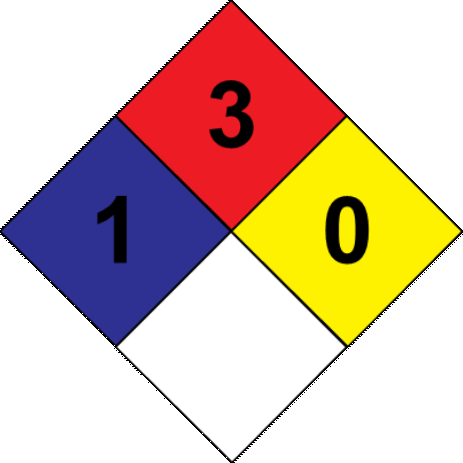

*Imagen técnica — documento: FDS 31 - 407141521 - RECUBRIMIENTO ANTIGRAFFITI - CORONA .pdf.pdf, página 1, sección: 2.*

*Imagen técnica — documento: FDS 31 - 407141521 - RECUBRIMIENTO ANTIGRAFFITI - CORONA .pdf.pdf, página 1, sección: 2.*

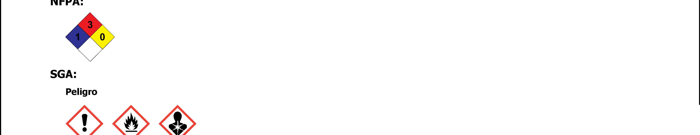

*Imagen técnica — documento: FDS 31 - 407141521 - RECUBRIMIENTO ANTIGRAFFITI - CORONA .pdf.pdf, página 1, sección: 2.*

*Imagen técnica — documento: FDS 31 - 407141521 - RECUBRIMIENTO ANTIGRAFFITI - CORONA .pdf.pdf, página 1, sección: 2.*

*Imagen técnica — documento: FDS 31 - 407141521 - RECUBRIMIENTO ANTIGRAFFITI - CORONA .pdf.pdf, página 1, sección: 2.*

*Imagen técnica — documento: FDS 31 - 407141521 - RECUBRIMIENTO ANTIGRAFFITI - CORONA .pdf.pdf, página 1, sección: 2.*

*Imagen técnica — documento: FDS 31 - 407141521 - RECUBRIMIENTO ANTIGRAFFITI - CORONA .pdf.pdf, página 1, sección: 2.*

### Página 2

407141521 - RECUBRIMIENTO ANTIGRAFFITI
Ficha de datos de seguridad
según Decreto 1496 de 2018
## 2. IDENTIFICACION DEL PELIGRO O PELIGROS (CONTINUA)

P101: Si se necesita consultar a un médico, tener a mano el recipiente o la etiqueta del producto
P102: Mantener fuera del alcance de los niños
P210: Mantener alejado del calor, superficies calientes, chispas llamas al descubierto y otras fuentes de ignición. No fumar
P264: Lavarse cuidadosamente después de la manipulación
P280: Usar guantes/ropa de protección/equipo de protección para los ojos/la cara
P305+P351+P338: EN CASO DE CONTACTO CON LOS OJOS: Enjuagar con agua cuidadosamente durante varios minutos.
Quitar las lentes de contacto cuando estén presentes y pueda hacerse con facilidad. Proseguir con el lavado
P370+P378: En caso de incendio: Utilizar extintor de polvo ABC para la extinción
P501: Eliminar el contenido/recipiente mediante el sistema de recogida selectiva habilitado en su municipio
Sustancias que contribuyen a la clasificación
N-butil-N-((trietoxisilil)metil)butan-1-amina; Destilados (petróleo), fracción ligera tratada con hidrógeno; Nafta (petróleo),
fracción pesada tratada con hidrógeno; N-(3-(trimetoxisilil)propil)etilenodiamina
2.3
Otros peligros que no conducen a una clasificación:
No relevante
## 3. COMPOSICION/INFORMACION SOBRE LOS COMPONENTES

CAS:
1760-24-3
N-(3-(trimetoxisilil)propil)etilenodiamina
Les. Oc. 1: H318; Sens. Cut. 1: H317; Tox. Agud. 5: H303 - Peligro
1 - <10 %
Para ampliar información sobre la peligrosidad de la sustancias consultar las secciones 8, 11, 12, 15 y 16. La clasificación respecto
Carcinogenicidad de las sustancias se ha establecido en función de las monografías de la IARC adecuandola al sistema de
clasificación SGA, para información sobre la clasificación IARC consulte la sección 11.
## 4. PRIMEROS AUXILIOS

4.1
Descripción de los primeros auxilios necesarios:
Los síntomas como consecuencia de una intoxicación pueden presentarse con posterioridad a la exposición, por lo que, en caso
de duda, exposición directa al producto químico o persistencia del malestar solicitar atención médica, mostrándole la FDS de este
producto.
Por inhalación:
Se trata de un producto que no contiene sustancias clasificadas como peligrosas por inhalación, sin embargo, en caso de
síntomas de intoxicación sacar al afectado de la zona de exposición y proporcionarle aire fresco. Solicitar atención médica si los
síntomas se agravan o persisten.
Por contacto con la piel:
Quitar la ropa y los zapatos contaminados, aclarar la piel o duchar al afectado si procede con abundante agua fría y jabón
neutro. En caso de afección importante acudir al médico. Si el producto produce quemaduras o congelación, no se debe quitar la
ropa debido a que podría empeorar la lesión producida si esta se encuentra pegada a la piel. En el caso de formarse ampollas en
la piel, éstas nunca deben reventarse ya que aumentaría el riesgo de infección.
Por contacto con los ojos:
Enjuagar los ojos con abundante agua a temperatura ambiente al menos durante 15 minutos. Evitar que el afectado se frote o
cierre los ojos. En el caso de que el accidentado use lentes de contacto, éstas deben retirarse siempre que no estén pegadas a
los ojos, de otro modo podría producirse un daño adicional. En todos los casos, después del lavado, se debe acudir al médico lo
más rápidamente posible con la FDS del producto.
Por ingestión/aspiración:
Página 2/11
Emisión: 25/07/2019            Versión: 1
- CONTINÚA EN LA SIGUIENTE PÁGINA -

#### Tabla 1 (página 2, sección 4)

|  | SECCIÓN 2: IDENTIFICACIÓN DEL PELIGRO O PELIGROS (continúa)|
|---|---|
| P101: Si se necesita consultar a un médico, tener a mano el recipiente o la etiqueta del producto P102: Mantener fuera del alcance de los niños P210: Mantener alejado del calor, superficies calientes, chispas llamas al descubierto y otras fuentes de ignición. No fumar P264: Lavarse cuidadosamente después de la manipulación P280: Usar guantes/ropa de protección/equipo de protección para los ojos/la cara P305+P351+P338: EN CASO DE CONTACTO CON LOS OJOS: Enjuagar con agua cuidadosamente durante varios minutos. Quitar las lentes de contacto cuando estén presentes y pueda hacerse con facilidad. Proseguir con el lavado P370+P378: En caso de incendio: Utilizar extintor de polvo ABC para la extinción P501: Eliminar el contenido/recipiente mediante el sistema de recogida selectiva habilitado en su municipio Sustancias que contribuyen a la clasificación N-butil-N-((trietoxisilil)metil)butan-1-amina; Destilados (petróleo), fracción ligera tratada con hidrógeno; Nafta (petróleo), fracción pesada tratada con hidrógeno; N-(3-(trimetoxisilil)propil)etilenodiamina 2.3 Otros peligros que no conducen a una clasificación: No relevante | |

#### Tabla 2 (página 2, sección 4)

|  | SECCIÓN 4: PRIMEROS AUXILIOS|
|---|---|
| 4.1 Descripción de los primeros auxilios necesarios: Los síntomas como consecuencia de una intoxicación pueden presentarse con posterioridad a la exposición, por lo que, en caso de duda, exposición directa al producto químico o persistencia del malestar solicitar atención médica, mostrándole la FDS de este producto. Por inhalación: Se trata de un producto que no contiene sustancias clasificadas como peligrosas por inhalación, sin embargo, en caso de síntomas de intoxicación sacar al afectado de la zona de exposición y proporcionarle aire fresco. Solicitar atención médica si los síntomas se agravan o persisten. Por contacto con la piel: Quitar la ropa y los zapatos contaminados, aclarar la piel o duchar al afectado si procede con abundante agua fría y jabón neutro. En caso de afección importante acudir al médico. Si el producto produce quemaduras o congelación, no se debe quitar la ropa debido a que podría empeorar la lesión producida si esta se encuentra pegada a la piel. En el caso de formarse ampollas en la piel, éstas nunca deben reventarse ya que aumentaría el riesgo de infección. Por contacto con los ojos: Enjuagar los ojos con abundante agua a temperatura ambiente al menos durante 15 minutos. Evitar que el afectado se frote o cierre los ojos. En el caso de que el accidentado use lentes de contacto, éstas deben retirarse siempre que no estén pegadas a los ojos, de otro modo podría producirse un daño adicional. En todos los casos, después del lavado, se debe acudir al médico lo más rápidamente posible con la FDS del producto. Por ingestión/aspiración: | |

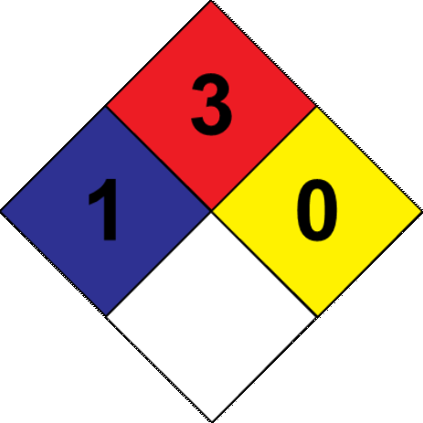

*Imagen técnica — documento: FDS 31 - 407141521 - RECUBRIMIENTO ANTIGRAFFITI - CORONA .pdf.pdf, página 2, sección: 4.*

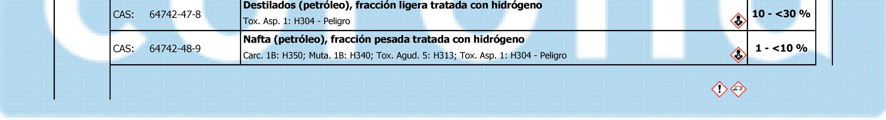

*Imagen técnica — documento: FDS 31 - 407141521 - RECUBRIMIENTO ANTIGRAFFITI - CORONA .pdf.pdf, página 2, sección: 4.*

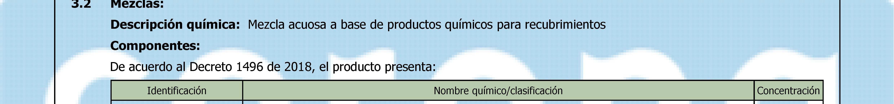

*Imagen técnica — documento: FDS 31 - 407141521 - RECUBRIMIENTO ANTIGRAFFITI - CORONA .pdf.pdf, página 2, sección: 4.*

*Imagen técnica — documento: FDS 31 - 407141521 - RECUBRIMIENTO ANTIGRAFFITI - CORONA .pdf.pdf, página 2, sección: 4.*

### Página 3

407141521 - RECUBRIMIENTO ANTIGRAFFITI
Ficha de datos de seguridad
según Decreto 1496 de 2018
## 4. PRIMEROS AUXILIOS (CONTINUA)

Requerir asistencia médica inmediata, mostrándole la FDS de este producto. No inducir al vómito, en el caso de que se produzca
mantener inclinada la cabeza hacia delante para evitar la aspiración. En el caso de pérdida de consciencia no administrar nada
por vía oral hasta la supervisión del médico. Enjuagar la boca y la garganta, ya que existe la posibilidad de que hayan sido
afectadas en la ingestión. Mantener al afectado en reposo.
4.2
Síntomas/efectos más importantes, agudos o retardados:
Los efectos agudos y retardados son los indicados en las secciones 2 y 11.
4.3
Indicación de la necesidad de recibir atención médica inmediata y, en su caso, de tratamiento especial:
No relevante
## 5. MEDIDAS DE LUCHA CONTRA INCENDIOS

5.1
Medios de extinción apropiados:
Emplear preferentemente extintores de polvo polivalente (polvo ABC), alternativamente utilizar espuma física o extintores de
dióxido de carbono (CO2). NO SE RECOMIENDA emplear agua a chorro como agente de extinción.
5.2
Peligros específicos del producto químico:
Como consecuencia de la combustión o descomposición térmica se generan subproductos de reacción que pueden resultar
altamente tóxicos y, consecuentemente, pueden presentar un riesgo elevado para la salud.
5.3
Medidas especiales que deben tomar los equipos de lucha contra incendios:
En función de la magnitud del incendio puede hacerse necesario el uso de ropa protectora completa y equipo de respiración
autónomo. Disponer de un mínimo de instalaciones de emergencia o elementos de actuación (mantas ignífugas, botiquín
portátil,...).
Disposiciones adicionales:
Actuar conforme el Plan de Emergencia Interior y las Fichas Informativas sobre actuación ante accidentes y otras emergencias.
Suprimir cualquier fuente de ignición. En caso de incendio, refrigerar los recipientes y tanques de almacenamiento de productos
susceptibles a inflamación, explosión o BLEVE como consecuencia de elevadas temperaturas. Evitar el vertido de los productos
empleados en la extinción del incendio al medio acuático.
## 6. MEDIDAS QUE DEBEN TOMARSE EN CASO DE VERTIDO ACCIDENTAL

6.1
Precauciones personales, equipo protector y procedimiento de emergencia:
Aislar las fugas siempre y cuando no suponga un riesgo adicional para las personas que desempeñen esta función. Evacuar la
zona y mantener a las personas sin protección alejadas. Ante el contacto potencial con el producto derramado se hace obligatorio
el uso de elementos de protección personal (ver sección 8). Evitar de manera prioritaria la formación de mezclas vapor-aire
inflamables, ya sea mediante ventilación o el uso de un agente inertizante. Suprimir cualquier fuente de ignición. Eliminar las
cargas electroestáticas mediante la interconexión de todas las superficies conductoras sobre las que se puede formar electricidad
estática, y estando a su vez el conjunto conectado a tierra.
6.2
Precauciones relativas al medio ambiente:
Producto no clasificado como peligroso para el medioambiente. Mantener el producto alejado de los desagües y de las aguas
superficiales y subterráneas.
6.3
Métodos y materiales para la contención y limpieza de vertidos:
Se recomienda:
Absorber el vertido mediante arena o absorbente inerte y trasladarlo a un lugar seguro. No absorber en serrín u otros
absorbentes combustibles. Para cualquier consideración relativa a la eliminación consultar la sección 13.
6.4
Referencias a otras secciones:
Ver secciones 8 y 13.
## 7. MANIPULACION Y ALMACENAMIENTO

7.1
Precauciones que se deben tomar para garantizar una manipulación segura:
A.- Precauciones generales
Cumplir con la legislación vigente en materia de prevención de riesgos laborales. Mantener los recipientes herméticamente
cerrados. Controlar los derrames y residuos, eliminándolos con métodos seguros (sección 6). Evitar el vertido libre desde el
recipiente. Mantener orden y limpieza donde se manipulen productos peligrosos.
B.- Recomendaciones técnicas para la prevención de incendios y explosiones.
Página 3/11
Emisión: 25/07/2019            Versión: 1
- CONTINÚA EN LA SIGUIENTE PÁGINA -

#### Tabla 1 (página 3, sección 7)

|  | SECCIÓN 4: PRIMEROS AUXILIOS (continúa)|
|---|---|
| Requerir asistencia médica inmediata, mostrándole la FDS de este producto. No inducir al vómito, en el caso de que se produzca mantener inclinada la cabeza hacia delante para evitar la aspiración. En el caso de pérdida de consciencia no administrar nada por vía oral hasta la supervisión del médico. Enjuagar la boca y la garganta, ya que existe la posibilidad de que hayan sido afectadas en la ingestión. Mantener al afectado en reposo. 4.2 Síntomas/efectos más importantes, agudos o retardados: Los efectos agudos y retardados son los indicados en las secciones 2 y 11. 4.3 Indicación de la necesidad de recibir atención médica inmediata y, en su caso, de tratamiento especial: No relevante | |

#### Tabla 2 (página 3, sección 7)

|  | SECCIÓN 5: MEDIDAS DE LUCHA CONTRA INCENDIOS|
|---|---|
| 5.1 Medios de extinción apropiados: Emplear preferentemente extintores de polvo polivalente (polvo ABC), alternativamente utilizar espuma física o extintores de dióxido de carbono (CO2). NO SE RECOMIENDA emplear agua a chorro como agente de extinción. 5.2 Peligros específicos del producto químico: Como consecuencia de la combustión o descomposición térmica se generan subproductos de reacción que pueden resultar altamente tóxicos y, consecuentemente, pueden presentar un riesgo elevado para la salud. 5.3 Medidas especiales que deben tomar los equipos de lucha contra incendios: En función de la magnitud del incendio puede hacerse necesario el uso de ropa protectora completa y equipo de respiración autónomo. Disponer de un mínimo de instalaciones de emergencia o elementos de actuación (mantas ignífugas, botiquín portátil,...). Disposiciones adicionales: Actuar conforme el Plan de Emergencia Interior y las Fichas Informativas sobre actuación ante accidentes y otras emergencias. Suprimir cualquier fuente de ignición. En caso de incendio, refrigerar los recipientes y tanques de almacenamiento de productos susceptibles a inflamación, explosión o BLEVE como consecuencia de elevadas temperaturas. Evitar el vertido de los productos empleados en la extinción del incendio al medio acuático. | |

#### Tabla 3 (página 3, sección 7)

|  | SECCIÓN 6: MEDIDAS QUE DEBEN TOMARSE EN CASO DE VERTIDO ACCIDENTAL|
|---|---|
| 6.1 Precauciones personales, equipo protector y procedimiento de emergencia: Aislar las fugas siempre y cuando no suponga un riesgo adicional para las personas que desempeñen esta función. Evacuar la zona y mantener a las personas sin protección alejadas. Ante el contacto potencial con el producto derramado se hace obligatorio el uso de elementos de protección personal (ver sección 8). Evitar de manera prioritaria la formación de mezclas vapor-aire inflamables, ya sea mediante ventilación o el uso de un agente inertizante. Suprimir cualquier fuente de ignición. Eliminar las cargas electroestáticas mediante la interconexión de todas las superficies conductoras sobre las que se puede formar electricidad estática, y estando a su vez el conjunto conectado a tierra. 6.2 Precauciones relativas al medio ambiente: Producto no clasificado como peligroso para el medioambiente. Mantener el producto alejado de los desagües y de las aguas superficiales y subterráneas. 6.3 Métodos y materiales para la contención y limpieza de vertidos: Se recomienda: Absorber el vertido mediante arena o absorbente inerte y trasladarlo a un lugar seguro. No absorber en serrín u otros absorbentes combustibles. Para cualquier consideración relativa a la eliminación consultar la sección 13. 6.4 Referencias a otras secciones: Ver secciones 8 y 13. | |

#### Tabla 4 (página 3, sección 7)

|  | SECCIÓN 7: MANIPULACIÓN Y ALMACENAMIENTO|
|---|---|
| 7.1 Precauciones que se deben tomar para garantizar una manipulación segura: A.-Precauciones generales Cumplir con la legislación vigente en materia de prevención de riesgos laborales. Mantener los recipientes herméticamente cerrados. Controlar los derrames y residuos, eliminándolos con métodos seguros (sección 6). Evitar el vertido libre desde el recipiente. Mantener orden y limpieza donde se manipulen productos peligrosos. B.-Recomendaciones técnicas para la prevención de incendios y explosiones. | |

*Imagen técnica — documento: FDS 31 - 407141521 - RECUBRIMIENTO ANTIGRAFFITI - CORONA .pdf.pdf, página 3, sección: 7.*

*Imagen técnica — documento: FDS 31 - 407141521 - RECUBRIMIENTO ANTIGRAFFITI - CORONA .pdf.pdf, página 3, sección: 7.*

*Imagen técnica — documento: FDS 31 - 407141521 - RECUBRIMIENTO ANTIGRAFFITI - CORONA .pdf.pdf, página 3, sección: 7.*

### Página 4

407141521 - RECUBRIMIENTO ANTIGRAFFITI
Ficha de datos de seguridad
según Decreto 1496 de 2018
## 7. MANIPULACION Y ALMACENAMIENTO (CONTINUA)

Trasvasar en lugares bien ventilados, preferentemente mediante extracción localizada. Controlar totalmente los focos de
ignición (teléfonos móviles, chispas,…) y ventilar en las operaciones de limpieza. Evitar la existencia de atmósferas peligrosas
en el interior de recipientes, aplicando en lo posible sistemas de inertización. Trasvasar a velocidades lentas para evitar la
generación de cargas electroestáticas. Ante la posibilidad de existencia de cargas electroestáticas: asegurar una perfecta
conexión equipotencial, utilizar siempre tomas de tierras, no emplear ropa de trabajo de fibras acrílicas, empleando
preferiblemente ropa de algodón y calzado conductor. Cumplir con los requisitos esenciales de seguridad para equipos  y con
las disposiciones mínimas para la protección de la seguridad y salud de los trabajadores. Consultar la sección 10 sobre
condiciones y materias que deben evitarse.
C.- Recomendaciones técnicas para prevenir riesgos ergonómicos y toxicológicos.
Para control de exposición consultar la sección 8. No comer, beber ni fumar en las zonas de trabajo; lavarse las manos
después de cada utilización, y despojarse de prendas de vestir y equipos de protección contaminados antes de entrar en las
zonas para comer.
D.- Recomendaciones técnicas para prevenir riesgos medioambientales
Se recomienda disponer de material absorbente en las proximidades del producto (ver epígrafe 6.3)
7.2
Condiciones de almacenamiento seguro, incluidas cualesquiera incompatibilidades:
A.- Medidas técnicas de almacenamiento
B.- Condiciones generales de almacenamiento.
Evitar fuentes de calor, radiación, electricidad estática y el contacto con alimentos. Para información adicional ver epígrafe
10.5
7.3
Usos específicos finales:
Salvo las indicaciones ya especificadas no es preciso realizar ninguna recomendación especial en cuanto a los usos de este
producto.
Tª mínima:
5 ºC
Tª máxima:
30 ºC
Tiempo máximo:
12 meses
## 8. CONTROLES DE EXPOSICION/PROTECCION PERSONAL

Proteccion obligatoria
del las vias
respiratorias
Máscara autofiltrante para gases y vapores
Reemplazar cuando se detecte olor o sabor del contaminante en el interior de la
máscara o adaptador facial. Cuando el contaminante no tiene buenas propiedades
de aviso se recomienda el uso de equipos aislantes.
C.- Protección específica de las manos.
Página 4/11
Emisión: 25/07/2019            Versión: 1
- CONTINÚA EN LA SIGUIENTE PÁGINA -

#### Tabla 1 (página 4, sección 8)

|  | SECCIÓN 7: MANIPULACIÓN Y ALMACENAMIENTO (continúa)|
|---|---|
| Trasvasar en lugares bien ventilados, preferentemente mediante extracción localizada. Controlar totalmente los focos de ignición (teléfonos móviles, chispas,…) y ventilar en las operaciones de limpieza. Evitar la existencia de atmósferas peligrosas en el interior de recipientes, aplicando en lo posible sistemas de inertización. Trasvasar a velocidades lentas para evitar la generación de cargas electroestáticas. Ante la posibilidad de existencia de cargas electroestáticas: asegurar una perfecta conexión equipotencial, utilizar siempre tomas de tierras, no emplear ropa de trabajo de fibras acrílicas, empleando preferiblemente ropa de algodón y calzado conductor. Cumplir con los requisitos esenciales de seguridad para equipos y con las disposiciones mínimas para la protección de la seguridad y salud de los trabajadores. Consultar la sección 10 sobre condiciones y materias que deben evitarse. C.-Recomendaciones técnicas para prevenir riesgos ergonómicos y toxicológicos. Para control de exposición consultar la sección 8. No comer, beber ni fumar en las zonas de trabajo; lavarse las manos después de cada utilización, y despojarse de prendas de vestir y equipos de protección contaminados antes de entrar en las zonas para comer. D.-Recomendaciones técnicas para prevenir riesgos medioambientales Se recomienda disponer de material absorbente en las proximidades del producto (ver epígrafe 6.3) 7.2 Condiciones de almacenamiento seguro, incluidas cualesquiera incompatibilidades: A.-Medidas técnicas de almacenamiento Tª mínima: 5 ºC Tª máxima: 30 ºC Tiempo máximo: 12 meses B.-Condiciones generales de almacenamiento. Evitar fuentes de calor, radiación, electricidad estática y el contacto con alimentos. Para información adicional ver epígrafe 10.5 7.3 Usos específicos finales: Salvo las indicaciones ya especificadas no es preciso realizar ninguna recomendación especial en cuanto a los usos de este producto. | |

*Imagen técnica — documento: FDS 31 - 407141521 - RECUBRIMIENTO ANTIGRAFFITI - CORONA .pdf.pdf, página 4, sección: 8.*

*Imagen técnica — documento: FDS 31 - 407141521 - RECUBRIMIENTO ANTIGRAFFITI - CORONA .pdf.pdf, página 4, sección: 8.*

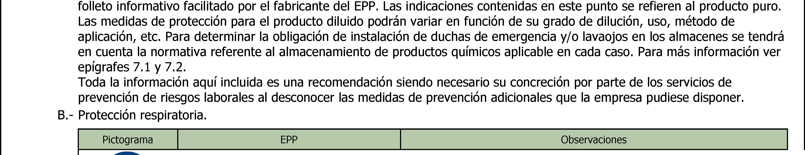

*Imagen técnica — documento: FDS 31 - 407141521 - RECUBRIMIENTO ANTIGRAFFITI - CORONA .pdf.pdf, página 4, sección: 8.*

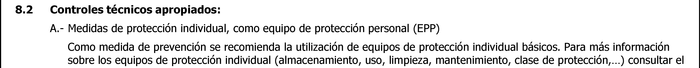

*Imagen técnica — documento: FDS 31 - 407141521 - RECUBRIMIENTO ANTIGRAFFITI - CORONA .pdf.pdf, página 4, sección: 8.*

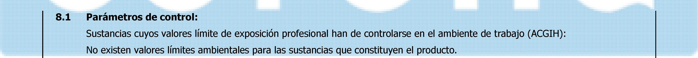

*Imagen técnica — documento: FDS 31 - 407141521 - RECUBRIMIENTO ANTIGRAFFITI - CORONA .pdf.pdf, página 4, sección: 8.*

*Imagen técnica — documento: FDS 31 - 407141521 - RECUBRIMIENTO ANTIGRAFFITI - CORONA .pdf.pdf, página 4, sección: 8.*

### Página 5

407141521 - RECUBRIMIENTO ANTIGRAFFITI
Ficha de datos de seguridad
según Decreto 1496 de 2018
## 8. CONTROLES DE EXPOSICION/PROTECCION PERSONAL (CONTINUA)

Ducha de emergencia
ANSI Z358-1
ISO 3864-1:2011, ISO 3864-4:2011
Lavaojos
DIN 12 899
ISO 3864-1:2011, ISO 3864-4:2011
Controles de la exposición del medio ambiente:
En virtud de la legislación comunitaria de protección del medio ambiente se recomienda evitar el vertido tanto del producto como
de su envase al medio ambiente. Para información adicional ver epígrafe 7.1.D
## 9. PROPIEDADES FISICAS Y QUIMICAS Y CARACTERISTICAS DE SEGURIDAD

9.1
Información de propiedades físicas y químicas básicas:
Para completar la información ver la ficha técnica/hoja de especificaciones del producto.
Aspecto físico:
Estado físico a 20 ºC:
Líquido
Aspecto:
Cristalino
Color:
Incoloro
Olor:
Característico
Umbral olfativo:
No relevante *
Volatilidad:
Temperatura de ebullición a presión atmosférica:
211 ºC
Presión de vapor a 20 ºC:
209 Pa
Presión de vapor a 50 ºC:
1158,31 Pa  (1,16 kPa)
Tasa de evaporación a 20 ºC:
No relevante *
*No relevante debido a la naturaleza del producto, no aportando información característica de su peligrosidad.
Página 5/11
Emisión: 25/07/2019            Versión: 1
- CONTINÚA EN LA SIGUIENTE PÁGINA -

#### Tabla 1 (página 5, sección 9)

|  | SECCIÓN 9: PROPIEDADES FÍSICAS Y QUÍMICAS Y CARACTERÍSTICAS DE SEGURIDAD|
|---|---|
| 9.1 Información de propiedades físicas y químicas básicas: Para completar la información ver la ficha técnica/hoja de especificaciones del producto. Aspecto físico: Estado físico a 20 ºC: Líquido Aspecto: Cristalino Color: Incoloro Olor: Característico Umbral olfativo: No relevante * Volatilidad: Temperatura de ebullición a presión atmosférica: 211 ºC Presión de vapor a 20 ºC: 209 Pa Presión de vapor a 50 ºC: 1158,31 Pa (1,16 kPa) Tasa de evaporación a 20 ºC: No relevante * *No relevante debido a la naturaleza del producto, no aportando información característica de su peligrosidad. | |

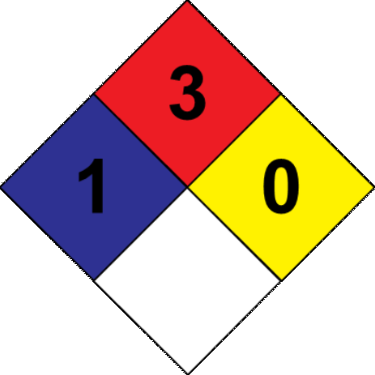

*Imagen técnica — documento: FDS 31 - 407141521 - RECUBRIMIENTO ANTIGRAFFITI - CORONA .pdf.pdf, página 5, sección: 9.*

*Imagen técnica — documento: FDS 31 - 407141521 - RECUBRIMIENTO ANTIGRAFFITI - CORONA .pdf.pdf, página 5, sección: 9.*

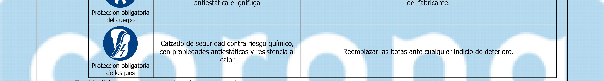

*Imagen técnica — documento: FDS 31 - 407141521 - RECUBRIMIENTO ANTIGRAFFITI - CORONA .pdf.pdf, página 5, sección: 9.*

*Imagen técnica — documento: FDS 31 - 407141521 - RECUBRIMIENTO ANTIGRAFFITI - CORONA .pdf.pdf, página 5, sección: 9.*

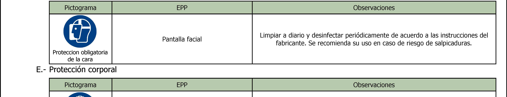

*Imagen técnica — documento: FDS 31 - 407141521 - RECUBRIMIENTO ANTIGRAFFITI - CORONA .pdf.pdf, página 5, sección: 9.*

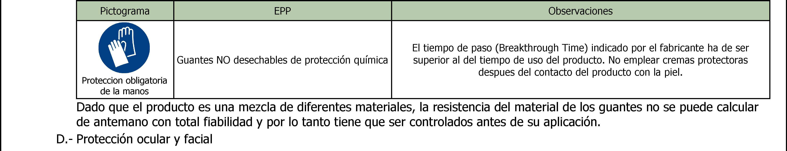

*Imagen técnica — documento: FDS 31 - 407141521 - RECUBRIMIENTO ANTIGRAFFITI - CORONA .pdf.pdf, página 5, sección: 9.*

### Página 6

407141521 - RECUBRIMIENTO ANTIGRAFFITI
Ficha de datos de seguridad
según Decreto 1496 de 2018
## 9. PROPIEDADES FISICAS Y QUIMICAS Y CARACTERISTICAS DE SEGURIDAD (CONTINUA)

Caracterización del producto:
Densidad a 20 ºC:
981,6 kg/m³
Densidad relativa a 20 ºC:
0,982
Viscosidad dinámica a 20 ºC:
6,59 cP
Viscosidad cinemática a 20 ºC:
6,51 cSt
Viscosidad cinemática a 40 ºC:
<20,5 cSt
Concentración:
No relevante *
pH:
No relevante *
Densidad de vapor a 20 ºC:
No relevante *
Coeficiente de reparto n-octanol/agua a 20 ºC:
No relevante *
Solubilidad en agua a 20 ºC:
No relevante *
Propiedad de solubilidad:
No relevante *
Temperatura de descomposición:
No relevante *
Punto de fusión/punto de congelación:
No relevante *
Propiedades explosivas:
No relevante *
Propiedades comburentes:
No relevante *
Inflamabilidad:
Punto de inflamación:
54 ºC
Inflamabilidad (sólido, gas):
No relevante *
Temperatura de auto-inflamación:
410 ºC
Límite de inflamabilidad inferior:
No determinado
Límite de inflamabilidad superior:
>110 % Volumen
Explosividad:
Límite inferior de explosividad:
No relevante *
Límite superior de explosividad:
No relevante *
9.2
Información adicional:
Tensión superficial a 20 ºC:
No relevante *
Índice de refracción:
No relevante *
*No relevante debido a la naturaleza del producto, no aportando información característica de su peligrosidad.
## 10. ESTABILIDAD Y REACTIVIDAD

10.1
Reactividad:
No se esperan reacciones peligrosas si se cumplen las instrucciones técnicas de almacenamiento de productos químicos. Ver
## 7. Manipulación y almacenamiento

10.2
Estabilidad química:
Estable químicamente bajo las condiciones indicadas de almacenamiento, manipulación y uso.
10.3
Posibilidad de reacciones peligrosas:
Bajo las condiciones indicadas no se esperan reacciones peligrosas que puedan producir una presión o temperaturas excesivas.
10.4
Condiciones que deben evitarse:
Aplicables para manipulación y almacenamiento a temperatura ambiente:
Choque y fricción
Contacto con el aire
Calentamiento
Luz Solar
Humedad
No aplicable
No aplicable
Riesgo de inflamación
Evitar incidencia directa
No aplicable
10.5
Materiales incompatibles:
Ácidos
Agua
Materias comburentes
Materias combustibles
Otros
Evitar ácidos fuertes
No aplicable
Evitar incidencia directa
No aplicable
Evitar alcalis o bases fuertes
10.6
Productos de descomposición peligrosos:
Página 6/11
Emisión: 25/07/2019            Versión: 1
- CONTINÚA EN LA SIGUIENTE PÁGINA -

#### Tabla 1 (página 6, sección 7)

|  | SECCIÓN 9: PROPIEDADES FÍSICAS Y QUÍMICAS Y CARACTERÍSTICAS DE SEGURIDAD (continúa)|
|---|---|
| Caracterización del producto: Densidad a 20 ºC: 981,6 kg/m³ Densidad relativa a 20 ºC: 0,982 Viscosidad dinámica a 20 ºC: 6,59 cP Viscosidad cinemática a 20 ºC: 6,51 cSt Viscosidad cinemática a 40 ºC: <20,5 cSt Concentración: No relevante * pH: No relevante * Densidad de vapor a 20 ºC: No relevante * Coeficiente de reparto n-octanol/agua a 20 ºC: No relevante * Solubilidad en agua a 20 ºC: No relevante * Propiedad de solubilidad: No relevante * Temperatura de descomposición: No relevante * Punto de fusión/punto de congelación: No relevante * Propiedades explosivas: No relevante * Propiedades comburentes: No relevante * Inflamabilidad: Punto de inflamación: 54 ºC Inflamabilidad (sólido, gas): No relevante * Temperatura de auto-inflamación: 410 ºC Límite de inflamabilidad inferior: No determinado Límite de inflamabilidad superior: >110 % Volumen Explosividad: Límite inferior de explosividad: No relevante * Límite superior de explosividad: No relevante * 9.2 Información adicional: Tensión superficial a 20 ºC: No relevante * Índice de refracción: No relevante * *No relevante debido a la naturaleza del producto, no aportando información característica de su peligrosidad. | |

#### Tabla 2 (página 6, sección 7)

|  | SECCIÓN 10: ESTABILIDAD Y REACTIVIDAD|
|---|---|
| 10.1 Reactividad: No se esperan reacciones peligrosas si se cumplen las instrucciones técnicas de almacenamiento de productos químicos. Ver sección 7. 10.2 Estabilidad química: Estable químicamente bajo las condiciones indicadas de almacenamiento, manipulación y uso. 10.3 Posibilidad de reacciones peligrosas: Bajo las condiciones indicadas no se esperan reacciones peligrosas que puedan producir una presión o temperaturas excesivas. 10.4 Condiciones que deben evitarse: Aplicables para manipulación y almacenamiento a temperatura ambiente: Choque y fricción Contacto con el aire Calentamiento Luz Solar Humedad No aplicable No aplicable Riesgo de inflamación Evitar incidencia directa No aplicable 10.5 Materiales incompatibles: Ácidos Agua Materias comburentes Materias combustibles Otros Evitar ácidos fuertes No aplicable Evitar incidencia directa No aplicable Evitar alcalis o bases fuertes 10.6 Productos de descomposición peligrosos: | |

#### Tabla 3 (página 6, sección 7)

| Choque y fricción | Contacto con el aire | Calentamiento | Luz Solar | Humedad|
|---|---|---|---|---|
| No aplicable | No aplicable | Riesgo de inflamación | Evitar incidencia directa | No aplicable|

#### Tabla 4 (página 6, sección 7)

| Ácidos | Agua | Materias comburentes | Materias combustibles | Otros|
|---|---|---|---|---|
| Evitar ácidos fuertes | No aplicable | Evitar incidencia directa | No aplicable | Evitar alcalis o bases fuertes|

*Imagen técnica — documento: FDS 31 - 407141521 - RECUBRIMIENTO ANTIGRAFFITI - CORONA .pdf.pdf, página 6, sección: 7.*

*Imagen técnica — documento: FDS 31 - 407141521 - RECUBRIMIENTO ANTIGRAFFITI - CORONA .pdf.pdf, página 6, sección: 7.*

*Imagen técnica — documento: FDS 31 - 407141521 - RECUBRIMIENTO ANTIGRAFFITI - CORONA .pdf.pdf, página 6, sección: 7.*

### Página 7

407141521 - RECUBRIMIENTO ANTIGRAFFITI
Ficha de datos de seguridad
según Decreto 1496 de 2018
## 10. ESTABILIDAD Y REACTIVIDAD (CONTINUA)

Ver epígrafe 10.3, 10.4 y 10.5 para conocer los productos de descomposición específicamente. En dependencia de las condiciones
de descomposición, como consecuencia de la misma pueden liberarse mezclas complejas de sustancias químicas: dióxido de
carbono (CO2), monóxido de carbono y otros compuestos orgánicos.
## 11. INFORMACION TOXICOLOGICA

11.1
Información sobre las posibles vías de exposición:
No se dispone de datos experimentales del producto en si mismos relativos a las propiedades toxicológicas
Efectos peligrosos para la salud:
En caso de exposición repetitiva, prolongada o a concentraciones superiores a las establecidas por los límites de exposición
profesionales, pueden producirse efectos adversos para la salud en función de la vía de exposición:
A- Ingestión (efecto agudo):
-   Toxicidad aguda: A la vista de los datos disponibles, no se cumplen los criterios de clasificación, sin embargo, presenta
sustancias clasificadas como peligrosas por ingestión. Para más información ver sección 3.
-   Corrosividad/Irritabilidad: A la vista de los datos disponibles, no se cumplen los criterios de clasificación, no presentando
sustancias clasificadas como peligrosas por este efecto. Para más información ver sección 3.
B- Inhalación (efecto agudo):
-   Toxicidad aguda: A la vista de los datos disponibles, no se cumplen los criterios de clasificación, no presentando sustancias
clasificadas como peligrosas por inhalación. Para más información ver sección 3.
-   Corrosividad/Irritabilidad: A la vista de los datos disponibles, no se cumplen los criterios de clasificación, no presentando
sustancias clasificadas como peligrosas por este efecto. Para más información ver sección 3.
C- Contacto con la piel y los ojos (efecto agudo):
-   Contacto con la piel: Principalmente puede presentar efectos nocivos para la salud si el producto es absorbido vía cutánea.
Para más información sobre efectos secundarios por contacto con la piel ver sección 2.
-   Contacto con los ojos: Produce lesiones oculares tras contacto.
D- Efectos CMR (carcinogenicidad, mutagenicidad y toxicidad para la reproducción):
-   Carcinogenicidad: La exposición a este producto puede causar cáncer. Para más información sobre posibles efectos
específicos sobre la salud ver sección 2.
   IARC: Nafta (petróleo), fracción pesada tratada con hidrógeno (1)
-   Mutagenicidad: La exposición a este producto puede causar alteraciones genéticas. Para más información sobre posibles
efectos específicos sobre la salud ver sección 2.
-   Toxicidad para la reproducción: A la vista de los datos disponibles, no se cumplen los criterios de clasificación, no
presentando sustancias clasificadas como peligrosas por este efecto. Para más información ver sección 3.
E- Efectos de sensibilización:
-   Respiratoria: A la vista de los datos disponibles, no se cumplen los criterios de clasificación, no presentando sustancias
clasificadas como peligrosas con efectos sensibilizantes. Para más información ver secciónes 2, 3 y 15.
-   Cutánea: El contacto prolongado con la piel puede derivar en EPPsodios de dermatitis alérgicas de contacto.
F- Toxicidad específica en determinados órganos (STOT)-exposición única:
A la vista de los datos disponibles, no se cumplen los criterios de clasificación, no presentando sustancias clasificadas como
peligrosas por este efecto. Para más información ver sección 3.
G- Toxicidad específica en determinados órganos (STOT)-exposición repetida:
-   Toxicidad específica en determinados órganos (STOT)-exposición repetida: A la vista de los datos disponibles, no se
cumplen los criterios de clasificación, no presentando sustancias clasificadas como peligrosas por este efecto. Para más
información ver sección 3.
-   Piel: A la vista de los datos disponibles, no se cumplen los criterios de clasificación, no presentando sustancias clasificadas
como peligrosas por este efecto. Para más información ver sección 3.
H- Peligro por aspiración:
La ingesta de una dosis considerable puede producir daño pulmonar.
Información adicional:
No relevante
Información toxicológica específica de las sustancias:
Página 7/11
Emisión: 25/07/2019            Versión: 1
- CONTINÚA EN LA SIGUIENTE PÁGINA -

#### Tabla 1 (página 7, sección 11)

|  | SECCIÓN 10: ESTABILIDAD Y REACTIVIDAD (continúa)|
|---|---|
| Ver epígrafe 10.3, 10.4 y 10.5 para conocer los productos de descomposición específicamente. En dependencia de las condiciones de descomposición, como consecuencia de la misma pueden liberarse mezclas complejas de sustancias químicas: dióxido de carbono (CO2), monóxido de carbono y otros compuestos orgánicos. | |

#### Tabla 2 (página 7, sección 11)

|  | SECCIÓN 11: INFORMACIÓN TOXICOLÓGICA|
|---|---|
| 11.1 Información sobre las posibles vías de exposición: No se dispone de datos experimentales del producto en si mismos relativos a las propiedades toxicológicas Efectos peligrosos para la salud: En caso de exposición repetitiva, prolongada o a concentraciones superiores a las establecidas por los límites de exposición profesionales, pueden producirse efectos adversos para la salud en función de la vía de exposición: A- Ingestión (efecto agudo): - Toxicidad aguda: A la vista de los datos disponibles, no se cumplen los criterios de clasificación, sin embargo, presenta sustancias clasificadas como peligrosas por ingestión. Para más información ver sección 3. - Corrosividad/Irritabilidad: A la vista de los datos disponibles, no se cumplen los criterios de clasificación, no presentando sustancias clasificadas como peligrosas por este efecto. Para más información ver sección 3. B- Inhalación (efecto agudo): - Toxicidad aguda: A la vista de los datos disponibles, no se cumplen los criterios de clasificación, no presentando sustancias clasificadas como peligrosas por inhalación. Para más información ver sección 3. - Corrosividad/Irritabilidad: A la vista de los datos disponibles, no se cumplen los criterios de clasificación, no presentando sustancias clasificadas como peligrosas por este efecto. Para más información ver sección 3. C- Contacto con la piel y los ojos (efecto agudo): - Contacto con la piel: Principalmente puede presentar efectos nocivos para la salud si el producto es absorbido vía cutánea. Para más información sobre efectos secundarios por contacto con la piel ver sección 2. - Contacto con los ojos: Produce lesiones oculares tras contacto. D- Efectos CMR (carcinogenicidad, mutagenicidad y toxicidad para la reproducción): - Carcinogenicidad: La exposición a este producto puede causar cáncer. Para más información sobre posibles efectos específicos sobre la salud ver sección 2. IARC: Nafta (petróleo), fracción pesada tratada con hidrógeno (1) - Mutagenicidad: La exposición a este producto puede causar alteraciones genéticas. Para más información sobre posibles efectos específicos sobre la salud ver sección 2. - Toxicidad para la reproducción: A la vista de los datos disponibles, no se cumplen los criterios de clasificación, no presentando sustancias clasificadas como peligrosas por este efecto. Para más información ver sección 3. E- Efectos de sensibilización: - Respiratoria: A la vista de los datos disponibles, no se cumplen los criterios de clasificación, no presentando sustancias clasificadas como peligrosas con efectos sensibilizantes. Para más información ver secciónes 2, 3 y 15. - Cutánea: El contacto prolongado con la piel puede derivar en EPPsodios de dermatitis alérgicas de contacto. F- Toxicidad específica en determinados órganos (STOT)-exposición única: A la vista de los datos disponibles, no se cumplen los criterios de clasificación, no presentando sustancias clasificadas como peligrosas por este efecto. Para más información ver sección 3. G- Toxicidad específica en determinados órganos (STOT)-exposición repetida: - Toxicidad específica en determinados órganos (STOT)-exposición repetida: A la vista de los datos disponibles, no se cumplen los criterios de clasificación, no presentando sustancias clasificadas como peligrosas por este efecto. Para más información ver sección 3. - Piel: A la vista de los datos disponibles, no se cumplen los criterios de clasificación, no presentando sustancias clasificadas como peligrosas por este efecto. Para más información ver sección 3. H- Peligro por aspiración: La ingesta de una dosis considerable puede producir daño pulmonar. Información adicional: No relevante Información toxicológica específica de las sustancias: | |

*Imagen técnica — documento: FDS 31 - 407141521 - RECUBRIMIENTO ANTIGRAFFITI - CORONA .pdf.pdf, página 7, sección: 11.*

*Imagen técnica — documento: FDS 31 - 407141521 - RECUBRIMIENTO ANTIGRAFFITI - CORONA .pdf.pdf, página 7, sección: 11.*

*Imagen técnica — documento: FDS 31 - 407141521 - RECUBRIMIENTO ANTIGRAFFITI - CORONA .pdf.pdf, página 7, sección: 11.*

### Página 8

407141521 - RECUBRIMIENTO ANTIGRAFFITI
Ficha de datos de seguridad
según Decreto 1496 de 2018
## 11. INFORMACION TOXICOLOGICA (CONTINUA)

Identificación
Toxicidad aguda
Género
Nafta (petróleo), fracción pesada tratada con hidrógeno
DL50 oral
15000 mg/kg
Rata
CAS: 64742-48-9
DL50 cutánea
3160 mg/kg
Conejo
CL50 inhalación
No relevante
N-(3-(trimetoxisilil)propil)etilenodiamina
DL50 oral
2413 mg/kg
Rata
CAS: 1760-24-3
DL50 cutánea
No relevante
CL50 inhalación
No relevante
## 12. INFORMACION ECOTOXICOLOGICA

No se disponen de datos experimentales de la mezcla en sí misma relativos a las propiedades ecotoxicológicas.
12.1
Toxicidad:
Identificación
Toxicidad aguda
Especie
Género
Nafta (petróleo), fracción pesada tratada con hidrógeno
CL50
2200 mg/L (96 h)
Pimephales promelas
Pez
CAS: 64742-48-9
CE50
1000 mg/L (96 h)
Daphnia magna
Crustáceo
CE50
No relevante
N-(3-(trimetoxisilil)propil)etilenodiamina
CL50
597 mg/L (96 h)
Brachydanio rerio
Pez
CAS: 1760-24-3
CE50
81 mg/L (48 h)
Daphnia magna
Crustáceo
CE50
8,8 mg/L (72 h)
Selenastrum capricornutum
Alga
12.2
Persistencia y degradabilidad:
Identificación
Degradabilidad
Biodegradabilidad
Nafta (petróleo), fracción pesada tratada con hidrógeno
DBO5
No relevante
Concentración
No relevante
CAS: 64742-48-9
DQO
No relevante
Periodo
28 días
DBO5/DQO
No relevante
% Biodegradado
89,9 %
N-(3-(trimetoxisilil)propil)etilenodiamina
DBO5
No relevante
Concentración
No relevante
CAS: 1760-24-3
DQO
No relevante
Periodo
28 días
DBO5/DQO
No relevante
% Biodegradado
39 %
12.3
Potencial de bioacumulación:
Identificación
Potencial de bioacumulación
Destilados (petróleo), fracción ligera tratada con hidrógeno
BCF
130
CAS: 64742-47-8
Log POW
3,3
Potencial
Alto
12.4
Movilidad en el suelo:
Identificación
Absorción/Desorción
Volatilidad
Nafta (petróleo), fracción pesada tratada con hidrógeno
Koc
100
Henry
No relevante
CAS: 64742-48-9
Conclusión
Alto
Suelo seco
No relevante
Tensión superficial
No relevante
Suelo húmedo
No relevante
12.5
Resultados de la valoración PBT y mPmB:
No aplicable
12.6
Otros efectos adversos:
No descritos
## 13. INFORMACION RELATIVA A LA ELIMINACION DE LOS PRODUCTOS

13.1
Métodos de eliminación:
Gestión del residuo (eliminación y valorización):
Consultar al gestor de residuos autorizado las operaciones de valorización y eliminación. En el caso de que el envase haya estado
en contacto directo con el producto se gestionará del mismo modo que el propio producto, en caso contrario se gestionará como
residuo no peligroso. Se desaconseja su vertido a cursos de agua. Ver epígrafe 6.2.
Disposiciones legislativas relacionadas con la gestión de residuos:
Legislación relacionada con la gestión de residuos:
Página 8/11
Emisión: 25/07/2019            Versión: 1
- CONTINÚA EN LA SIGUIENTE PÁGINA -

#### Tabla 1 (página 8, sección 13)

|  | SECCIÓN 11: INFORMACIÓN TOXICOLÓGICA (continúa)|
|---|---|
| Identificación Toxicidad aguda Género Nafta (petróleo), fracción pesada tratada con hidrógeno DL50 oral 15000 mg/kg Rata CAS: 64742-48-9 DL50 cutánea 3160 mg/kg Conejo CL50 inhalación No relevante N-(3-(trimetoxisilil)propil)etilenodiamina DL50 oral 2413 mg/kg Rata CAS: 1760-24-3 DL50 cutánea No relevante CL50 inhalación No relevante | |

#### Tabla 2 (página 8, sección 13)

| Identificación | Toxicidad aguda |  | Género|
|---|---|---|---|
| Nafta (petróleo), fracción pesada tratada con hidrógeno CAS: 64742-48-9 | DL50 oral | 15000 mg/kg | Rata|
|  | DL50 cutánea | 3160 mg/kg | Conejo|
|  | CL50 inhalación | No relevante | |
| N-(3-(trimetoxisilil)propil)etilenodiamina CAS: 1760-24-3 | DL50 oral | 2413 mg/kg | Rata|
|  | DL50 cutánea | No relevante | |
|  | CL50 inhalación | No relevante | |

#### Tabla 3 (página 8, sección 13)

|  | SECCIÓN 12: INFORMACIÓN ECOTOXICOLÓGICA|
|---|---|
| No se disponen de datos experimentales de la mezcla en sí misma relativos a las propiedades ecotoxicológicas. 12.1 Toxicidad: Identificación Toxicidad aguda Especie Género Nafta (petróleo), fracción pesada tratada con hidrógeno CL50 2200 mg/L (96 h) Pimephales promelas Pez CAS: 64742-48-9 CE50 1000 mg/L (96 h) Daphnia magna Crustáceo CE50 No relevante N-(3-(trimetoxisilil)propil)etilenodiamina CL50 597 mg/L (96 h) Brachydanio rerio Pez CAS: 1760-24-3 CE50 81 mg/L (48 h) Daphnia magna Crustáceo CE50 8,8 mg/L (72 h) Selenastrum capricornutum Alga 12.2 Persistencia y degradabilidad: Identificación Degradabilidad Biodegradabilidad Nafta (petróleo), fracción pesada tratada con hidrógeno DBO5 No relevante Concentración No relevante CAS: 64742-48-9 DQO No relevante Periodo 28 días DBO5/DQO No relevante % Biodegradado 89,9 % N-(3-(trimetoxisilil)propil)etilenodiamina DBO5 No relevante Concentración No relevante CAS: 1760-24-3 DQO No relevante Periodo 28 días DBO5/DQO No relevante % Biodegradado 39 % 12.3 Potencial de bioacumulación: Identificación Potencial de bioacumulación Destilados (petróleo), fracción ligera tratada con hidrógeno BCF 130 CAS: 64742-47-8 Log POW 3,3 Potencial Alto 12.4 Movilidad en el suelo: Identificación Absorción/Desorción Volatilidad Nafta (petróleo), fracción pesada tratada con hidrógeno Koc 100 Henry No relevante CAS: 64742-48-9 Conclusión Alto Suelo seco No relevante Tensión superficial No relevante Suelo húmedo No relevante 12.5 Resultados de la valoración PBT y mPmB: No aplicable 12.6 Otros efectos adversos: No descritos | |

#### Tabla 4 (página 8, sección 13)

| Identificación | Toxicidad aguda |  | Especie | Género|
|---|---|---|---|---|
| Nafta (petróleo), fracción pesada tratada con hidrógeno CAS: 64742-48-9 | CL50 | 2200 mg/L (96 h) | Pimephales promelas | Pez|
|  | CE50 | 1000 mg/L (96 h) | Daphnia magna | Crustáceo|
|  | CE50 | No relevante |  | |
| N-(3-(trimetoxisilil)propil)etilenodiamina CAS: 1760-24-3 | CL50 | 597 mg/L (96 h) | Brachydanio rerio | Pez|
|  | CE50 | 81 mg/L (48 h) | Daphnia magna | Crustáceo|
|  | CE50 | 8,8 mg/L (72 h) | Selenastrum capricornutum | Alga|

#### Tabla 5 (página 8, sección 13)

| Identificación | Degradabilidad |  | Biodegradabilidad | |
|---|---|---|---|---|
| Nafta (petróleo), fracción pesada tratada con hidrógeno CAS: 64742-48-9 | DBO5 | No relevante | Concentración | No relevante|
|  | DQO | No relevante | Periodo | 28 días|
|  | DBO5/DQO | No relevante | % Biodegradado | 89,9 %|
| N-(3-(trimetoxisilil)propil)etilenodiamina CAS: 1760-24-3 | DBO5 | No relevante | Concentración | No relevante|
|  | DQO | No relevante | Periodo | 28 días|
|  | DBO5/DQO | No relevante | % Biodegradado | 39 %|

#### Tabla 6 (página 8, sección 13)

| Identificación | Potencial de bioacumulación | |
|---|---|---|
| Destilados (petróleo), fracción ligera tratada con hidrógeno CAS: 64742-47-8 | BCF | 130|
|  | Log POW | 3,3|
|  | Potencial | Alto|

#### Tabla 7 (página 8, sección 13)

| Identificación | Absorción/Desorción |  | Volatilidad | |
|---|---|---|---|---|
| Nafta (petróleo), fracción pesada tratada con hidrógeno CAS: 64742-48-9 | Koc | 100 | Henry | No relevante|
|  | Conclusión | Alto | Suelo seco | No relevante|
|  | Tensión superficial | No relevante | Suelo húmedo | No relevante|

#### Tabla 8 (página 8, sección 13)

|  | SECCIÓN 13: INFORMACIÓN RELATIVA A LA ELIMINACIÓN DE LOS PRODUCTOS|
|---|---|
| 13.1 Métodos de eliminación: Gestión del residuo (eliminación y valorización): Consultar al gestor de residuos autorizado las operaciones de valorización y eliminación. En el caso de que el envase haya estado en contacto directo con el producto se gestionará del mismo modo que el propio producto, en caso contrario se gestionará como residuo no peligroso. Se desaconseja su vertido a cursos de agua. Ver epígrafe 6.2. Disposiciones legislativas relacionadas con la gestión de residuos: Legislación relacionada con la gestión de residuos: | |

*Imagen técnica — documento: FDS 31 - 407141521 - RECUBRIMIENTO ANTIGRAFFITI - CORONA .pdf.pdf, página 8, sección: 13.*

*Imagen técnica — documento: FDS 31 - 407141521 - RECUBRIMIENTO ANTIGRAFFITI - CORONA .pdf.pdf, página 8, sección: 13.*

*Imagen técnica — documento: FDS 31 - 407141521 - RECUBRIMIENTO ANTIGRAFFITI - CORONA .pdf.pdf, página 8, sección: 13.*

### Página 9

407141521 - RECUBRIMIENTO ANTIGRAFFITI
Ficha de datos de seguridad
según Decreto 1496 de 2018
## 13. INFORMACION RELATIVA A LA ELIMINACION DE LOS PRODUCTOS (CONTINUA)

Decreto 4741 de 2005, Por el cual se reglamenta parcialmente la prevención y el manejo de los residuos o desechos peligrosos
generados en el marco de la gestión integral
## 14. INFORMACION RELATIVA AL TRANSPORTE

14.6
14.4
14.3
14.2
14.1
ver epígrafe 9
Propiedades físico-químicas:
III
Grupo de
embalaje/envasado si se
aplica:
3
Etiquetas:
3
Clase(s) relativas al
transporte:
PINTURA
Designación oficial de
transporte de las Naciones
Unidas:
Número ONU:
UN1263
Riesgos ambientales:
No
14.5
Transporte a granel con
arreglo al anexo II de
MARPOL 73/78 y al Código
IBC:
No relevante
14.7
Precauciones especiales para el usuario
Transporte aéreo de mercancías peligrosas:
En aplicación al IATA/OACI 2019:
Página 9/11
Emisión: 25/07/2019            Versión: 1
- CONTINÚA EN LA SIGUIENTE PÁGINA -

#### Tabla 1 (página 9, sección 14)

|  | SECCIÓN 13: INFORMACIÓN RELATIVA A LA ELIMINACIÓN DE LOS PRODUCTOS (continúa)|
|---|---|
| Decreto 4741 de 2005, Por el cual se reglamenta parcialmente la prevención y el manejo de los residuos o desechos peligrosos generados en el marco de la gestión integral | |

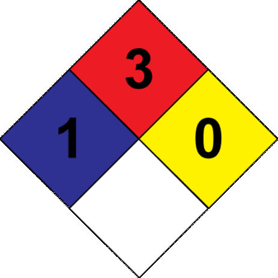

*Imagen técnica — documento: FDS 31 - 407141521 - RECUBRIMIENTO ANTIGRAFFITI - CORONA .pdf.pdf, página 9, sección: 14.*

*Imagen técnica — documento: FDS 31 - 407141521 - RECUBRIMIENTO ANTIGRAFFITI - CORONA .pdf.pdf, página 9, sección: 14.*

*Imagen técnica — documento: FDS 31 - 407141521 - RECUBRIMIENTO ANTIGRAFFITI - CORONA .pdf.pdf, página 9, sección: 14.*

*Imagen técnica — documento: FDS 31 - 407141521 - RECUBRIMIENTO ANTIGRAFFITI - CORONA .pdf.pdf, página 9, sección: 14.*

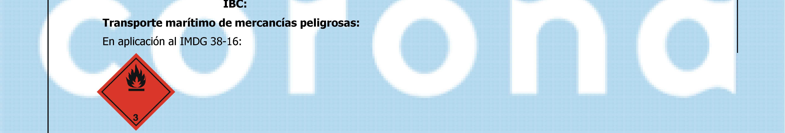

*Imagen técnica — documento: FDS 31 - 407141521 - RECUBRIMIENTO ANTIGRAFFITI - CORONA .pdf.pdf, página 9, sección: 14.*

*Imagen técnica — documento: FDS 31 - 407141521 - RECUBRIMIENTO ANTIGRAFFITI - CORONA .pdf.pdf, página 9, sección: 14.*

*Imagen técnica — documento: FDS 31 - 407141521 - RECUBRIMIENTO ANTIGRAFFITI - CORONA .pdf.pdf, página 9, sección: 14.*

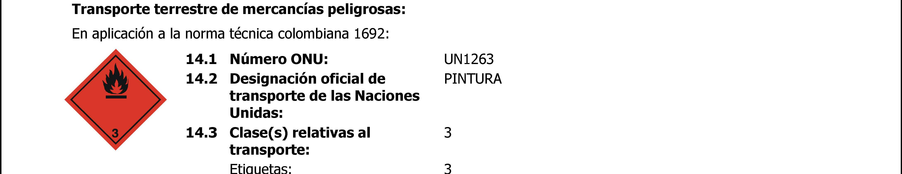

*Imagen técnica — documento: FDS 31 - 407141521 - RECUBRIMIENTO ANTIGRAFFITI - CORONA .pdf.pdf, página 9, sección: 14.*

### Página 10

407141521 - RECUBRIMIENTO ANTIGRAFFITI
Ficha de datos de seguridad
según Decreto 1496 de 2018
## 14. INFORMACION RELATIVA AL TRANSPORTE (CONTINUA)

14.6
14.4
14.3
14.2
14.1
ver epígrafe 9
Propiedades físico-químicas:
III
Grupo de
embalaje/envasado si se
aplica:
3
Etiquetas:
3
Clase(s) relativas al
transporte:
PINTURA
Designación oficial de
transporte de las Naciones
Unidas:
Número ONU:
UN1263
Riesgos ambientales:
No
14.5
Transporte a granel con
arreglo al anexo II de
MARPOL 73/78 y al Código
IBC:
No relevante
14.7
Precauciones especiales para el usuario
## 15. INFORMACION SOBRE LA REGLAMENTACION

NTP (National Toxicology Program): No relevante
Disposiciones particulares en materia de protección de las personas o el medio ambiente:
Se recomienda emplear la información recopilada en esta hoja de datos de seguridad de materiales como datos de entrada en
una evaluación de riesgos de las circunstancias locales con el objeto de establecer las medidas necesarias de prevención de
riesgos para el manejo, utilización, almacenamiento y eliminación de este producto.
Otras legislaciones:
Resolución 0312 de 2019 – Nuevos estándares mínimos del SG-SST
CONPES 3868 - Política de gestión del riesgo asociado al uso de sustancias químicas.
Decreto 1079 de 2015 - decreto único reglamentario del sector transporte
NTC 1692 -Transporte de mercancías peligrosas. Definiciones, clasificación, marcado, etiquetado y rotulado
NTC 4532- Transporte de mercancías peligrosas. Tarjetas de emergencia para transporte de materiales. Elaboración
Decreto número 4741 de 2005
Decreto 1299 de 2008 -Reglamenta departamento de gestión ambiental de empresas a nivel industrial estado
Decreto 321 de 1999  - Adopta el Plan Nacional de Contingencia contra derrames de hidrocarburos, derivados y sustancias
nocivas.
NTC 4702 - 1 -Embalaje y Envases para Transporte de Mercancías Peligrosas Clase 1. Explosivos
NTC 4702 - 2 - Embalaje y Envases para Transporte de Mercancías Peligrosas Clase 2. Gases
NTC 4702 - 3 - Embalaje y Envases para Transporte de Mercancías Peligrosas Clase 3. Líquidos Inflamables
NTC 4702 - 4 - Embalaje y Envases para Transporte de Mercancías Peligrosas Clase 4. Sólidos Inflamables, Sustancias que
presentan riesgo de combustión espontánea, sustancias que en contacto con el agua desprenden gases inflamables.
NTC 4702 - 5 - Embalaje y Envases para Transporte de Mercancías Peligrosas Clase 5. Sustancias Comburentes y Peróxidos
Orgánicos
NTC 4702 - 6 - Embalaje y Envases para Transporte de Mercancías Peligrosas Clase 6. Sustancias Tóxicas e Infecciosas
NTC 4702 - 8 - Embalaje y Envases para Transporte de Mercancías Peligrosas Clase 8. Sustancias Corrosivas
NTC 4702 - 9 - Embalaje y Envases para Transporte de Mercancías Peligrosas Clase 9. Sustancias Peligrosas varias
15.1
Disposiciones específicas sobre seguridad, salud y medio ambiente para el producto de que se trate:
## 16. OTRAS INFORMACIONES

Legislación aplicable a fichas de datos de seguridad:
Esta hoja de datos de seguridad de materiales se ha desarrollado de acuerdo a la norma técnica colombiana NTC 4435:2010
Textos de las frases legislativas contempladas en la sección 2:
H340: Puede provocar defectos genéticos
H350: Puede provocar cáncer
H317: Puede provocar una reacción cutánea alérgica
H313: Puede ser nocivo en contacto con la piel
H304: Puede ser mortal en caso de ingestión y de penetración en las vías respiratorias
H226: Líquido y vapores inflamables
H319: Provoca irritación ocular grave
Página 10/11
Emisión: 25/07/2019            Versión: 1
- CONTINÚA EN LA SIGUIENTE PÁGINA -

#### Tabla 1 (página 10, sección 16)

|  | SECCIÓN 14: INFORMACIÓN RELATIVA AL TRANSPORTE (continúa)|
|---|---|
| 14.1 Número ONU: UN1263 14.2 Designación oficial de PINTURA transporte de las Naciones Unidas: 14.3 Clase(s) relativas al 3 transporte: Etiquetas: 3 14.4 Grupo de III embalaje/envasado si se aplica: 14.5 Riesgos ambientales: No 14.6 Precauciones especiales para el usuario Propiedades físico-químicas: ver epígrafe 9 14.7 Transporte a granel con No relevante arreglo al anexo II de MARPOL 73/78 y al Código IBC: | |

#### Tabla 2 (página 10, sección 16)

|  | SECCIÓN 15: INFORMACIÓN SOBRE LA REGLAMENTACIÓN|
|---|---|
| 15.1 Disposiciones específicas sobre seguridad, salud y medio ambiente para el producto de que se trate: NTP (National Toxicology Program): No relevante Disposiciones particulares en materia de protección de las personas o el medio ambiente: Se recomienda emplear la información recopilada en esta hoja de datos de seguridad de materiales como datos de entrada en una evaluación de riesgos de las circunstancias locales con el objeto de establecer las medidas necesarias de prevención de riesgos para el manejo, utilización, almacenamiento y eliminación de este producto. Otras legislaciones: Resolución 0312 de 2019 – Nuevos estándares mínimos del SG-SST CONPES 3868 - Política de gestión del riesgo asociado al uso de sustancias químicas. Decreto 1079 de 2015 - decreto único reglamentario del sector transporte NTC 1692 -Transporte de mercancías peligrosas. Definiciones, clasificación, marcado, etiquetado y rotulado NTC 4532- Transporte de mercancías peligrosas. Tarjetas de emergencia para transporte de materiales. Elaboración Decreto número 4741 de 2005 Decreto 1299 de 2008 -Reglamenta departamento de gestión ambiental de empresas a nivel industrial estado Decreto 321 de 1999 - Adopta el Plan Nacional de Contingencia contra derrames de hidrocarburos, derivados y sustancias nocivas. NTC 4702 - 1 -Embalaje y Envases para Transporte de Mercancías Peligrosas Clase 1. Explosivos NTC 4702 - 2 - Embalaje y Envases para Transporte de Mercancías Peligrosas Clase 2. Gases NTC 4702 - 3 - Embalaje y Envases para Transporte de Mercancías Peligrosas Clase 3. Líquidos Inflamables NTC 4702 - 4 - Embalaje y Envases para Transporte de Mercancías Peligrosas Clase 4. Sólidos Inflamables, Sustancias que presentan riesgo de combustión espontánea, sustancias que en contacto con el agua desprenden gases inflamables. NTC 4702 - 5 - Embalaje y Envases para Transporte de Mercancías Peligrosas Clase 5. Sustancias Comburentes y Peróxidos Orgánicos NTC 4702 - 6 - Embalaje y Envases para Transporte de Mercancías Peligrosas Clase 6. Sustancias Tóxicas e Infecciosas NTC 4702 - 8 - Embalaje y Envases para Transporte de Mercancías Peligrosas Clase 8. Sustancias Corrosivas NTC 4702 - 9 - Embalaje y Envases para Transporte de Mercancías Peligrosas Clase 9. Sustancias Peligrosas varias | |

#### Tabla 3 (página 10, sección 16)

|  | SECCIÓN 16: OTRAS INFORMACIONES|
|---|---|
| Legislación aplicable a fichas de datos de seguridad: Esta hoja de datos de seguridad de materiales se ha desarrollado de acuerdo a la norma técnica colombiana NTC 4435:2010 Textos de las frases legislativas contempladas en la sección 2: H340: Puede provocar defectos genéticos H350: Puede provocar cáncer H317: Puede provocar una reacción cutánea alérgica H313: Puede ser nocivo en contacto con la piel H304: Puede ser mortal en caso de ingestión y de penetración en las vías respiratorias H226: Líquido y vapores inflamables H319: Provoca irritación ocular grave | |

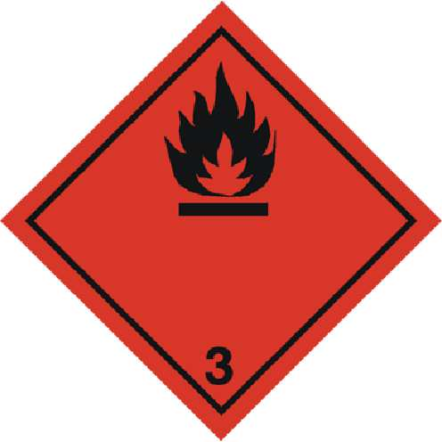

*Imagen técnica — documento: FDS 31 - 407141521 - RECUBRIMIENTO ANTIGRAFFITI - CORONA .pdf.pdf, página 10, sección: 16.*

*Imagen técnica — documento: FDS 31 - 407141521 - RECUBRIMIENTO ANTIGRAFFITI - CORONA .pdf.pdf, página 10, sección: 16.*

*Imagen técnica — documento: FDS 31 - 407141521 - RECUBRIMIENTO ANTIGRAFFITI - CORONA .pdf.pdf, página 10, sección: 16.*

### Página 11

407141521 - RECUBRIMIENTO ANTIGRAFFITI
Ficha de datos de seguridad
según Decreto 1496 de 2018
## 16. OTRAS INFORMACIONES (CONTINUA)

Textos de las frases legislativas contempladas en la sección 3:
Las frases indicadas no se refieren al producto en sí, son sólo a título informativo y hacen referencia a los componentes
individuales que aparecen en la sección 3
SGA:
Carc. 1B: H350 - Puede provocar cáncer
Les. Oc. 1: H318 - Provoca lesiones oculares graves
Muta. 1B: H340 - Puede provocar defectos genéticos
Sens. Cut. 1: H317 - Puede provocar una reacción cutánea alérgica
Tox. Agud. 5: H303 - Puede ser nocivo en caso de ingestión
Tox. Agud. 5: H313 - Puede ser nocivo en contacto con la piel
Tox. Asp. 1: H304 - Puede ser mortal en caso de ingestión y de penetración en las vías respiratorias
Consejos relativos a la formación:
Se recomienda formación mínima en materia de prevención de riesgos laborales al personal que va a manipular este producto,
con la finalidad de facilitar la comprensión e interpretación de esta hoja de datos de seguridad de materiales, así como del
etiquetado del producto.
Principales fuentes bibliográficas:
Instituto Colombiano de Normas Técnicas y Certificación (ICONTEC)
IARC:Agencia Internacional para la Investigación sobre Cáncer
OSHA:Occupational Safety and Health Administration, U.S Department of Labor
NTP:National Toxicology Program
TOXNET: Toxicology data network
Abreviaturas y acrónimos:
IMDG: Código Marítimo Internacional de Mercancías Peligrosas
IATA: Asociación Internacional de Transporte Aéreo
OACI: Organización de Aviación Civil Internacional
DQO:Demanda Quimica de oxígeno
DBO5:Demanda biológica de oxígeno a los 5 días
BCF: factor de bioconcentración
DL50: dosis letal 50
CL50: concentración letal 50
EC50: concentración efectiva 50
Log POW: logaritmo coeficiente partición octanol-agua
Koc: coeficiente de partición del carbono orgánico
La información contenida en esta ficha de datos de seguridad está fundamentada en fuentes, conocimientos técnicos y legislación vigente a nivel europeo y estatal, no pudiendo garantizar la
exactitud de la misma. Esta información no es posible considerarla como una garantía de las propiedades del producto, se trata simplemente de una descripción en cuanto a los requerimientos en
materia de seguridad. La metodología y condiciones de trabajo de los usuarios de este producto se encuentran fuera de nuestro conocimiento y control, siendo siempre responsabilidad última del
usuario tomar las medidas necesarias para adecuarse a las exigencias legislativas en cuanto a manipulación, almacenamiento, uso y eliminación de productos químicos. La información de esta
ficha de datos de seguridad de materiales únicamente se refiere a este producto, el cual no debe emplearse con fines distintos a los que se especifican.
Página 11/11
Emisión: 25/07/2019            Versión: 1
FIN DE LA FICHA DE DATOS DE SEGURIDAD

#### Tabla 1 (página 11, sección 16)

|  | SECCIÓN 16: OTRAS INFORMACIONES (continúa)|
|---|---|
| Textos de las frases legislativas contempladas en la sección 3: Las frases indicadas no se refieren al producto en sí, son sólo a título informativo y hacen referencia a los componentes individuales que aparecen en la sección 3 SGA: Carc. 1B: H350 - Puede provocar cáncer Les. Oc. 1: H318 - Provoca lesiones oculares graves Muta. 1B: H340 - Puede provocar defectos genéticos Sens. Cut. 1: H317 - Puede provocar una reacción cutánea alérgica Tox. Agud. 5: H303 - Puede ser nocivo en caso de ingestión Tox. Agud. 5: H313 - Puede ser nocivo en contacto con la piel Tox. Asp. 1: H304 - Puede ser mortal en caso de ingestión y de penetración en las vías respiratorias Consejos relativos a la formación: Se recomienda formación mínima en materia de prevención de riesgos laborales al personal que va a manipular este producto, con la finalidad de facilitar la comprensión e interpretación de esta hoja de datos de seguridad de materiales, así como del etiquetado del producto. Principales fuentes bibliográficas: Instituto Colombiano de Normas Técnicas y Certificación (ICONTEC) IARC:Agencia Internacional para la Investigación sobre Cáncer OSHA:Occupational Safety and Health Administration, U.S Department of Labor NTP:National Toxicology Program TOXNET: Toxicology data network Abreviaturas y acrónimos: IMDG: Código Marítimo Internacional de Mercancías Peligrosas IATA: Asociación Internacional de Transporte Aéreo OACI: Organización de Aviación Civil Internacional DQO:Demanda Quimica de oxígeno DBO5:Demanda biológica de oxígeno a los 5 días BCF: factor de bioconcentración DL50: dosis letal 50 CL50: concentración letal 50 EC50: concentración efectiva 50 Log POW: logaritmo coeficiente partición octanol-agua Koc: coeficiente de partición del carbono orgánico | |
