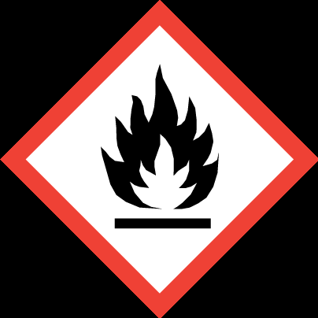
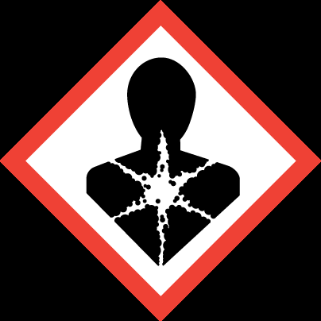
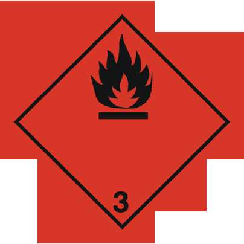

# HS-P-P-029 - Premier

> **Documento fuente:** FDS 52 - HS-P-P-029 - Premier - INVESA.pdf
> **Fabricante:** Invesa S.A.
> **Versión / fecha:** 4/08/2021 Versión: 1
> **Páginas:** 12

## Mapa de secciones FDS

| # | Sección | Página | Estado |
|---|---|---|---|
| 1 | IDENTIFICACION DEL PRODUCTO | 1 | OK |
| 2 | IDENTIFICACION DEL PELIGRO O PELIGROS | 1 | OK |
| 3 | Identificación de los peligros | 4 | OK (sin encabezado numerado) |
| 4 | PRIMEROS AUXILIOS | 2 | OK |
| 5 | MEDIDAS DE LUCHA CONTRA INCENDIOS | 2 | OK |
| 6 | MEDIDAS QUE DEBEN TOMARSE EN CASO DE VERTIDO ACCIDENTAL | 3 | OK |
| 7 | MANIPULACION Y ALMACENAMIENTO | 3 | OK |
| 8 | CONTROLES DE EXPOSICION/PROTECCION PERSONAL | 4 | OK |
| 9 | PROPIEDADES FISICAS Y QUIMICAS Y CARACTERISTICAS DE SEGURIDAD | 5 | OK |
| 10 | ESTABILIDAD Y REACTIVIDAD | 6 | OK |
| 11 | INFORMACION TOXICOLOGICA | 7 | OK |
| 12 | INFORMACION ECOTOXICOLOGICA | 8 | OK |
| 13 | INFORMACION RELATIVA A LA ELIMINACION DE LOS PRODUCTOS | 9 | OK |
| 14 | INFORMACION RELATIVA AL TRANSPORTE | 9 | OK |
| 15 | INFORMACION SOBRE LA REGLAMENTACION | 10 | OK |
| 16 | OTRAS INFORMACIONES | 11 | OK |

---

### Página 1

HS-P-P-029 - Premier
Ficha de datos de seguridad
según Decreto 1496 de 2018 y Resolución 773 de 2021
## 1. IDENTIFICACION DEL PRODUCTO

1.1
Identificador SGA del producto:
HS-P-P-029 - Premier
Otros medios de identificación:
No relevante
1.2
Uso recomendado del producto químico y restricciones:
Usos pertinentes: Pintura
Usos desaconsejados: Todo aquel uso no especificado en este epígrafe ni en el epígrafe 7.3
1.3
Datos sobre el proveedor:
Invesa S.A.
Autopista Norte Km 24, Vereda La Palma
051030 Girardota - Antioquia - Colombia
Tfno.: 289 08 11- 334 27 27 - Fax: 289 49 86 - 334 25 97
info@invesa.com  -  contactenos@invesa.com
www.invesa.com
1.4
Número de teléfono para emergencias:
Para emergencias químicas e intoxicaciones llamar a CISPROQUIM®. Servicio las
24 horas. Teléfonos: 018000916012 ó desde celular (031) 2886012
## 2. IDENTIFICACION DEL PELIGRO O PELIGROS

2.1
Clasificación de la sustancia o de la mezcla:
SGA:
La clasificación del producto se ha realizado conforme con al decreto 1496 de 2018, por el cual se adopta el Sistema
Globalmente Armonizado de Clasificación y Etiquetado de Productos Químicos y se dictan otras disposiciones en materia de
seguridad química.
Carc. 2: Carcinogenicidad, Categoría 2, H351
Carc. 2: Carcinogenicidad, Categoría 2, H351
Liq. Infl. 3: Líquidos inflamables, Categoría 3, H226
STOT única 3: Toxicidad específica con efectos de somnolencia y vértigo (exposición única), Categoría 3, H336
2.2
Elementos de las etiquetas del SGA, incluidos los consejos de prudencia:
SGA:
Atención
Indicaciones de peligro:
Carc. 2: H351 - Susceptible de provocar cáncer.
Carc. 2: H351 - Susceptible de provocar cáncer (Inhalación).
Liq. Infl. 3: H226 - Líquido y vapores inflamables.
STOT única 3: H336 - Puede provocar somnolencia o vértigo.
Consejos de prudencia:
P101: Si se necesita consultar a un médico, tener a mano el recipiente o la etiqueta del producto.
P102: Mantener fuera del alcance de los niños.
P201: Procurarse las instrucciones antes del uso.
P210: Mantener alejado del calor, superficies calientes, chispas llamas al descubierto y otras fuentes de ignición. No fumar.
P280: Usar guantes de protección/equipo de protección para la cara/ropa de protección.
P304+P340: EN CASO DE INHALACIÓN: Transportar a la persona al aire libre y mantenerla en una posición que le facilite la
respiración.
P308+P313: EN CASO DE exposición demostrada o supuesta: consultar a un médico.
P370+P378: En caso de incendio: Utilizar extintor de polvo ABC para la extinción.
P403+P233: Almacenar en un lugar bien ventilado. Mantener el recipiente herméticamente cerrado.
P501: Eliminar el contenido/recipiente mediante el sistema de recogida selectiva habilitado en su municipio.
Sustancias que contribuyen a la clasificación
Hidrocarburos, C9-C11, n-alcanos, isoalcanos, ciclicos, <2% aromaticos; Dioxido de titanio (diámetro aerodinámico ≤ 10 μm);
Negro de carbon
2.3
Otros peligros que no conducen a una clasificación:
No relevante
Página 1/12
Emisión: 4/08/2021            Versión: 1
- CONTINÚA EN LA SIGUIENTE PÁGINA -

#### Tabla 1 (página 1, sección 2)

|  | SECCIÓN 1: IDENTIFICACIÓN DEL PRODUCTO|
|---|---|
| 1.1 Identificador SGA del producto: HS-P-P-029 - Premier Otros medios de identificación: No relevante 1.2 Uso recomendado del producto químico y restricciones: Usos pertinentes: Pintura Usos desaconsejados: Todo aquel uso no especificado en este epígrafe ni en el epígrafe 7.3 1.3 Datos sobre el proveedor: Invesa S.A. Autopista Norte Km 24, Vereda La Palma 051030 Girardota - Antioquia - Colombia Tfno.: 289 08 11- 334 27 27 - Fax: 289 49 86 - 334 25 97 info@invesa.com - contactenos@invesa.com www.invesa.com 1.4 Número de teléfono para emergencias: Para emergencias químicas e intoxicaciones llamar a CISPROQUIM®. Servicio las 24 horas. Teléfonos: 018000916012 ó desde celular (031) 2886012 | |

#### Tabla 2 (página 1, sección 2)

|  | SECCIÓN 2: IDENTIFICACIÓN DEL PELIGRO O PELIGROS|
|---|---|
| 2.1 Clasificación de la sustancia o de la mezcla: SGA: La clasificación del producto se ha realizado conforme con al decreto 1496 de 2018, por el cual se adopta el Sistema Globalmente Armonizado de Clasificación y Etiquetado de Productos Químicos y se dictan otras disposiciones en materia de seguridad química. Carc. 2: Carcinogenicidad, Categoría 2, H351 Carc. 2: Carcinogenicidad, Categoría 2, H351 Liq. Infl. 3: Líquidos inflamables, Categoría 3, H226 STOT única 3: Toxicidad específica con efectos de somnolencia y vértigo (exposición única), Categoría 3, H336 2.2 Elementos de las etiquetas del SGA, incluidos los consejos de prudencia: SGA: Atención Indicaciones de peligro: Carc. 2: H351 - Susceptible de provocar cáncer. Carc. 2: H351 - Susceptible de provocar cáncer (Inhalación). Liq. Infl. 3: H226 - Líquido y vapores inflamables. STOT única 3: H336 - Puede provocar somnolencia o vértigo. Consejos de prudencia: P101: Si se necesita consultar a un médico, tener a mano el recipiente o la etiqueta del producto. P102: Mantener fuera del alcance de los niños. P201: Procurarse las instrucciones antes del uso. P210: Mantener alejado del calor, superficies calientes, chispas llamas al descubierto y otras fuentes de ignición. No fumar. P280: Usar guantes de protección/equipo de protección para la cara/ropa de protección. P304+P340: EN CASO DE INHALACIÓN: Transportar a la persona al aire libre y mantenerla en una posición que le facilite la respiración. P308+P313: EN CASO DE exposición demostrada o supuesta: consultar a un médico. P370+P378: En caso de incendio: Utilizar extintor de polvo ABC para la extinción. P403+P233: Almacenar en un lugar bien ventilado. Mantener el recipiente herméticamente cerrado. P501: Eliminar el contenido/recipiente mediante el sistema de recogida selectiva habilitado en su municipio. Sustancias que contribuyen a la clasificación Hidrocarburos, C9-C11, n-alcanos, isoalcanos, ciclicos, <2% aromaticos; Dioxido de titanio (diámetro aerodinámico ≤ 10 μm); Negro de carbon 2.3 Otros peligros que no conducen a una clasificación: No relevante | |

*Imagen técnica — documento: FDS 52 - HS-P-P-029 - Premier - INVESA.pdf.pdf, página 1, sección: 2.*

*Imagen técnica — documento: FDS 52 - HS-P-P-029 - Premier - INVESA.pdf.pdf, página 1, sección: 2.*

*Imagen técnica — documento: FDS 52 - HS-P-P-029 - Premier - INVESA.pdf.pdf, página 1, sección: 2.*

*Imagen técnica — documento: FDS 52 - HS-P-P-029 - Premier - INVESA.pdf.pdf, página 1, sección: 2.*

### Página 2

HS-P-P-029 - Premier
Ficha de datos de seguridad
según Decreto 1496 de 2018 y Resolución 773 de 2021
## 3. COMPOSICION/INFORMACION SOBRE LOS COMPONENTES

3.1
Sustancias:
No aplicable
3.2
Mezclas:
Descripción química: Dispersión de pigmentos en disolventes
Componentes:
De acuerdo al Decreto 1496 de 2018, el producto presenta:
Identificación
Nombre químico/clasificación
Concentración
CAS:
64742-48-9
Hidrocarburos, C9-C11, n-alcanos, isoalcanos, ciclicos, <2% aromaticos
Liq. Infl. 3: H226; STOT única 3: H336; Tox. Asp. 1: H304 - Peligro
50 - <60 %
CAS:
13463-67-7
Dioxido de titanio (diámetro aerodinámico ≤ 10 μm)
Carc. 2: H351 - Atención
10 - <25 %
CAS:
1333-86-4
Negro de carbon
Carc. 2: H351 - Atención
2 - <10 %
Para ampliar información sobre la peligrosidad de las sustancias consultar las secciones 11, 12 y 16. La clasificación respecto
Carcinogenicidad de las sustancias se ha establecido en función de las monografías de la IARC adecuándola al sistema de
clasificación SGA, para información sobre la clasificación IARC consulte la sección 11.
El contenido de pigmentos varía según color
## 4. PRIMEROS AUXILIOS

4.1
Descripción de los primeros auxilios necesarios:
Los síntomas como consecuencia de una intoxicación pueden presentarse con posterioridad a la exposición, por lo que, en caso
de duda, exposición directa al producto químico o persistencia del malestar solicitar atención médica, mostrándole la FDS de
este producto.
Por inhalación:
Sacar al afectado del lugar de exposición, suministrarle aire limpio y mantenerlo en reposo. En casos graves como parada
cardiorespiratoria, se aplicarán técnicas de respiración artificial (respiración boca a boca, masaje cardíaco, suministro de
oxígeno, etc.) requiriendo asistencia médica inmediata.
Por contacto con la piel:
En caso de contacto se recomienda limpiar la zona afecta con agua por arrastre y con jabón neutro. En caso de alteraciones en
la piel (escozor, rojez, sarpullidos, ampollas…), acudir a consulta médica con esta Ficha de Datos de Seguridad
Por contacto con los ojos:
Se trata de un producto que no contiene sustancias clasificadas como peligrosas en contacto con los ojos. Enjuagar durante al
menos 15 minutos con abundante agua a temperatura ambiente, evitando que el afectado se frote o cierre los ojos.
Por ingestión/aspiración:
No inducir al vómito, en el caso de que se produzca mantener inclinada la cabeza hacia delante para evitar la aspiración.
Mantener al afectado en reposo. Enjuagar la boca y la garganta, ya que existe la posibilidad de que hayan sido afectadas en la
ingestión.
4.2
Síntomas/efectos más importantes, agudos o retardados:
Los efectos agudos y retardados son los indicados en las secciones 2 y 11 de la FDS.
4.3
Indicación de la necesidad de recibir atención médica inmediata y, en su caso, de tratamiento especial:
No relevante
## 5. MEDIDAS DE LUCHA CONTRA INCENDIOS

5.1
Medios de extinción apropiados:
Medios de extinción apropiados:
Emplear preferentemente extintores de polvo polivalente (polvo ABC), alternativamente utilizar espuma física o extintores de
dióxido de carbono (CO2).
Medios de extinción no apropiados:
NO SE RECOMIENDA emplear agua a chorro como agente de extinción.
5.2
Peligros específicos del producto químico:
Página 2/12
Emisión: 4/08/2021            Versión: 1
- CONTINÚA EN LA SIGUIENTE PÁGINA -

#### Tabla 1 (página 2, sección 5)

|  | SECCIÓN 3: COMPOSICIÓN/INFORMACIÓN SOBRE LOS COMPONENTES|
|---|---|
| 3.1 Sustancias: No aplicable 3.2 Mezclas: Descripción química: Dispersión de pigmentos en disolventes Componentes: De acuerdo al Decreto 1496 de 2018, el producto presenta: Identificación Nombre químico/clasificación Concentración Hidrocarburos, C9-C11, n-alcanos, isoalcanos, ciclicos, <2% aromaticos CAS: 64742-48-9 50 - <60 % Liq. Infl. 3: H226; STOT única 3: H336; Tox. Asp. 1: H304 - Peligro Dioxido de titanio (diámetro aerodinámico ≤ 10 μm) CAS: 13463-67-7 10 - <25 % Carc. 2: H351 - Atención Negro de carbon CAS: 1333-86-4 2 - <10 % Carc. 2: H351 - Atención Para ampliar información sobre la peligrosidad de las sustancias consultar las secciones 11, 12 y 16. La clasificación respecto Carcinogenicidad de las sustancias se ha establecido en función de las monografías de la IARC adecuándola al sistema de clasificación SGA, para información sobre la clasificación IARC consulte la sección 11. El contenido de pigmentos varía según color | |

#### Tabla 2 (página 2, sección 5)

| Identificación | Nombre químico/clasificación | Concentración|
|---|---|---|
| CAS: 64742-48-9 | Hidrocarburos, C9-C11, n-alcanos, isoalcanos, ciclicos, <2% aromaticos Liq. Infl. 3: H226; STOT única 3: H336; Tox. Asp. 1: H304 - Peligro | 50 - <60 %|
| CAS: 13463-67-7 | Dioxido de titanio (diámetro aerodinámico ≤ 10 μm) Carc. 2: H351 - Atención | 10 - <25 %|
| CAS: 1333-86-4 | Negro de carbon Carc. 2: H351 - Atención | 2 - <10 %|

#### Tabla 3 (página 2, sección 5)

|  | SECCIÓN 4: PRIMEROS AUXILIOS|
|---|---|
| 4.1 Descripción de los primeros auxilios necesarios: Los síntomas como consecuencia de una intoxicación pueden presentarse con posterioridad a la exposición, por lo que, en caso de duda, exposición directa al producto químico o persistencia del malestar solicitar atención médica, mostrándole la FDS de este producto. Por inhalación: Sacar al afectado del lugar de exposición, suministrarle aire limpio y mantenerlo en reposo. En casos graves como parada cardiorespiratoria, se aplicarán técnicas de respiración artificial (respiración boca a boca, masaje cardíaco, suministro de oxígeno, etc.) requiriendo asistencia médica inmediata. Por contacto con la piel: En caso de contacto se recomienda limpiar la zona afecta con agua por arrastre y con jabón neutro. En caso de alteraciones en la piel (escozor, rojez, sarpullidos, ampollas…), acudir a consulta médica con esta Ficha de Datos de Seguridad Por contacto con los ojos: Se trata de un producto que no contiene sustancias clasificadas como peligrosas en contacto con los ojos. Enjuagar durante al menos 15 minutos con abundante agua a temperatura ambiente, evitando que el afectado se frote o cierre los ojos. Por ingestión/aspiración: No inducir al vómito, en el caso de que se produzca mantener inclinada la cabeza hacia delante para evitar la aspiración. Mantener al afectado en reposo. Enjuagar la boca y la garganta, ya que existe la posibilidad de que hayan sido afectadas en la ingestión. 4.2 Síntomas/efectos más importantes, agudos o retardados: Los efectos agudos y retardados son los indicados en las secciones 2 y 11 de la FDS. 4.3 Indicación de la necesidad de recibir atención médica inmediata y, en su caso, de tratamiento especial: No relevante | |

#### Tabla 4 (página 2, sección 5)

|  | SECCIÓN 5: MEDIDAS DE LUCHA CONTRA INCENDIOS|
|---|---|
| 5.1 Medios de extinción apropiados: Medios de extinción apropiados: Emplear preferentemente extintores de polvo polivalente (polvo ABC), alternativamente utilizar espuma física o extintores de dióxido de carbono (CO2). Medios de extinción no apropiados: NO SE RECOMIENDA emplear agua a chorro como agente de extinción. 5.2 Peligros específicos del producto químico: | |

### Página 3

HS-P-P-029 - Premier
Ficha de datos de seguridad
según Decreto 1496 de 2018 y Resolución 773 de 2021
## 5. MEDIDAS DE LUCHA CONTRA INCENDIOS (CONTINUA)

Como consecuencia de la combustión o descomposición térmica se generan subproductos de reacción que pueden resultar
altamente tóxicos y, consecuentemente, pueden presentar un riesgo elevado para la salud.
5.3
Medidas especiales que deben tomar los equipos de lucha contra incendios:
En función de la magnitud del incendio puede hacerse necesario el uso de ropa protectora completa y equipo de respiración
autónomo. Disponer de un mínimo de instalaciones de emergencia o elementos de actuación (mantas ignífugas, botiquín
portátil,...).
Disposiciones adicionales:
Actuar conforme el Plan de Emergencia Interior y las Fichas Informativas sobre actuación ante accidentes y otras emergencias.
Suprimir cualquier fuente de ignición. En caso de incendio, refrigerar los recipientes y tanques de almacenamiento de productos
susceptibles a inflamación, explosión o BLEVE como consecuencia de elevadas temperaturas. Evitar el vertido de los productos
empleados en la extinción del incendio al medio acuático.
## 6. MEDIDAS QUE DEBEN TOMARSE EN CASO DE VERTIDO ACCIDENTAL

6.1
Precauciones personales, equipo protector y procedimiento de emergencia:
Para el personal que no forma parte de los servicios de emergencia:
Aislar las fugas siempre y cuando no suponga un riesgo adicional para las personas que desempeñen esta función. Evacuar la
zona y mantener a las personas sin protección alejadas. Ante el contacto potencial con el producto derramado se hace
obligatorio el uso de elementos de protección personal (ver sección 8 de la FDS). Evitar de manera prioritaria la formación de
mezclas vapor-aire inflamables, ya sea mediante ventilación o el uso de un agente inertizante. Suprimir cualquier fuente de
ignición. Eliminar las cargas electroestáticas mediante la interconexión de todas las superficies conductoras sobre las que se
puede formar electricidad estática, y estando a su vez el conjunto conectado a tierra.
Para el personal de emergencia:
Ver sección 8 de la FDS.
6.2
Precauciones relativas al medio ambiente:
Producto no clasificado como peligroso para el medioambiente. Mantener el producto alejado de los desagües y de las aguas
superficiales y subterráneas.
6.3
Métodos y materiales para la contención y limpieza de vertidos:
Se recomienda:
Absorber el vertido mediante arena o absorbente inerte y trasladarlo a un lugar seguro. No absorber en serrín u otros
absorbentes combustibles. Para cualquier consideración relativa a la eliminación consultar la sección 13 de la FDS.
6.4
Referencias a otras secciones:
Ver secciones 8 y 13.
## 7. MANIPULACION Y ALMACENAMIENTO

7.1
Precauciones que se deben tomar para garantizar una manipulación segura:
A.- Precauciones generales
Cumplir con la legislación vigente en materia de prevención de riesgos laborales. Mantener los recipientes herméticamente
cerrados. Controlar los derrames y residuos, eliminándolos con métodos seguros (sección 6 de la FDS). Evitar el vertido libre
desde el recipiente. Mantener orden y limpieza donde se manipulen productos peligrosos.
B.- Recomendaciones técnicas para la prevención de incendios y explosiones.
Trasvasar en lugares bien ventilados, preferentemente mediante extracción localizada. Controlar totalmente los focos de
ignición (teléfonos móviles, chispas,…) y ventilar en las operaciones de limpieza. Evitar la existencia de atmósferas
peligrosas en el interior de recipientes, aplicando en lo posible sistemas de inertización. Trasvasar a velocidades lentas para
evitar la generación de cargas electroestáticas. Ante la posibilidad de existencia de cargas electroestáticas: asegurar una
perfecta conexión equipotencial, utilizar siempre tomas de tierras, no emplear ropa de trabajo de fibras acrílicas, empleando
preferiblemente ropa de algodón y calzado conductor. Cumplir con los requisitos esenciales de seguridad para equipos  y con
las disposiciones mínimas para la protección de la seguridad y salud de los trabajadores. Consultar la sección 10 de la FDS
sobre condiciones y materias que deben evitarse.
C.- Recomendaciones técnicas para prevenir riesgos ergonómicos y toxicológicos.
Para control de exposición consultar la sección 8 de la FDS. No comer, beber ni fumar en las zonas de trabajo
lavarse las manos después de cada utilización, y despojarse de prendas de vestir y equipos de protección contaminados
antes de entrar en las zonas para comer.
D.- Recomendaciones técnicas para prevenir riesgos medioambientales
Se recomienda disponer de material absorbente en las proximidades del producto (ver epígrafe 6.3 de la FDS para mayor
información)
Página 3/12
Emisión: 4/08/2021            Versión: 1
- CONTINÚA EN LA SIGUIENTE PÁGINA -

#### Tabla 1 (página 3, sección 7)

|  | SECCIÓN 5: MEDIDAS DE LUCHA CONTRA INCENDIOS (continúa)|
|---|---|
| Como consecuencia de la combustión o descomposición térmica se generan subproductos de reacción que pueden resultar altamente tóxicos y, consecuentemente, pueden presentar un riesgo elevado para la salud. 5.3 Medidas especiales que deben tomar los equipos de lucha contra incendios: En función de la magnitud del incendio puede hacerse necesario el uso de ropa protectora completa y equipo de respiración autónomo. Disponer de un mínimo de instalaciones de emergencia o elementos de actuación (mantas ignífugas, botiquín portátil,...). Disposiciones adicionales: Actuar conforme el Plan de Emergencia Interior y las Fichas Informativas sobre actuación ante accidentes y otras emergencias. Suprimir cualquier fuente de ignición. En caso de incendio, refrigerar los recipientes y tanques de almacenamiento de productos susceptibles a inflamación, explosión o BLEVE como consecuencia de elevadas temperaturas. Evitar el vertido de los productos empleados en la extinción del incendio al medio acuático. | |

#### Tabla 2 (página 3, sección 7)

|  | SECCIÓN 6: MEDIDAS QUE DEBEN TOMARSE EN CASO DE VERTIDO ACCIDENTAL|
|---|---|
| 6.1 Precauciones personales, equipo protector y procedimiento de emergencia: Para el personal que no forma parte de los servicios de emergencia: Aislar las fugas siempre y cuando no suponga un riesgo adicional para las personas que desempeñen esta función. Evacuar la zona y mantener a las personas sin protección alejadas. Ante el contacto potencial con el producto derramado se hace obligatorio el uso de elementos de protección personal (ver sección 8 de la FDS). Evitar de manera prioritaria la formación de mezclas vapor-aire inflamables, ya sea mediante ventilación o el uso de un agente inertizante. Suprimir cualquier fuente de ignición. Eliminar las cargas electroestáticas mediante la interconexión de todas las superficies conductoras sobre las que se puede formar electricidad estática, y estando a su vez el conjunto conectado a tierra. Para el personal de emergencia: Ver sección 8 de la FDS. 6.2 Precauciones relativas al medio ambiente: Producto no clasificado como peligroso para el medioambiente. Mantener el producto alejado de los desagües y de las aguas superficiales y subterráneas. 6.3 Métodos y materiales para la contención y limpieza de vertidos: Se recomienda: Absorber el vertido mediante arena o absorbente inerte y trasladarlo a un lugar seguro. No absorber en serrín u otros absorbentes combustibles. Para cualquier consideración relativa a la eliminación consultar la sección 13 de la FDS. 6.4 Referencias a otras secciones: Ver secciones 8 y 13. | |

#### Tabla 3 (página 3, sección 7)

|  | SECCIÓN 7: MANIPULACIÓN Y ALMACENAMIENTO|
|---|---|
| 7.1 Precauciones que se deben tomar para garantizar una manipulación segura: A.-Precauciones generales Cumplir con la legislación vigente en materia de prevención de riesgos laborales. Mantener los recipientes herméticamente cerrados. Controlar los derrames y residuos, eliminándolos con métodos seguros (sección 6 de la FDS). Evitar el vertido libre desde el recipiente. Mantener orden y limpieza donde se manipulen productos peligrosos. B.-Recomendaciones técnicas para la prevención de incendios y explosiones. Trasvasar en lugares bien ventilados, preferentemente mediante extracción localizada. Controlar totalmente los focos de ignición (teléfonos móviles, chispas,…) y ventilar en las operaciones de limpieza. Evitar la existencia de atmósferas peligrosas en el interior de recipientes, aplicando en lo posible sistemas de inertización. Trasvasar a velocidades lentas para evitar la generación de cargas electroestáticas. Ante la posibilidad de existencia de cargas electroestáticas: asegurar una perfecta conexión equipotencial, utilizar siempre tomas de tierras, no emplear ropa de trabajo de fibras acrílicas, empleando preferiblemente ropa de algodón y calzado conductor. Cumplir con los requisitos esenciales de seguridad para equipos y con las disposiciones mínimas para la protección de la seguridad y salud de los trabajadores. Consultar la sección 10 de la FDS sobre condiciones y materias que deben evitarse. C.-Recomendaciones técnicas para prevenir riesgos ergonómicos y toxicológicos. Para control de exposición consultar la sección 8 de la FDS. No comer, beber ni fumar en las zonas de trabajo lavarse las manos después de cada utilización, y despojarse de prendas de vestir y equipos de protección contaminados antes de entrar en las zonas para comer. D.-Recomendaciones técnicas para prevenir riesgos medioambientales Se recomienda disponer de material absorbente en las proximidades del producto (ver epígrafe 6.3 de la FDS para mayor información) | |

### Página 4

HS-P-P-029 - Premier
Ficha de datos de seguridad
según Decreto 1496 de 2018 y Resolución 773 de 2021
## 7. MANIPULACION Y ALMACENAMIENTO (CONTINUA)

7.2
Condiciones de almacenamiento seguro, incluidas cualesquiera incompatibilidades:
A.- Medidas técnicas de almacenamiento
B.- Condiciones generales de almacenamiento.
Evitar fuentes de calor, radiación, electricidad estática y el contacto con alimentos. Para información adicional ver epígrafe
10.5
7.3
Usos específicos finales:
Salvo las indicaciones ya especificadas no es preciso realizar ninguna recomendación especial en cuanto a los usos de este
producto.
Temperatura mínima:
5 ºC
Temperatura máxima:
30 ºC
## 8. CONTROLES DE EXPOSICION/PROTECCION PERSONAL

8.1
Parámetros de control:
Sustancias cuyos valores límite de exposición profesional han de controlarse en el ambiente de trabajo:
OSHA (Tablas Z):
Identificación
Valores límite ambientales
Dioxido de titanio (diámetro aerodinámico ≤ 10 μm)
## 8. hour TWA PEL

15 mg/m³
CAS: 13463-67-7
Ceiling Values - TWA
PEL
Negro de carbon
## 8. hour TWA PEL

3.5 mg/m³
CAS: 1333-86-4
Ceiling Values - TWA
PEL
ACGIH:
Identificación
Valores límite ambientales
Dioxido de titanio (diámetro aerodinámico ≤ 10 μm)
TLV-TWA
10 mg/m³
CAS: 13463-67-7
TLV-STEL
Negro de carbon
TLV-TWA
3 mg/m³
CAS: 1333-86-4
TLV-STEL
8.2
Controles técnicos apropiados:
A.- Medidas de protección individual, como equipo de protección personal (EPP)
Realizar la identificación de los peligros y la valoración de los riesgos de acuerdo a la Guia técnica colombiana GTC 45.
Como medida de prevención se recomienda la utilización de equipos de protección individual básicos. Para más información
sobre los equipos de protección individual (almacenamiento, uso, limpieza, mantenimiento, clase de protección,…) consultar
el folleto informativo facilitado por el fabricante del EPP. Las indicaciones contenidas en este punto se refieren al producto
puro. Las medidas de protección para el producto diluido podrán variar en función de su grado de dilución, uso, método de
aplicación, etc. Para determinar la obligación de instalación de duchas de emergencia y/o lavaojos en los almacenes se
tendrá en cuenta la normativa referente al almacenamiento de productos químicos aplicable en cada caso. Para más
información ver epígrafes 7.1 y 7.2 de la FDS.
Toda la información aquí incluida es una recomendación siendo necesario su concreción por parte de los servicios de
prevención de riesgos laborales al desconocer las medidas de prevención adicionales que la empresa pudiese disponer.
B.- Protección respiratoria.
Pictograma
EPP
Observaciones
Protección
obligatoria de las
vías respiratorias
Máscara autofiltrante para gases y vapores
NOMATIVIDAD APLICABLE: NTC 1584, NTC 1589, NTC 3851 y NTC 1728.
Reemplazar cuando se detecte olor o sabor del contaminante en el interior de la
máscara o adaptador facial. Cuando el contaminante no tiene buenas propiedades
de aviso se recomienda el uso de equipos aislantes.
C.- Protección específica de las manos.
Pictograma
EPP
Observaciones
Protección
obligatoria de la
manos
Guantes NO desechables de protección
química
NORMATIVIDAD APLICABLE: NTC 3398, EN 374 y EN420. El tiempo de paso
(Breakthrough Time) indicado por el fabricante ha de ser superior al del tiempo de
uso del producto. No emplear cremas protectoras después del contacto del
producto con la piel.
Página 4/12
Emisión: 4/08/2021            Versión: 1
- CONTINÚA EN LA SIGUIENTE PÁGINA -

#### Tabla 1 (página 4, sección 8)

|  | SECCIÓN 7: MANIPULACIÓN Y ALMACENAMIENTO (continúa)|
|---|---|
| 7.2 Condiciones de almacenamiento seguro, incluidas cualesquiera incompatibilidades: A.-Medidas técnicas de almacenamiento Temperatura mínima: 5 ºC Temperatura máxima: 30 ºC B.-Condiciones generales de almacenamiento. Evitar fuentes de calor, radiación, electricidad estática y el contacto con alimentos. Para información adicional ver epígrafe 10.5 7.3 Usos específicos finales: Salvo las indicaciones ya especificadas no es preciso realizar ninguna recomendación especial en cuanto a los usos de este producto. | |

#### Tabla 2 (página 4, sección 8)

|  | SECCIÓN 8: CONTROLES DE EXPOSICIÓN/PROTECCIÓN PERSONAL|
|---|---|
| 8.1 Parámetros de control: Sustancias cuyos valores límite de exposición profesional han de controlarse en el ambiente de trabajo: OSHA (Tablas Z): Identificación Valores límite ambientales Dioxido de titanio (diámetro aerodinámico ≤ 10 μm) 8-hour TWA PEL 15 mg/m³ Ceiling Values - TWA CAS: 13463-67-7 PEL Negro de carbon 8-hour TWA PEL 3.5 mg/m³ Ceiling Values - TWA CAS: 1333-86-4 PEL ACGIH: Identificación Valores límite ambientales Dioxido de titanio (diámetro aerodinámico ≤ 10 μm) TLV-TWA 10 mg/m³ CAS: 13463-67-7 TLV-STEL Negro de carbon TLV-TWA 3 mg/m³ CAS: 1333-86-4 TLV-STEL 8.2 Controles técnicos apropiados: A.-Medidas de protección individual, como equipo de protección personal (EPP) Realizar la identificación de los peligros y la valoración de los riesgos de acuerdo a la Guia técnica colombiana GTC 45. Como medida de prevención se recomienda la utilización de equipos de protección individual básicos. Para más información sobre los equipos de protección individual (almacenamiento, uso, limpieza, mantenimiento, clase de protección,…) consultar el folleto informativo facilitado por el fabricante del EPP. Las indicaciones contenidas en este punto se refieren al producto puro. Las medidas de protección para el producto diluido podrán variar en función de su grado de dilución, uso, método de aplicación, etc. Para determinar la obligación de instalación de duchas de emergencia y/o lavaojos en los almacenes se tendrá en cuenta la normativa referente al almacenamiento de productos químicos aplicable en cada caso. Para más información ver epígrafes 7.1 y 7.2 de la FDS. Toda la información aquí incluida es una recomendación siendo necesario su concreción por parte de los servicios de prevención de riesgos laborales al desconocer las medidas de prevención adicionales que la empresa pudiese disponer. B.-Protección respiratoria. Pictograma EPP Observaciones NOMATIVIDAD APLICABLE: NTC 1584, NTC 1589, NTC 3851 y NTC 1728. Reemplazar cuando se detecte olor o sabor del contaminante en el interior de la Máscara autofiltrante para gases y vapores máscara o adaptador facial. Cuando el contaminante no tiene buenas propiedades Protección de aviso se recomienda el uso de equipos aislantes. obligatoria de las vías respiratorias C.-Protección específica de las manos. Pictograma EPP Observaciones NORMATIVIDAD APLICABLE: NTC 3398, EN 374 y EN420. El tiempo de paso Guantes NO desechables de protección (Breakthrough Time) indicado por el fabricante ha de ser superior al del tiempo de química uso del producto. No emplear cremas protectoras después del contacto del Protección producto con la piel. obligatoria de la manos | |

#### Tabla 3 (página 4, sección 8)

| Identificación | Valores límite ambientales |  | |
|---|---|---|---|
| Dioxido de titanio (diámetro aerodinámico ≤ 10 μm) CAS: 13463-67-7 | 8-hour TWA PEL |  | 15 mg/m³|
|  | Ceiling Values - TWA PEL |  | |
| Negro de carbon CAS: 1333-86-4 | 8-hour TWA PEL |  | 3.5 mg/m³|
|  | Ceiling Values - TWA PEL |  | |

#### Tabla 4 (página 4, sección 8)

| Identificación | Valores límite ambientales |  | |
|---|---|---|---|
| Dioxido de titanio (diámetro aerodinámico ≤ 10 μm) CAS: 13463-67-7 | TLV-TWA |  | 10 mg/m³|
|  | TLV-STEL |  | |
| Negro de carbon CAS: 1333-86-4 | TLV-TWA |  | 3 mg/m³|
|  | TLV-STEL |  | |

#### Tabla 5 (página 4, sección 8)

| Pictograma | EPP | Observaciones|
|---|---|---|
| Protección obligatoria de las vías respiratorias | Máscara autofiltrante para gases y vapores | NOMATIVIDAD APLICABLE: NTC 1584, NTC 1589, NTC 3851 y NTC 1728. Reemplazar cuando se detecte olor o sabor del contaminante en el interior de la máscara o adaptador facial. Cuando el contaminante no tiene buenas propiedades de aviso se recomienda el uso de equipos aislantes.|

#### Tabla 6 (página 4, sección 8)

| Pictograma | EPP | Observaciones|
|---|---|---|
| Protección obligatoria de la manos | Guantes NO desechables de protección química | NORMATIVIDAD APLICABLE: NTC 3398, EN 374 y EN420. El tiempo de paso (Breakthrough Time) indicado por el fabricante ha de ser superior al del tiempo de uso del producto. No emplear cremas protectoras después del contacto del producto con la piel.|

*Imagen técnica — documento: FDS 52 - HS-P-P-029 - Premier - INVESA.pdf.pdf, página 4, sección: 8.*

*Imagen técnica — documento: FDS 52 - HS-P-P-029 - Premier - INVESA.pdf.pdf, página 4, sección: 8.*

### Página 5

HS-P-P-029 - Premier
Ficha de datos de seguridad
según Decreto 1496 de 2018 y Resolución 773 de 2021
## 8. CONTROLES DE EXPOSICION/PROTECCION PERSONAL (CONTINUA)

Dado que el producto es una mezcla de diferentes materiales, la resistencia del material de los guantes no se puede calcular
de antemano con total fiabilidad y por lo tanto tiene que ser controlados antes de su aplicación.
D.- Protección ocular y facial
Pictograma
EPP
Observaciones
Protección
obligatoria de la cara
Pantalla facial
NORMATIVIDAD APLICABLE: NTC 1825, NTC 1826 y ANSI Z87.1. Limpiar a
diario y desinfectar periódicamente de acuerdo a las instrucciones del fabricante.
Se recomienda su uso en caso de riesgo de salpicaduras.
E.- Protección corporal
Pictograma
EPP
Observaciones
Protección
obligatoria del
cuerpo
Prenda de protección frente a riesgos químicos,
antiestática e ignífuga
NORMATIVIDAD APLICABLE: EN ISO 13688 y EN 14605. Uso exclusivo en el
trabajo. Limpiar periódicamente de acuerdo a las instrucciones del fabricante.
Protección
obligatoria de los
pies
Calzado de seguridad contra riesgo químico,
con propiedades antiestáticas y resistencia al
calor
NORMATIVIDAD APLICABLE: NTC-ISO 20345, NTC-ISO 20344 y NTC 2257.
Reemplazar las botas ante cualquier indicio de deterioro.
F.- Medidas complementarias de emergencia
Medida de emergencia
Normas
Medida de emergencia
Normas
Ducha de emergencia
ANSI Z358-1
ISO 3864-1:2011, ISO 3864-4:2011
Lavaojos
DIN 12 899
ISO 3864-1:2011, ISO 3864-4:2011
Controles de la exposición del medio ambiente:
Se recomienda evitar el vertido tanto del producto como de su envase al medio ambiente. Para información adicional ver epígrafe
7.1.D de la FDS.
NTC 6018- Etiquetas ambientales tipo I. Sello ambiental colombiano. Criterios ambientales para pinturas y materiales de
recubrimiento (determinados de acuerdo con la norma ASTM D6886):
Compuestos orgánicos volátiles:
53 % peso
Concentración C.O.V. a 20 ºC:
513.93 kg/m³  (513.93 g/L)
## 9. PROPIEDADES FISICAS Y QUIMICAS Y CARACTERISTICAS DE SEGURIDAD

9.1
Información de propiedades físicas y químicas básicas:
Para completar la información ver la ficha técnica/hoja de especificaciones del producto.
Aspecto físico:
Estado físico a 20 ºC:
Líquido
Aspecto:
Viscoso
Color:
No determinado
Olor:
No determinado
Umbral olfativo:
No relevante *
Volatilidad:
Temperatura de ebullición a presión atmosférica:
170 ºC
Presión de vapor a 20 ºC:
199 Pa
Presión de vapor a 50 ºC:
1807.19 Pa  (1.81 kPa)
Tasa de evaporación a 20 ºC:
No relevante *
Caracterización del producto:
*No relevante debido a la naturaleza del producto, no aportando información característica de su peligrosidad.
Página 5/12
Emisión: 4/08/2021            Versión: 1
- CONTINÚA EN LA SIGUIENTE PÁGINA -

#### Tabla 1 (página 5, sección 9)

|  | SECCIÓN 8: CONTROLES DE EXPOSICIÓN/PROTECCIÓN PERSONAL (continúa)|
|---|---|
| Dado que el producto es una mezcla de diferentes materiales, la resistencia del material de los guantes no se puede calcular de antemano con total fiabilidad y por lo tanto tiene que ser controlados antes de su aplicación. D.-Protección ocular y facial Pictograma EPP Observaciones NORMATIVIDAD APLICABLE: NTC 1825, NTC 1826 y ANSI Z87.1. Limpiar a Pantalla facial diario y desinfectar periódicamente de acuerdo a las instrucciones del fabricante. Se recomienda su uso en caso de riesgo de salpicaduras. Protección obligatoria de la cara E.-Protección corporal Pictograma EPP Observaciones Prenda de protección frente a riesgos químicos, NORMATIVIDAD APLICABLE: EN ISO 13688 y EN 14605. Uso exclusivo en el antiestática e ignífuga trabajo. Limpiar periódicamente de acuerdo a las instrucciones del fabricante. Protección obligatoria del cuerpo Calzado de seguridad contra riesgo químico, NORMATIVIDAD APLICABLE: NTC-ISO 20345, NTC-ISO 20344 y NTC 2257. con propiedades antiestáticas y resistencia al Reemplazar las botas ante cualquier indicio de deterioro. calor Protección obligatoria de los pies F.- Medidas complementarias de emergencia Medida de emergencia Normas Medida de emergencia Normas ANSI Z358-1 DIN 12 899 ISO 3864-1:2011, ISO 3864-4:2011 ISO 3864-1:2011, ISO 3864-4:2011 Ducha de emergencia Lavaojos Controles de la exposición del medio ambiente: Se recomienda evitar el vertido tanto del producto como de su envase al medio ambiente. Para información adicional ver epígrafe 7.1.D de la FDS. NTC 6018- Etiquetas ambientales tipo I. Sello ambiental colombiano. Criterios ambientales para pinturas y materiales de recubrimiento (determinados de acuerdo con la norma ASTM D6886): Compuestos orgánicos volátiles: 53 % peso Concentración C.O.V. a 20 ºC: 513.93 kg/m³ (513.93 g/L) | |

#### Tabla 2 (página 5, sección 9)

| Pictograma | EPP | Observaciones|
|---|---|---|
| Protección obligatoria de la cara | Pantalla facial | NORMATIVIDAD APLICABLE: NTC 1825, NTC 1826 y ANSI Z87.1. Limpiar a diario y desinfectar periódicamente de acuerdo a las instrucciones del fabricante. Se recomienda su uso en caso de riesgo de salpicaduras.|

#### Tabla 3 (página 5, sección 9)

| Pictograma | EPP | Observaciones|
|---|---|---|
| Protección obligatoria del cuerpo | Prenda de protección frente a riesgos químicos, antiestática e ignífuga | NORMATIVIDAD APLICABLE: EN ISO 13688 y EN 14605. Uso exclusivo en el trabajo. Limpiar periódicamente de acuerdo a las instrucciones del fabricante.|
| Protección obligatoria de los pies | Calzado de seguridad contra riesgo químico, con propiedades antiestáticas y resistencia al calor | NORMATIVIDAD APLICABLE: NTC-ISO 20345, NTC-ISO 20344 y NTC 2257. Reemplazar las botas ante cualquier indicio de deterioro.|

#### Tabla 4 (página 5, sección 9)

| Medida de emergencia | Normas | Medida de emergencia | Normas|
|---|---|---|---|
| Ducha de emergencia | ANSI Z358-1 ISO 3864-1:2011, ISO 3864-4:2011 | Lavaojos | DIN 12 899 ISO 3864-1:2011, ISO 3864-4:2011|

#### Tabla 5 (página 5, sección 9)

|  | SECCIÓN 9: PROPIEDADES FÍSICAS Y QUÍMICAS Y CARACTERÍSTICAS DE SEGURIDAD|
|---|---|
| 9.1 Información de propiedades físicas y químicas básicas: Para completar la información ver la ficha técnica/hoja de especificaciones del producto. Aspecto físico: Estado físico a 20 ºC: Líquido Aspecto: Viscoso Color: No determinado Olor: No determinado Umbral olfativo: No relevante * Volatilidad: Temperatura de ebullición a presión atmosférica: 170 ºC Presión de vapor a 20 ºC: 199 Pa Presión de vapor a 50 ºC: 1807.19 Pa (1.81 kPa) Tasa de evaporación a 20 ºC: No relevante * Caracterización del producto: *No relevante debido a la naturaleza del producto, no aportando información característica de su peligrosidad. | |

*Imagen técnica — documento: FDS 52 - HS-P-P-029 - Premier - INVESA.pdf.pdf, página 5, sección: 9.*

*Imagen técnica — documento: FDS 52 - HS-P-P-029 - Premier - INVESA.pdf.pdf, página 5, sección: 9.*

*Imagen técnica — documento: FDS 52 - HS-P-P-029 - Premier - INVESA.pdf.pdf, página 5, sección: 9.*

*Imagen técnica — documento: FDS 52 - HS-P-P-029 - Premier - INVESA.pdf.pdf, página 5, sección: 9.*

*Imagen técnica — documento: FDS 52 - HS-P-P-029 - Premier - INVESA.pdf.pdf, página 5, sección: 9.*

### Página 6

HS-P-P-029 - Premier
Ficha de datos de seguridad
según Decreto 1496 de 2018 y Resolución 773 de 2021
## 9. PROPIEDADES FISICAS Y QUIMICAS Y CARACTERISTICAS DE SEGURIDAD (CONTINUA)

Densidad a 20 ºC:
969.7 kg/m³
Densidad relativa a 20 ºC:
0.97
Viscosidad dinámica a 20 ºC:
No relevante *
Viscosidad cinemática a 20 ºC:
No relevante *
Viscosidad cinemática a 40 ºC:
>20.5 mm²/s
Concentración:
No relevante *
pH:
No relevante *
Densidad de vapor a 20 ºC:
No relevante *
Coeficiente de reparto n-octanol/agua a 20 ºC:
No relevante *
Solubilidad en agua a 20 ºC:
No relevante *
Propiedad de solubilidad:
No relevante *
Temperatura de descomposición:
No relevante *
Punto de fusión/punto de congelación:
No relevante *
Inflamabilidad:
Punto de inflamación:
39 ºC
Inflamabilidad (sólido, gas):
No relevante *
Temperatura de auto-inflamación:
270 ºC
Límite de inflamabilidad inferior:
No determinado
Límite de inflamabilidad superior:
No determinado
Características de las partículas:
Diámetro medio equivalente:
No aplicable
9.2
Información adicional:
Información relativa a las clases de peligro físico:
Propiedades explosivas:
No relevante *
Propiedades comburentes:
No relevante *
Corrosivos para los metales:
No relevante *
Calor de combustión:
No relevante *
Aerosoles-porcentaje total (en masa) de componentes
inflamables:
No relevante *
Otras características de seguridad:
Tensión superficial a 20 ºC:
No relevante *
Índice de refracción:
No relevante *
*No relevante debido a la naturaleza del producto, no aportando información característica de su peligrosidad.
## 10. ESTABILIDAD Y REACTIVIDAD

10.1
Reactividad:
No se esperan reacciones peligrosas si se cumplen las instrucciones técnicas de almacenamiento de productos químicos. Ver
## 7. DE LA FDS PARA MAYOR INFORMACION.

10.2
Estabilidad química:
Estable químicamente bajo las condiciones indicadas de almacenamiento, manipulación y uso.
10.3
Posibilidad de reacciones peligrosas:
Bajo las condiciones indicadas no se esperan reacciones peligrosas ni polimerización peligrosa que puedan producir una presión
o temperaturas excesivas.
10.4
Condiciones que deben evitarse:
Aplicables para manipulación y almacenamiento a temperatura ambiente:
Choque y fricción
Contacto con el aire
Calentamiento
Luz Solar
Humedad
No aplicable
No aplicable
Riesgo de inflamación
Evitar incidencia directa
No aplicable
Página 6/12
Emisión: 4/08/2021            Versión: 1
- CONTINÚA EN LA SIGUIENTE PÁGINA -

#### Tabla 1 (página 6, sección 7)

|  | SECCIÓN 9: PROPIEDADES FÍSICAS Y QUÍMICAS Y CARACTERÍSTICAS DE SEGURIDAD (continúa)|
|---|---|
| Densidad a 20 ºC: 969.7 kg/m³ Densidad relativa a 20 ºC: 0.97 Viscosidad dinámica a 20 ºC: No relevante * Viscosidad cinemática a 20 ºC: No relevante * Viscosidad cinemática a 40 ºC: >20.5 mm²/s Concentración: No relevante * pH: No relevante * Densidad de vapor a 20 ºC: No relevante * Coeficiente de reparto n-octanol/agua a 20 ºC: No relevante * Solubilidad en agua a 20 ºC: No relevante * Propiedad de solubilidad: No relevante * Temperatura de descomposición: No relevante * Punto de fusión/punto de congelación: No relevante * Inflamabilidad: Punto de inflamación: 39 ºC Inflamabilidad (sólido, gas): No relevante * Temperatura de auto-inflamación: 270 ºC Límite de inflamabilidad inferior: No determinado Límite de inflamabilidad superior: No determinado Características de las partículas: Diámetro medio equivalente: No aplicable 9.2 Información adicional: Información relativa a las clases de peligro físico: Propiedades explosivas: No relevante * Propiedades comburentes: No relevante * Corrosivos para los metales: No relevante * Calor de combustión: No relevante * Aerosoles-porcentaje total (en masa) de componentes No relevante * inflamables: Otras características de seguridad: Tensión superficial a 20 ºC: No relevante * Índice de refracción: No relevante * *No relevante debido a la naturaleza del producto, no aportando información característica de su peligrosidad. | |

#### Tabla 2 (página 6, sección 7)

|  | SECCIÓN 10: ESTABILIDAD Y REACTIVIDAD|
|---|---|
| 10.1 Reactividad: No se esperan reacciones peligrosas si se cumplen las instrucciones técnicas de almacenamiento de productos químicos. Ver sección 7 de la FDS para mayor información. 10.2 Estabilidad química: Estable químicamente bajo las condiciones indicadas de almacenamiento, manipulación y uso. 10.3 Posibilidad de reacciones peligrosas: Bajo las condiciones indicadas no se esperan reacciones peligrosas ni polimerización peligrosa que puedan producir una presión o temperaturas excesivas. 10.4 Condiciones que deben evitarse: Aplicables para manipulación y almacenamiento a temperatura ambiente: Choque y fricción Contacto con el aire Calentamiento Luz Solar Humedad No aplicable No aplicable Riesgo de inflamación Evitar incidencia directa No aplicable | |

#### Tabla 3 (página 6, sección 7)

| Choque y fricción | Contacto con el aire | Calentamiento | Luz Solar | Humedad|
|---|---|---|---|---|
| No aplicable | No aplicable | Riesgo de inflamación | Evitar incidencia directa | No aplicable|

### Página 7

HS-P-P-029 - Premier
Ficha de datos de seguridad
según Decreto 1496 de 2018 y Resolución 773 de 2021
## 10. ESTABILIDAD Y REACTIVIDAD (CONTINUA)

10.5
Materiales incompatibles:
Ácidos
Agua
Materias comburentes
Materias combustibles
Otros
Evitar ácidos fuertes
No aplicable
Evitar incidencia directa
No aplicable
Evitar álcalis o bases fuertes
10.6
Productos de descomposición peligrosos:
Ver epígrafe 10.3, 10.4 y 10.5 de la FDS para conocer los productos de descomposición específicamente. En dependencia de las
condiciones de descomposición, como consecuencia de la misma pueden liberarse mezclas complejas de sustancias químicas:
dióxido de carbono (CO2), monóxido de carbono y otros compuestos orgánicos.
## 11. INFORMACION TOXICOLOGICA

11.1
Información sobre las posibles vías de exposición:
No se dispone de datos experimentales del producto en sí mismo relativos a las propiedades toxicológicas
Efectos peligrosos para la salud:
En caso de exposición repetitiva, prolongada o a concentraciones superiores a las establecidas por los límites de exposición
profesionales, pueden producirse efectos adversos para la salud en función de la vía de exposición:
A- Ingestión (efecto agudo):
-   Toxicidad aguda: A la vista de los datos disponibles, no se cumplen los criterios de clasificación, no presentando sustancias
clasificadas como peligrosas por ingestión. Para más información ver sección 3 de la FDS.
-   Corrosividad/Irritabilidad: A la vista de los datos disponibles, no se cumplen los criterios de clasificación, no presentando
sustancias clasificadas como peligrosas por este efecto. Para más información ver sección 3 de la FDS.
B- Inhalación (efecto agudo):
-   Toxicidad aguda: A la vista de los datos disponibles, no se cumplen los criterios de clasificación, no presentando sustancias
clasificadas como peligrosas por inhalación. Para más información ver sección 3 de la FDS.
-   Corrosividad/Irritabilidad: A la vista de los datos disponibles, no se cumplen los criterios de clasificación, no presentando
sustancias clasificadas como peligrosas por este efecto. Para más información ver sección 3 de la FDS.
C- Contacto con la piel y los ojos (efecto agudo):
-   Contacto con la piel: A la vista de los datos disponibles, no se cumplen los criterios de clasificación, no presentando
sustancias clasificadas como peligrosas por contacto con la piel. Para más información ver sección 3 de la FDS.
-   Contacto con los ojos: A la vista de los datos disponibles, no se cumplen los criterios de clasificación, no presentando
sustancias clasificadas como peligrosas por este efecto. Para más información ver sección 3 de la FDS.
D- Efectos CMR (carcinogenicidad, mutagenicidad y toxicidad para la reproducción):
-   Carcinogenicidad: La exposición a este producto puede causar cáncer. Para más información sobre posibles efectos
específicos sobre la salud ver sección 2 de la FDS.
  IARC: Hidrocarburos, C9-C11, n-alcanos, isoalcanos, ciclicos, <2% aromaticos (3); Negro de carbon (2B); Dioxido de titanio
(diámetro aerodinámico ≤ 10 μm) (2B)
-   Mutagenicidad: A la vista de los datos disponibles, no se cumplen los criterios de clasificación, no presentando sustancias
clasificadas como peligrosas por este efecto. Para más información ver sección 3 de la FDS.
-   Toxicidad para la reproducción: A la vista de los datos disponibles, no se cumplen los criterios de clasificación, no
presentando sustancias clasificadas como peligrosas por este efecto. Para más información ver sección 3 de la FDS.
E- Efectos de sensibilización:
-   Respiratoria: A la vista de los datos disponibles, no se cumplen los criterios de clasificación, no presentando sustancias
clasificadas como peligrosas con efectos sensibilizantes. Para más información ver secciones 2, 3 y 15 de la FDS.
-   Cutánea: A la vista de los datos disponibles, no se cumplen los criterios de clasificación, no presentando sustancias
clasificadas como peligrosas por este efecto. Para más información ver sección 3 de la FDS.
F- Toxicidad específica en determinados órganos (STOT)-exposición única:
Una exposición a altas concentraciones pueden motivar depresión del sistema nervioso central ocasionando dolor de cabeza,
mareos, vértigos, nauseas, vómitos, confusión y en caso de afección grave, pérdida de conciencia.
G- Toxicidad específica en determinados órganos (STOT)-exposición repetida:
-   Toxicidad específica en determinados órganos (STOT)-exposición repetida: A la vista de los datos disponibles, no se
cumplen los criterios de clasificación, no presentando sustancias clasificadas como peligrosas por este efecto. Para más
información ver sección 3 de la FDS.
-   Piel: A la vista de los datos disponibles, no se cumplen los criterios de clasificación, no presentando sustancias clasificadas
como peligrosas por este efecto. Para más información ver sección 3 de la FDS.
H- Peligro por aspiración:
A la vista de los datos disponibles, no se cumplen los criterios de clasificación, sin embargo presenta sustancias clasificadas
como peligrosas por este efecto. Para más información ver sección 3 de la FDS.
Página 7/12
Emisión: 4/08/2021            Versión: 1
- CONTINÚA EN LA SIGUIENTE PÁGINA -

#### Tabla 1 (página 7, sección 11)

|  | SECCIÓN 10: ESTABILIDAD Y REACTIVIDAD (continúa)|
|---|---|
| 10.5 Materiales incompatibles: Ácidos Agua Materias comburentes Materias combustibles Otros Evitar ácidos fuertes No aplicable Evitar incidencia directa No aplicable Evitar álcalis o bases fuertes 10.6 Productos de descomposición peligrosos: Ver epígrafe 10.3, 10.4 y 10.5 de la FDS para conocer los productos de descomposición específicamente. En dependencia de las condiciones de descomposición, como consecuencia de la misma pueden liberarse mezclas complejas de sustancias químicas: dióxido de carbono (CO2), monóxido de carbono y otros compuestos orgánicos. | |

#### Tabla 2 (página 7, sección 11)

| Ácidos | Agua | Materias comburentes | Materias combustibles | Otros|
|---|---|---|---|---|
| Evitar ácidos fuertes | No aplicable | Evitar incidencia directa | No aplicable | Evitar álcalis o bases fuertes|

#### Tabla 3 (página 7, sección 11)

|  | SECCIÓN 11: INFORMACIÓN TOXICOLÓGICA|
|---|---|
| 11.1 Información sobre las posibles vías de exposición: No se dispone de datos experimentales del producto en sí mismo relativos a las propiedades toxicológicas Efectos peligrosos para la salud: En caso de exposición repetitiva, prolongada o a concentraciones superiores a las establecidas por los límites de exposición profesionales, pueden producirse efectos adversos para la salud en función de la vía de exposición: A- Ingestión (efecto agudo): - Toxicidad aguda: A la vista de los datos disponibles, no se cumplen los criterios de clasificación, no presentando sustancias clasificadas como peligrosas por ingestión. Para más información ver sección 3 de la FDS. - Corrosividad/Irritabilidad: A la vista de los datos disponibles, no se cumplen los criterios de clasificación, no presentando sustancias clasificadas como peligrosas por este efecto. Para más información ver sección 3 de la FDS. B- Inhalación (efecto agudo): - Toxicidad aguda: A la vista de los datos disponibles, no se cumplen los criterios de clasificación, no presentando sustancias clasificadas como peligrosas por inhalación. Para más información ver sección 3 de la FDS. - Corrosividad/Irritabilidad: A la vista de los datos disponibles, no se cumplen los criterios de clasificación, no presentando sustancias clasificadas como peligrosas por este efecto. Para más información ver sección 3 de la FDS. C- Contacto con la piel y los ojos (efecto agudo): - Contacto con la piel: A la vista de los datos disponibles, no se cumplen los criterios de clasificación, no presentando sustancias clasificadas como peligrosas por contacto con la piel. Para más información ver sección 3 de la FDS. - Contacto con los ojos: A la vista de los datos disponibles, no se cumplen los criterios de clasificación, no presentando sustancias clasificadas como peligrosas por este efecto. Para más información ver sección 3 de la FDS. D- Efectos CMR (carcinogenicidad, mutagenicidad y toxicidad para la reproducción): - Carcinogenicidad: La exposición a este producto puede causar cáncer. Para más información sobre posibles efectos específicos sobre la salud ver sección 2 de la FDS. IARC: Hidrocarburos, C9-C11, n-alcanos, isoalcanos, ciclicos, <2% aromaticos (3); Negro de carbon (2B); Dioxido de titanio (diámetro aerodinámico ≤ 10 μm) (2B) - Mutagenicidad: A la vista de los datos disponibles, no se cumplen los criterios de clasificación, no presentando sustancias clasificadas como peligrosas por este efecto. Para más información ver sección 3 de la FDS. - Toxicidad para la reproducción: A la vista de los datos disponibles, no se cumplen los criterios de clasificación, no presentando sustancias clasificadas como peligrosas por este efecto. Para más información ver sección 3 de la FDS. E- Efectos de sensibilización: - Respiratoria: A la vista de los datos disponibles, no se cumplen los criterios de clasificación, no presentando sustancias clasificadas como peligrosas con efectos sensibilizantes. Para más información ver secciones 2, 3 y 15 de la FDS. - Cutánea: A la vista de los datos disponibles, no se cumplen los criterios de clasificación, no presentando sustancias clasificadas como peligrosas por este efecto. Para más información ver sección 3 de la FDS. F- Toxicidad específica en determinados órganos (STOT)-exposición única: Una exposición a altas concentraciones pueden motivar depresión del sistema nervioso central ocasionando dolor de cabeza, mareos, vértigos, nauseas, vómitos, confusión y en caso de afección grave, pérdida de conciencia. G- Toxicidad específica en determinados órganos (STOT)-exposición repetida: - Toxicidad específica en determinados órganos (STOT)-exposición repetida: A la vista de los datos disponibles, no se cumplen los criterios de clasificación, no presentando sustancias clasificadas como peligrosas por este efecto. Para más información ver sección 3 de la FDS. - Piel: A la vista de los datos disponibles, no se cumplen los criterios de clasificación, no presentando sustancias clasificadas como peligrosas por este efecto. Para más información ver sección 3 de la FDS. H- Peligro por aspiración: A la vista de los datos disponibles, no se cumplen los criterios de clasificación, sin embargo presenta sustancias clasificadas como peligrosas por este efecto. Para más información ver sección 3 de la FDS. | |

### Página 8

HS-P-P-029 - Premier
Ficha de datos de seguridad
según Decreto 1496 de 2018 y Resolución 773 de 2021
## 11. INFORMACION TOXICOLOGICA (CONTINUA)

Información adicional:
CAS 13463-67-7 Dióxido de Titanio: IARC lista esta sustancia como un posible carcinógeno humano (grupo 2B), indicando que
hay suficientes evidencias para considerarlo carcinógeno en animales pero insuficientes para considerarlo como carcinógeno
para seres humanos.
La monografía de IARC para esta sustancia indica que no hay exposición significativa al dióxido de titanio durante el uso normal
de productos en los que dióxido de titanio está unido permanentemente a otros materiales, tales como pinturas (Ref: Monografía
IARC, Vol. 93, 2010).
El lijado repetido de las superficies de película seca puede producir riesgo de sobreexposición al polvo dependiendo de la
duración y nivel de lijado, para evitarla deben tomarse las medidas de protección adecuadas.
CAS 1333-86-4 Negro de Carbón: IARC lista esta sustancia como un posible carcinógeno humano (grupo 2B), indicando que hay
suficientes evidencias para considerarlo carcinógeno en animales pero insuficientes para considerarlo como carcinógeno para
seres humanos.
La monografía de IARC para esta sustancia indica que la exposición al negro de carbón no se produce durante el uso normal de
productos en los que el negro de carbón está unido a otros materiales, tales como caucho, tintas o pinturas (Ref: Monografía
IARC, Vol. 93, 2010).
El lijado repetido de las superficies de película seca puede producir riesgo de sobreexposición al polvo dependiendo de la
duración y nivel de lijado, para evitarla deben tomarse las medidas de protección adecuadas.
Información toxicológica específica de las sustancias:
Identificación
Toxicidad aguda
Género
Dioxido de titanio (diámetro aerodinámico ≤ 10 μm)
DL50 oral
10000 mg/kg
Rata
CAS: 13463-67-7
DL50 cutánea
10000 mg/kg
Conejo
CL50 inhalación
No relevante
Hidrocarburos, C9-C11, n-alcanos, isoalcanos, ciclicos, <2% aromaticos
DL50 oral
5100 mg/kg
Rata
CAS: 64742-48-9
DL50 cutánea
No relevante
CL50 inhalación
No relevante
## 12. INFORMACION ECOTOXICOLOGICA

No se disponen de datos experimentales de la mezcla en sí misma relativos a las propiedades ecotoxicológicas.
12.1
Toxicidad:
Toxicidad aguda:
Identificación
Concentración
Especie
Género
Negro de carbon
CL50
1000 mg/L (96 h)
Brachydanio rerio
Pez
CAS: 1333-86-4
CE50
5600 mg/L (24 h)
Daphnia magna
Crustáceo
CE50
No relevante
12.2
Persistencia y degradabilidad:
Página 8/12
Emisión: 4/08/2021            Versión: 1
- CONTINÚA EN LA SIGUIENTE PÁGINA -

#### Tabla 1 (página 8, sección 12)

|  | SECCIÓN 11: INFORMACIÓN TOXICOLÓGICA (continúa)|
|---|---|
| Información adicional: CAS 13463-67-7 Dióxido de Titanio: IARC lista esta sustancia como un posible carcinógeno humano (grupo 2B), indicando que hay suficientes evidencias para considerarlo carcinógeno en animales pero insuficientes para considerarlo como carcinógeno para seres humanos. La monografía de IARC para esta sustancia indica que no hay exposición significativa al dióxido de titanio durante el uso normal de productos en los que dióxido de titanio está unido permanentemente a otros materiales, tales como pinturas (Ref: Monografía IARC, Vol. 93, 2010). El lijado repetido de las superficies de película seca puede producir riesgo de sobreexposición al polvo dependiendo de la duración y nivel de lijado, para evitarla deben tomarse las medidas de protección adecuadas. CAS 1333-86-4 Negro de Carbón: IARC lista esta sustancia como un posible carcinógeno humano (grupo 2B), indicando que hay suficientes evidencias para considerarlo carcinógeno en animales pero insuficientes para considerarlo como carcinógeno para seres humanos. La monografía de IARC para esta sustancia indica que la exposición al negro de carbón no se produce durante el uso normal de productos en los que el negro de carbón está unido a otros materiales, tales como caucho, tintas o pinturas (Ref: Monografía IARC, Vol. 93, 2010). El lijado repetido de las superficies de película seca puede producir riesgo de sobreexposición al polvo dependiendo de la duración y nivel de lijado, para evitarla deben tomarse las medidas de protección adecuadas. Información toxicológica específica de las sustancias: Identificación Toxicidad aguda Género Dioxido de titanio (diámetro aerodinámico ≤ 10 μm) DL50 oral 10000 mg/kg Rata CAS: 13463-67-7 DL50 cutánea 10000 mg/kg Conejo CL50 inhalación No relevante Hidrocarburos, C9-C11, n-alcanos, isoalcanos, ciclicos, <2% aromaticos DL50 oral 5100 mg/kg Rata CAS: 64742-48-9 DL50 cutánea No relevante CL50 inhalación No relevante | |

#### Tabla 2 (página 8, sección 12)

| Identificación | Toxicidad aguda |  | Género|
|---|---|---|---|
| Dioxido de titanio (diámetro aerodinámico ≤ 10 μm) CAS: 13463-67-7 | DL50 oral | 10000 mg/kg | Rata|
|  | DL50 cutánea | 10000 mg/kg | Conejo|
|  | CL50 inhalación | No relevante | |
| Hidrocarburos, C9-C11, n-alcanos, isoalcanos, ciclicos, <2% aromaticos CAS: 64742-48-9 | DL50 oral | 5100 mg/kg | Rata|
|  | DL50 cutánea | No relevante | |
|  | CL50 inhalación | No relevante | |

#### Tabla 3 (página 8, sección 12)

|  | SECCIÓN 12: INFORMACIÓN ECOTOXICOLÓGICA|
|---|---|
| No se disponen de datos experimentales de la mezcla en sí misma relativos a las propiedades ecotoxicológicas. 12.1 Toxicidad: Toxicidad aguda: Identificación Concentración Especie Género Negro de carbon CL50 1000 mg/L (96 h) Brachydanio rerio Pez CAS: 1333-86-4 CE50 5600 mg/L (24 h) Daphnia magna Crustáceo CE50 No relevante 12.2 Persistencia y degradabilidad: | |

#### Tabla 4 (página 8, sección 12)

| Identificación | Concentración |  | Especie | Género|
|---|---|---|---|---|
| Negro de carbon CAS: 1333-86-4 | CL50 | 1000 mg/L (96 h) | Brachydanio rerio | Pez|
|  | CE50 | 5600 mg/L (24 h) | Daphnia magna | Crustáceo|
|  | CE50 | No relevante |  | |

### Página 9

HS-P-P-029 - Premier
Ficha de datos de seguridad
según Decreto 1496 de 2018 y Resolución 773 de 2021
## 12. INFORMACION ECOTOXICOLOGICA (CONTINUA)

Identificación
Degradabilidad
Biodegradabilidad
Hidrocarburos, C9-C11, n-alcanos, isoalcanos, ciclicos,
<2% aromaticos
DBO5
No relevante
Concentración
No relevante
CAS: 64742-48-9
DQO
No relevante
Periodo
28 días
DBO5/DQO
No relevante
% Biodegradado
80 %
12.3
Potencial de bioacumulación:
No determinado
12.4
Movilidad en el suelo:
No determinado
12.5
Resultados de la valoración PBT y mPmB:
No aplicable
12.6
Otros efectos adversos:
No descritos
## 13. INFORMACION RELATIVA A LA ELIMINACION DE LOS PRODUCTOS

13.1
Métodos de eliminación:
Gestión del residuo (eliminación y valorización):
Consultar al gestor de residuos autorizado las operaciones de valorización y eliminación. En el caso de que el envase haya
estado en contacto directo con el producto se gestionará del mismo modo que el propio producto, en caso contrario se gestionará
como residuo no peligroso. Se desaconseja su vertido a cursos de agua. Ver epígrafe 6.2.
Disposiciones legislativas relacionadas con la gestión de residuos:
Legislación relacionada con la gestión de residuos:
Decreto 1076 de 2015 (Decreto único reglamentario del Sector Ambiente y Desarrollo Sostenible)
## 14. INFORMACION RELATIVA AL TRANSPORTE

Transporte terrestre de mercancías peligrosas:
En aplicación a la norma técnica colombiana 1692:
14.6
14.4
14.3
14.2
14.1
Ver sección 9
Propiedades físico-químicas:
III
Grupo de embalaje/envasado
si se aplica:
3
Etiquetas:
3
Clase(s) relativas al
transporte:
PINTURA
Designación oficial de
transporte de las Naciones
Unidas:
Número ONU:
UN1263
Riesgos ambientales:
No
14.5
Transporte a granel con
arreglo al anexo II de MARPOL
73/78 y al Código IBC:
No relevante
14.7
Precauciones especiales para el usuario
Transporte marítimo de mercancías peligrosas:
En aplicación al IMDG 39-18:
Página 9/12
Emisión: 4/08/2021            Versión: 1
- CONTINÚA EN LA SIGUIENTE PÁGINA -

#### Tabla 1 (página 9, sección 14)

|  | SECCIÓN 12: INFORMACIÓN ECOTOXICOLÓGICA (continúa)|
|---|---|
| Identificación Degradabilidad Biodegradabilidad Hidrocarburos, C9-C11, n-alcanos, isoalcanos, ciclicos, DBO5 No relevante Concentración No relevante <2% aromaticos CAS: 64742-48-9 DQO No relevante Periodo 28 días DBO5/DQO No relevante % Biodegradado 80 % 12.3 Potencial de bioacumulación: No determinado 12.4 Movilidad en el suelo: No determinado 12.5 Resultados de la valoración PBT y mPmB: No aplicable 12.6 Otros efectos adversos: No descritos | |

#### Tabla 2 (página 9, sección 14)

| Identificación | Degradabilidad |  | Biodegradabilidad | |
|---|---|---|---|---|
| Hidrocarburos, C9-C11, n-alcanos, isoalcanos, ciclicos, <2% aromaticos CAS: 64742-48-9 | DBO5 | No relevante | Concentración | No relevante|
|  | DQO | No relevante | Periodo | 28 días|
|  | DBO5/DQO | No relevante | % Biodegradado | 80 %|

#### Tabla 3 (página 9, sección 14)

|  | SECCIÓN 13: INFORMACIÓN RELATIVA A LA ELIMINACIÓN DE LOS PRODUCTOS|
|---|---|
| 13.1 Métodos de eliminación: Gestión del residuo (eliminación y valorización): Consultar al gestor de residuos autorizado las operaciones de valorización y eliminación. En el caso de que el envase haya estado en contacto directo con el producto se gestionará del mismo modo que el propio producto, en caso contrario se gestionará como residuo no peligroso. Se desaconseja su vertido a cursos de agua. Ver epígrafe 6.2. Disposiciones legislativas relacionadas con la gestión de residuos: Legislación relacionada con la gestión de residuos: Decreto 1076 de 2015 (Decreto único reglamentario del Sector Ambiente y Desarrollo Sostenible) | |

#### Tabla 4 (página 9, sección 14)

|  | SECCIÓN 14: INFORMACIÓN RELATIVA AL TRANSPORTE|
|---|---|
| Transporte terrestre de mercancías peligrosas: En aplicación a la norma técnica colombiana 1692: 14.1 Número ONU: UN1263 14.2 Designación oficial de PINTURA transporte de las Naciones Unidas: 14.3 Clase(s) relativas al 3 transporte: Etiquetas: 3 14.4 Grupo de embalaje/envasado III si se aplica: 14.5 Riesgos ambientales: No 14.6 Precauciones especiales para el usuario Propiedades físico-químicas: Ver sección 9 14.7 Transporte a granel con No relevante arreglo al anexo II de MARPOL 73/78 y al Código IBC: Transporte marítimo de mercancías peligrosas: En aplicación al IMDG 39-18: | |

*Imagen técnica — documento: FDS 52 - HS-P-P-029 - Premier - INVESA.pdf.pdf, página 9, sección: 14.*

### Página 10

HS-P-P-029 - Premier
Ficha de datos de seguridad
según Decreto 1496 de 2018 y Resolución 773 de 2021
## 14. INFORMACION RELATIVA AL TRANSPORTE (CONTINUA)

Cantidades limitadas:
5 L
Transporte a granel con
arreglo al anexo II de MARPOL
73/78 y al Código IBC:
No relevante
14.7
Precauciones especiales para el usuario
Contaminante marino:
No
14.5
F-E, S-E
Códigos FEm:
14.6
14.4
14.3
14.2
14.1
Etiquetas:
Designación oficial de
transporte de las Naciones
Unidas:
Grupo de embalaje/envasado
si se aplica:
Clase(s) relativas al
transporte:
Número ONU:
Disposiciones especiales:
Propiedades físico-químicas:
UN1263
3
III
3
PINTURA
223, 955, 163, 367
Ver sección 9
No relevante
Grupo de segregación:
Transporte aéreo de mercancías peligrosas:
En aplicación al IATA/OACI 2021:
14.6
14.4
14.3
14.2
14.1
Ver sección 9
Propiedades físico-químicas:
III
Grupo de embalaje/envasado
si se aplica:
3
Etiquetas:
3
Clase(s) relativas al
transporte:
PINTURA
Designación oficial de
transporte de las Naciones
Unidas:
Número ONU:
UN1263
Riesgos ambientales:
No
14.5
Transporte a granel con
arreglo al anexo II de MARPOL
73/78 y al Código IBC:
No relevante
14.7
Precauciones especiales para el usuario
## 15. INFORMACION SOBRE LA REGLAMENTACION

NTP (National Toxicology Program): No relevante
Disposiciones particulares en materia de protección de las personas o el medio ambiente:
Se recomienda emplear la información recopilada en esta hoja de datos de seguridad de materiales como datos de entrada en
una evaluación de riesgos de las circunstancias locales con el objeto de establecer las medidas necesarias de prevención de
riesgos para el manejo, utilización, almacenamiento y eliminación de este producto.
Otras legislaciones:
15.1
Disposiciones específicas sobre seguridad, salud y medio ambiente para el producto de que se trate:
Página 10/12
Emisión: 4/08/2021            Versión: 1
- CONTINÚA EN LA SIGUIENTE PÁGINA -

#### Tabla 1 (página 10, sección 15)

|  | SECCIÓN 14: INFORMACIÓN RELATIVA AL TRANSPORTE (continúa)|
|---|---|
| 14.1 Número ONU: UN1263 14.2 Designación oficial de PINTURA transporte de las Naciones Unidas: 14.3 Clase(s) relativas al 3 transporte: Etiquetas: 3 14.4 Grupo de embalaje/envasado III si se aplica: 14.5 Contaminante marino: No 14.6 Precauciones especiales para el usuario Disposiciones especiales: 223, 955, 163, 367 Códigos FEm: F-E, S-E Propiedades físico-químicas: Ver sección 9 Cantidades limitadas: 5 L Grupo de segregación: No relevante 14.7 Transporte a granel con No relevante arreglo al anexo II de MARPOL 73/78 y al Código IBC: Transporte aéreo de mercancías peligrosas: En aplicación al IATA/OACI 2021: 14.1 Número ONU: UN1263 14.2 Designación oficial de PINTURA transporte de las Naciones Unidas: 14.3 Clase(s) relativas al 3 transporte: Etiquetas: 3 14.4 Grupo de embalaje/envasado III si se aplica: 14.5 Riesgos ambientales: No 14.6 Precauciones especiales para el usuario Propiedades físico-químicas: Ver sección 9 14.7 Transporte a granel con No relevante arreglo al anexo II de MARPOL 73/78 y al Código IBC: | |

#### Tabla 2 (página 10, sección 15)

|  | SECCIÓN 15: INFORMACIÓN SOBRE LA REGLAMENTACIÓN|
|---|---|
| 15.1 Disposiciones específicas sobre seguridad, salud y medio ambiente para el producto de que se trate: NTP (National Toxicology Program): No relevante Disposiciones particulares en materia de protección de las personas o el medio ambiente: Se recomienda emplear la información recopilada en esta hoja de datos de seguridad de materiales como datos de entrada en una evaluación de riesgos de las circunstancias locales con el objeto de establecer las medidas necesarias de prevención de riesgos para el manejo, utilización, almacenamiento y eliminación de este producto. Otras legislaciones: | |

*Imagen técnica — documento: FDS 52 - HS-P-P-029 - Premier - INVESA.pdf.pdf, página 10, sección: 15.*

*Imagen técnica — documento: FDS 52 - HS-P-P-029 - Premier - INVESA.pdf.pdf, página 10, sección: 15.*

### Página 11

HS-P-P-029 - Premier
Ficha de datos de seguridad
según Decreto 1496 de 2018 y Resolución 773 de 2021
## 15. INFORMACION SOBRE LA REGLAMENTACION (CONTINUA)

Resolución 0312 de 2019 – Nuevos estándares mínimos del SG-SST
CONPES 3868 - Política de gestión del riesgo asociado al uso de sustancias químicas.
Decreto 1079 de 2015 - Decreto único reglamentario del sector transporte
NTC 1692 -Transporte de mercancías peligrosas. Definiciones, clasificación, marcado, etiquetado y rotulado
NTC 4532- Transporte de mercancías peligrosas. Tarjetas de emergencia para transporte de materiales. Elaboración
Decreto número 4741 de 2005
Decreto 1299 de 2008 -Reglamenta departamento de gestión ambiental de empresas a nivel industrial estado
Decreto 321 de 1999  - Adopta el Plan Nacional de Contingencia contra derrames de hidrocarburos, derivados y sustancias
nocivas.
NTC 4702 - 1 -Embalaje y Envases para Transporte de Mercancías Peligrosas Clase 1. Explosivos
NTC 4702 - 2 - Embalaje y Envases para Transporte de Mercancías Peligrosas Clase 2. Gases
NTC 4702 - 3 - Embalaje y Envases para Transporte de Mercancías Peligrosas Clase 3. Líquidos Inflamables
NTC 4702 - 4 - Embalaje y Envases para Transporte de Mercancías Peligrosas Clase 4. Sólidos Inflamables, Sustancias que
presentan riesgo de combustión espontánea, sustancias que en contacto con el agua desprenden gases inflamables.
NTC 4702 - 5 - Embalaje y Envases para Transporte de Mercancías Peligrosas Clase 5. Sustancias Comburentes y Peróxidos
Orgánicos
NTC 4702 - 6 - Embalaje y Envases para Transporte de Mercancías Peligrosas Clase 6. Sustancias Tóxicas e Infecciosas
NTC 4702 - 8 - Embalaje y Envases para Transporte de Mercancías Peligrosas Clase 8. Sustancias Corrosivas
NTC 4702 - 9 - Embalaje y Envases para Transporte de Mercancías Peligrosas Clase 9. Sustancias Peligrosas varias
Ley 2041 de 2020 - Por medio de la cual se garantiza el derecho de las personas a desarrollarse física e intelectualmente en un
ambiente libre de plomo, fijando límites para su contenido en productos comercializados en el país.
## 16. OTRAS INFORMACIONES

Legislación aplicable a fichas de datos de seguridad:
Esta ficha de datos de seguridad se ha desarrollado de conformidad al Decreto 1496 de 2018 y a la Resolución 773 de 2021,
contando con los elementos definidos en el ANEXO 4 - Guía para la elaboración de fichas de datos de seguridad (FDS) del
Sistema Globalmente Armonizado de clasificación y etiquetado de productos químicos (SGA), sexta edición revisada (2015).
Textos de las frases legislativas contempladas en la sección 2:
H336: Puede provocar somnolencia o vértigo.
H351: Susceptible de provocar cáncer.
H351: Susceptible de provocar cáncer (Inhalación).
H226: Líquido y vapores inflamables.
Textos de las frases legislativas contempladas en la sección 3:
Las frases indicadas no se refieren al producto en sí, son sólo a título informativo y hacen referencia a los componentes
individuales que aparecen en la sección 3
SGA:
Carc. 2: H351 - Susceptible de provocar cáncer (Inhalación).
Carc. 2: H351 - Susceptible de provocar cáncer.
Liq. Infl. 3: H226 - Líquido y vapores inflamables.
STOT única 3: H336 - Puede provocar somnolencia o vértigo.
Tox. Asp. 1: H304 - Puede ser mortal en caso de ingestión y de penetración en las vías respiratorias.
Consejos relativos a la formación:
Se recomienda formación mínima en materia de prevención de riesgos laborales al personal que va a manipular este producto,
con la finalidad de facilitar la comprensión e interpretación de esta hoja de datos de seguridad de materiales, así como del
etiquetado del producto.
Principales fuentes bibliográficas:
Ministerio de trabajo de la República de Colombia (https://www.mintrabajo.gov.co).
Portal global de información sobre sustancias químicas - e-CHEM-PORTAL.
Sistema de información sobre sustancias peligrosas-GESTIS.
Agencia Internacional para la Investigación del Cáncer-IARC.
Instituto Colombiano de Normas Técnicas y Certificación (ICONTEC).
Abreviaturas y acrónimos:
IMDG: Código Marítimo Internacional de Mercancías Peligrosas
IATA: Asociación Internacional de Transporte Aéreo
OACI: Organización de Aviación Civil Internacional
DQO: Demanda Química de Oxígeno
DBO5: Demanda Biológica de Oxígeno a los 5 días
BCF: Factor de bioconcentración
DL50: Dosis Letal 50
CL50: Concentración Letal 50
EC50: Concentración Efectiva 50
Log POW: Logaritmo Coeficiente Partición Octanol-Agua
Koc: Coeficiente de Partición del Carbono Orgánico
IARC: Centro Internacional de Investigaciones sobre el Cáncer
Página 11/12
Emisión: 4/08/2021            Versión: 1
- CONTINÚA EN LA SIGUIENTE PÁGINA -

#### Tabla 1 (página 11, sección 16)

|  | SECCIÓN 15: INFORMACIÓN SOBRE LA REGLAMENTACIÓN (continúa)|
|---|---|
| Resolución 0312 de 2019 – Nuevos estándares mínimos del SG-SST CONPES 3868 - Política de gestión del riesgo asociado al uso de sustancias químicas. Decreto 1079 de 2015 - Decreto único reglamentario del sector transporte NTC 1692 -Transporte de mercancías peligrosas. Definiciones, clasificación, marcado, etiquetado y rotulado NTC 4532- Transporte de mercancías peligrosas. Tarjetas de emergencia para transporte de materiales. Elaboración Decreto número 4741 de 2005 Decreto 1299 de 2008 -Reglamenta departamento de gestión ambiental de empresas a nivel industrial estado Decreto 321 de 1999 - Adopta el Plan Nacional de Contingencia contra derrames de hidrocarburos, derivados y sustancias nocivas. NTC 4702 - 1 -Embalaje y Envases para Transporte de Mercancías Peligrosas Clase 1. Explosivos NTC 4702 - 2 - Embalaje y Envases para Transporte de Mercancías Peligrosas Clase 2. Gases NTC 4702 - 3 - Embalaje y Envases para Transporte de Mercancías Peligrosas Clase 3. Líquidos Inflamables NTC 4702 - 4 - Embalaje y Envases para Transporte de Mercancías Peligrosas Clase 4. Sólidos Inflamables, Sustancias que presentan riesgo de combustión espontánea, sustancias que en contacto con el agua desprenden gases inflamables. NTC 4702 - 5 - Embalaje y Envases para Transporte de Mercancías Peligrosas Clase 5. Sustancias Comburentes y Peróxidos Orgánicos NTC 4702 - 6 - Embalaje y Envases para Transporte de Mercancías Peligrosas Clase 6. Sustancias Tóxicas e Infecciosas NTC 4702 - 8 - Embalaje y Envases para Transporte de Mercancías Peligrosas Clase 8. Sustancias Corrosivas NTC 4702 - 9 - Embalaje y Envases para Transporte de Mercancías Peligrosas Clase 9. Sustancias Peligrosas varias Ley 2041 de 2020 - Por medio de la cual se garantiza el derecho de las personas a desarrollarse física e intelectualmente en un ambiente libre de plomo, fijando límites para su contenido en productos comercializados en el país. | |

#### Tabla 2 (página 11, sección 16)

|  | SECCIÓN 16: OTRAS INFORMACIONES|
|---|---|
| Legislación aplicable a fichas de datos de seguridad: Esta ficha de datos de seguridad se ha desarrollado de conformidad al Decreto 1496 de 2018 y a la Resolución 773 de 2021, contando con los elementos definidos en el ANEXO 4 - Guía para la elaboración de fichas de datos de seguridad (FDS) del Sistema Globalmente Armonizado de clasificación y etiquetado de productos químicos (SGA), sexta edición revisada (2015). Textos de las frases legislativas contempladas en la sección 2: H336: Puede provocar somnolencia o vértigo. H351: Susceptible de provocar cáncer. H351: Susceptible de provocar cáncer (Inhalación). H226: Líquido y vapores inflamables. Textos de las frases legislativas contempladas en la sección 3: Las frases indicadas no se refieren al producto en sí, son sólo a título informativo y hacen referencia a los componentes individuales que aparecen en la sección 3 SGA: Carc. 2: H351 - Susceptible de provocar cáncer (Inhalación). Carc. 2: H351 - Susceptible de provocar cáncer. Liq. Infl. 3: H226 - Líquido y vapores inflamables. STOT única 3: H336 - Puede provocar somnolencia o vértigo. Tox. Asp. 1: H304 - Puede ser mortal en caso de ingestión y de penetración en las vías respiratorias. Consejos relativos a la formación: Se recomienda formación mínima en materia de prevención de riesgos laborales al personal que va a manipular este producto, con la finalidad de facilitar la comprensión e interpretación de esta hoja de datos de seguridad de materiales, así como del etiquetado del producto. Principales fuentes bibliográficas: Ministerio de trabajo de la República de Colombia (https://www.mintrabajo.gov.co). Portal global de información sobre sustancias químicas - e-CHEM-PORTAL. Sistema de información sobre sustancias peligrosas-GESTIS. Agencia Internacional para la Investigación del Cáncer-IARC. Instituto Colombiano de Normas Técnicas y Certificación (ICONTEC). Abreviaturas y acrónimos: IMDG: Código Marítimo Internacional de Mercancías Peligrosas IATA: Asociación Internacional de Transporte Aéreo OACI: Organización de Aviación Civil Internacional DQO: Demanda Química de Oxígeno DBO5: Demanda Biológica de Oxígeno a los 5 días BCF: Factor de bioconcentración DL50: Dosis Letal 50 CL50: Concentración Letal 50 EC50: Concentración Efectiva 50 Log POW: Logaritmo Coeficiente Partición Octanol-Agua Koc: Coeficiente de Partición del Carbono Orgánico IARC: Centro Internacional de Investigaciones sobre el Cáncer | |

### Página 12

HS-P-P-029 - Premier
Ficha de datos de seguridad
según Decreto 1496 de 2018 y Resolución 773 de 2021
La información contenida en esta Ficha de datos de seguridad está fundamentada en fuentes, conocimientos técnicos y legislación vigente COLOMBIANA, no pudiendo garantizar la exactitud de
la misma. Esta información no es posible considerarla como una garantía de las propiedades del producto, se trata simplemente de una descripción en cuanto a los requerimientos en materia de
seguridad. La metodología y condiciones de trabajo de los usuarios de este producto se encuentran fuera de nuestro conocimiento y control, siendo siempre responsabilidad última del usuario
tomar las medidas necesarias para adecuarse a las exigencias legislativas en cuanto a manipulación, almacenamiento, uso y eliminación de productos químicos. La información de esta ficha de
seguridad únicamente se refiere a este producto, el cual no debe emplearse con fines distintos a los que se especifican.
Página 12/12
Emisión: 4/08/2021            Versión: 1
FIN DE LA FICHA DE DATOS DE SEGURIDAD
