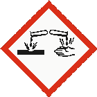
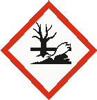

# Sikafloor®-161/264 Part B

> **Documento fuente:** FDS 74 - Sikafloor-161-264 (B) - SIKA.pdf
> **Fabricante:** Sika Colombia S.A.S.
> **Versión / fecha:** N/D (no inferir)
> **Páginas:** 12

## Mapa de secciones FDS

| # | Sección | Página | Estado |
|---|---|---|---|
| 1 | IDENTIFICACION DE LA SUSTANCIA QUIMICA PELIGROSA O MEZCLA Y DEL | 1 | OK |
| 2 | COMPOSICION/INFORMACION SOBRE LOS INGREDIENTES | 3 | OK |
| 3 | IDENTIFICACION DE LOS PELIGROS | 1 | OK |
| 4 | PRIMEROS AUXILIOS | 3 | OK |
| 5 | MEDIDAS CONTRA INCENDIOS | 4 | OK |
| 6 | MEDIDAS QUE DEBEN TOMARSE EN CASO DE DERRAME ACCIDENTAL O FUGA | 4 | OK |
| 7 | MANEJO Y ALMACENAMIENTO | 5 | OK |
| 8 | CONTROLES DE EXPOSICION/PROTECCION PERSONAL | 5 | OK |
| 9 | PROPIEDADES FISICAS Y QUIMICAS | 6 | OK |
| 10 | ESTABILIDAD Y REACTIVIDAD | 7 | OK |
| 11 | INFORMACION TOXICOLOGICA | 7 | OK |
| 12 | INFORMACION ECOTOXICOLOGICA | 9 | OK |
| 13 | INFORMACION RELATIVA A LA ELIMINACION DE LOS PRODUCTOS | 10 | OK |
| 14 | INFORMACION RELATIVA AL TRANSPORTE | 10 | OK |
| 15 | INFORMACION REGLAMENTARIA | 11 | OK |
| 16 | OTRA INFORMACION INCLUIDAS LAS RELATIVAS A LA PREPARACION Y | 11 | OK |

---

### Página 1

HOJA DE DATOS DE SEGURIDAD
Sikafloor®-161/264  Part B
Versión 2.0
Número de HDS: 100000034346
Fecha de revisión: 2023/07/25
1 / 12
## 1. IDENTIFICACION DE LA SUSTANCIA QUIMICA PELIGROSA O MEZCLA Y DEL

PROVEEDOR O FABRICANTE
Nombre del producto
: Sikafloor®-161/264  Part B
Informaciones sobre el fabricante o el proveedor
Compañía
:
Sika Colombia S.A.S.
Vereda Canavita km 20,5 Autopista Norte
Tocancipá, Cundinamarca
Colombia
Teléfono
:
(57-1) 8786333
Teléfono de emergencia
:
CISPROQUIM
Bogotá: 2886012 / 2886355
Resto del país: 01 8000 916012
Dirección de correo electróni-
co
:
controlcalidad.lab@co.sika.com
Fax
:
(57-1) 8786660
Uso recomendado del producto químico y restricciones de uso
Uso del producto
: Revestimiento de epoxi
## 2. IDENTIFICACION DE LOS PELIGROS

Clasificación según SGA (GHS)
Toxicidad aguda (Oral)
:
Categoría 4
Toxicidad aguda (Inhalación)
:
Categoría 4
Corrosión/irritación cutáneas
:
Sub-categoría 1B
Lesiones oculares gra-
ves/irritación ocular
:
Categoría 1
Sensibilización cutánea
:
Categoría 1
Carcinogenicidad
:
Categoría 2
Toxicidad a la reproducción
:
Categoría 2
Peligro a corto plazo (agudo)
para el medio ambiente acuá-
tico
:
Categoría 2
Peligro a largo plazo (crónico)
para el medio ambiente acuá-
tico
:
Categoría 2

*Imagen técnica — documento: FDS 74 - Sikafloor-161-264 (B) - SIKA.pdf.pdf, página 1, sección: 2.*

### Página 2

HOJA DE DATOS DE SEGURIDAD
Sikafloor®-161/264  Part B
Versión 2.0
Número de HDS: 100000034346
Fecha de revisión: 2023/07/25
2 / 12
Etiqueta SGA (GHS)
Pictogramas de peligro
:
Palabra de advertencia
:
Peligro
Indicaciones de peligro
:
H302 + H332 Nocivo en caso de ingestión o si se inhala.
H314 Provoca graves quemaduras en la piel y lesiones ocula-
res.
H317 Puede provocar una reacción cutánea alérgica.
H351 Susceptible de provocar cáncer.
H361fd Susceptible de perjudicar la fertilidad. Susceptible de
dañar al feto.
H411 Tóxico para los organismos acuáticos, con efectos noci-
vos duraderos.
Consejos de prudencia
:
Prevención:
P201 Procurarse las instrucciones antes del uso.
P202 No manipular antes de haber leído y comprendido todas
las precauciones de seguridad.
P261 Evitar respirar nieblas o vapores.
P264 Lavarse la piel cuidadosamente después de la manipula-
ción.
P270 No comer, beber o fumar mientras se manipula este pro-
ducto.
P271 Utilizar sólo al aire libre o en un lugar bien ventilado.
P272 La ropa de trabajo contaminada no debe salir del lugar
de trabajo.
P273 No dispersar en el medio ambiente.
P280 Usar guantes/ ropa de protección/ equipo de protección
para los ojos/ la cara.
Intervención:
P301 + P312 + P330 EN CASO DE INGESTIÓN: Llamar a un
CENTRO DE TOXICOLOGÍA o a un médico si la persona se
encuentra mal. Enjuagarse la boca.
P301 + P330 + P331 EN CASO DE INGESTIÓN: Enjuagar la
boca. NO provocar el vómito.
P303 + P361 + P353 EN CASO DE CONTACTO CON LA PIEL
(o el pelo): Quitar inmediatamente toda la ropa contaminada.
Enjuagar la piel con agua.
P304 + P340 + P310 EN CASO DE INHALACIÓN: Transportar
a la persona al aire libre y mantenerla en una posición que le
facilite la respiración. Llamar inmediatamente a un CENTRO
DE TOXICOLOGÍA/ médico.
P305 + P351 + P338 + P310 EN CASO DE CONTACTO CON
LOS OJOS: Enjuagar con agua cuidadosamente durante varios
minutos. Quitar las lentes de contacto cuando estén presentes
y pueda hacerse con facilidad. Proseguir con el lavado. Llamar
inmediatamente a un CENTRO DE TOXICOLOGÍA o a un mé-
dico.
P308 + P313 EN CASO DE exposición demostrada o supues-
ta: consultar a un médico.
P333 + P313 En caso de irritación cutánea o sarpullido: consul-

*Imagen técnica — documento: FDS 74 - Sikafloor-161-264 (B) - SIKA.pdf.pdf, página 2, sección: indeterminada.*

*Imagen técnica — documento: FDS 74 - Sikafloor-161-264 (B) - SIKA.pdf.pdf, página 2, sección: indeterminada.*

*Imagen técnica — documento: FDS 74 - Sikafloor-161-264 (B) - SIKA.pdf.pdf, página 2, sección: indeterminada.*

*Imagen técnica — documento: FDS 74 - Sikafloor-161-264 (B) - SIKA.pdf.pdf, página 2, sección: indeterminada.*

### Página 3

HOJA DE DATOS DE SEGURIDAD
Sikafloor®-161/264  Part B
Versión 2.0
Número de HDS: 100000034346
Fecha de revisión: 2023/07/25
3 / 12
tar a un médico.
P362 + P364 Quitar la ropa contaminada y lavarla antes de
volverla a usar.
P391 Recoger los vertidos.
Almacenamiento:
P405 Guardar bajo llave.
Eliminación:
P501 Eliminar el contenido/ recipiente en una planta de elimi-
nación de residuos aprobada.
Otros peligros no clasificables
No conocidos.
## 3. COMPOSICION/INFORMACION SOBRE LOS INGREDIENTES

Sustancia / mezcla
:  Mezcla
Componentes
Nombre químico
CAS No.
Concentración (% w/w)
alcohol bencílico
100-51-6
>= 30 -< 50
3-aminometil-3,5,5-trimetilciclohexilamina
2855-13-2
>= 10 -< 20
m-fenilenbis(metilamina)
1477-55-0
>= 10 -< 20
Producto de reacción: bisfenol-A-
(epiclorhidrina); resina epoxídica (peso molecu-
lar medio en número ≤ 700)
25068-38-6
>= 10 -< 20
Nafta disolvente (petróleo), fracción aromática
pesada; queroseno, sin especificar
64742-94-5
>= 5 -< 10
nonilfenol
25154-52-3
>= 3 -< 5
2,4,6-tris(dimetilaminometil)fenol
90-72-2
>= 3 -< 5
naftaleno
91-20-3
>= 0,25 -< 1
## 4. PRIMEROS AUXILIOS

Consejos generales
:
Retire a la persona de la zona peligrosa.
Consulte a un médico.
Muéstrele esta hoja de seguridad al doctor que esté de servi-
cio.
En caso de inhalación
:
Salga al aire libre.
Consultar a un médico después de una exposición importan-
te.
En caso de contacto con la
piel
:
Quítese inmediatamente la ropa y zapatos contaminados.
Elimínelo lavando con jabón y mucha agua.
Es necesario un tratamiento médico inmediato ya que las
corrosiones de la piel no tratadas son heridas difíciles y cica-
trizan lentamente.
En caso de contacto con los
ojos
:
Incluso pequeñas salpicaduras en los ojos pueden causar
daños irreversibles en los tejidos y ceguera.
En caso de contacto con los ojos, lávelos inmediata y abun-
dantemente con agua y acuda a un médico.
Continúe lavando los ojos en el trayecto al hospital.

#### Tabla 1 (página 3, sección 4)

| Nombre químico |  |  | CAS No. |  | Concentración (% w/w) | |
|---|---|---|---|---|---|---|
| alcohol bencílico |  | 100-51-6 |  | >= 30 -< 50 |  | |
| 3-aminometil-3,5,5-trimetilciclohexilamina |  | 2855-13-2 |  | >= 10 -< 20 |  | |
| m-fenilenbis(metilamina) |  | 1477-55-0 |  | >= 10 -< 20 |  | |
| Producto de reacción: bisfenol-A- (epiclorhidrina); resina epoxídica (peso molecu- lar medio en número ≤ 700) |  | 25068-38-6 |  | >= 10 -< 20 |  | |
| Nafta disolvente (petróleo), fracción aromática pesada; queroseno, sin especificar |  | 64742-94-5 |  | >= 5 -< 10 |  | |
| nonilfenol |  | 25154-52-3 |  | >= 3 -< 5 |  | |
| 2,4,6-tris(dimetilaminometil)fenol |  | 90-72-2 |  | >= 3 -< 5 |  | |
| naftaleno |  | 91-20-3 |  | >= 0,25 -< 1 |  | |

### Página 4

HOJA DE DATOS DE SEGURIDAD
Sikafloor®-161/264  Part B
Versión 2.0
Número de HDS: 100000034346
Fecha de revisión: 2023/07/25
4 / 12
Quítese los lentes de contacto.
Manténgase el ojo bien abierto mientras se lava.
En caso de ingestión
:
Lávese la boca con agua y después beba agua abundante.
No provoque vómitos.
No dé leche ni bebidas alcohólicas.
Nunca debe administrarse nada por la boca a una persona
inconsciente.
Lleve al afectado enseguida a un hospital.
Síntomas y efectos más im-
portante, agudos y retarda-
dos
:
Los daños a la salud pueden retardarse.
efectos corrosivos
efectos sensibilizantes
Molestias gastrointestinales
Desordenes respiratorios
Reacciones alérgicas
Dolor de cabeza
Dermatitis
Vea la Sección 11 para obtener información detallada sobre la
salud y los síntomas.
Nocivo en caso de ingestión o si se inhala.
Puede provocar una reacción cutánea alérgica.
Provoca lesiones oculares graves.
Susceptible de provocar cáncer.
Susceptible de perjudicar la fertilidad. Susceptible de dañar al
feto.
Provoca quemaduras graves.
Notas especiales para un
medico tratante
:
Trate sintomáticamente.
## 5. MEDIDAS CONTRA INCENDIOS

Medios de extinción apropia-
dos
:
Use medidas de extinción que sean apropiadas a las circuns-
tancias locales y de sus alrededores.
Peligros específicos durante
la extincion de incendios
:
No permita que la escorrentía posterior al control del incendio
entre a los desagües o cursos de agua.
Productos de combustión
peligrosos
:  No se conocen productos de combustión peligrosos
Métodos específicos de ex-
tinción
:
El agua de la extinción debe recogerse por separado, no debe
penetrar en el alcantarillado.
Los restos del incendio, así como el agua de extinción conta-
minada, deben eliminarse según las normas locales en vigor.
Equipo de protección espe-
cial para los bomberos
:
En caso de incendio, utilice un equipo respiratorio autónomo.
## 6. MEDIDAS QUE DEBEN TOMARSE EN CASO DE DERRAME ACCIDENTAL O FUGA

ACCIDENTAL
Precauciones personales,
equipo de protección y pro-
:
Utilice equipo de protección personal.
Negar el acceso a personas sin protección.

### Página 5

HOJA DE DATOS DE SEGURIDAD
Sikafloor®-161/264  Part B
Versión 2.0
Número de HDS: 100000034346
Fecha de revisión: 2023/07/25
5 / 12
cedimientos de emergencia
Precauciones relativas al
medio ambiente
:
No lo vierta en el agua superficial o el sistema de alcantarilla-
do sanitario.
Si el producto contamina los ríos, lagos o alcantarillados, in-
formar a las autoridades respectivas.
Métodos y materiales de
contención y limpieza
:
Recójalo con un producto absorbente inerte (por ejemplo,
arena, silicagel, aglutinante de ácidos, aglutinante universal,
aserrín).
Guarde en contenedores apropiados y cerrados para su eli-
minación.
## 7. MANEJO Y ALMACENAMIENTO

Sugerencias para la protec-
ción contra incendios y ex-
plosiones
:  Medidas normales preventivas para la protección contra in-
cendios.
Consejos para una manipu-
lación segura
:
Evitar sobrepasar los límites dados de exposición profesional
(ver sección 8).
Evitar todo contacto con los ojos, la piel o la ropa.
Ver sección 8 para el equipo de protección personal.
Las personas que hayan tenido problemas de sensibilisación
de la piel, asma, alergías, enfermedades respiratorias cróni-
cas o recurrentes, no deben ser empleadas en ninguna parte
del proceso en la cual esté utilizada esta preparación.
Fumar, comer y beber debe prohibirse en el área de aplica-
ción.
Provea de suficiente intercambio de aire y/o de extracción en
los lugares de trabajo.
Cuando se manejen productos químicos, siga las medidas
estándar de higiene.
Condiciones para el almace-
namiento seguro
:
Almacénelo en el envase original.
Conserve el envase herméticamente cerrado en un lugar seco
y bien ventilado.
Los contenedores que se abren deben ser cuidadosamente
resellados y mantenerlos en posición vertical para evitar fu-
gas.
Observar las indicaciones de la etiqueta.
Almacenar en conformidad con la reglamentación local.
## 8. CONTROLES DE EXPOSICION/PROTECCION PERSONAL

Componentes con parámetros de control en el área de trabajo
Componentes
CAS No.
Tipo de valor
(Forma de
exposición)
Parámetros de
control / Concen-
tración permisible
Bases
m-fenilenbis(metilamina)
1477-55-0
C
0,018 ppm
ACGIH
naftaleno
91-20-3
TWA
10 ppm
ACGIH
Protección personal
Protección respiratoria
:
Utilice protección respiratoria a menos que exista una venti-

#### Tabla 1 (página 5, sección 8)

| Componentes | CAS No. |  | Tipo de valor |  |  | Parámetros de |  | Bases|
|---|---|---|---|---|---|---|---|---|
|  |  |  | (Forma de |  |  | control / Concen- |  | |
|  |  |  | exposición) |  |  | tración permisible |  | |
| m-fenilenbis(metilamina) | 1477-55-0 | C |  |  | 0,018 ppm |  |  | ACGIH|
| naftaleno | 91-20-3 | TWA |  |  | 10 ppm |  |  | ACGIH|

### Página 6

HOJA DE DATOS DE SEGURIDAD
Sikafloor®-161/264  Part B
Versión 2.0
Número de HDS: 100000034346
Fecha de revisión: 2023/07/25
6 / 12
lación de escape adecuada o que la evaluación de la exposi-
ción indique que el nivel de exposición está dentro de las
pautas recomendadas.
La clase de filtro para el respirador debe ser adecuada para
la concentración máxima prevista del contaminante
(gas/vapor/aerosol/partículas) que puede presentarse al ma-
nejar el producto. Si se excede esta concentración, se debe
utilizar un aparato respiratorio autónomo.
Protección de las manos
:
Guantes químico-resistentes e impermeables que cumplan
con estándares aprobados deben ser utilizados cuando se
manejen productos químicos y la evaluación del riesgo indica
que es necesario.
Protección de los ojos
:
Equipo de protección ocular que cumpla con estándares
aprobados debe ser utilizado cuando la evaluación del riesgo
indica que es necesario.
Protección de la piel y del
cuerpo
:
Elegir la protección para el cuerpo según sus caraterísticas,
la concentración y la cantidad de sustancias peligrosas, y el
lugar específico de trabajo.
Medidas de higiene
:
Manipúlelo con las precauciones de higiene industrial ade-
cuadas, y respete las prácticas de seguridad.
No coma ni beba durante su utilización.
No fume durante su utilización.
Lavarse las manos antes de los descansos y después de
terminar la jornada laboral.
## 9. PROPIEDADES FISICAS Y QUIMICAS

Aspecto
:
líquido
Color
:  amarillo
Olor
:  similar a una amina
Umbral de olor
:  Sin datos disponibles
pH
:
no determinado
Punto de fusión/rango / Punto
de congelación
:
Sin datos disponibles
Punto / intervalo de ebullición
:
Sin datos disponibles
Punto de inflamación
:
> 93,3 °C (93,3 °C)
(Método: copa cerrada)
Tasa de evaporación
:  Sin datos disponibles
Inflamabilidad (sólido, gas)
:
Sin datos disponibles
Límite superior de explosivi-
dad / Límite de inflamabilidad
superior
:
Sin datos disponibles

### Página 7

HOJA DE DATOS DE SEGURIDAD
Sikafloor®-161/264  Part B
Versión 2.0
Número de HDS: 100000034346
Fecha de revisión: 2023/07/25
7 / 12
Límite inferior de explosividad
/ Límite de inflamabilidad infe-
rior
:
Sin datos disponibles
Presión de vapor
:
2 hPa
Densidad relativa de vapor
:
Sin datos disponibles
Densidad
:
aprox. 0,99 g/cm3 (20 °C (20 °C))
Solubilidad
Hidrosolubilidad
:
insoluble
Solubilidad en otros disol-
ventes
:
Sin datos disponibles
Coeficiente de reparto n-
octanol/agua
:
Sin datos disponibles
Temperatura de ignición es-
pontánea
:
Sin datos disponibles
Temperatura de descomposi-
ción
:  Sin datos disponibles
Viscosidad
Viscosidad, dinámica
:
Sin datos disponibles
Viscosidad, cinemática
:
> 20,5 mm2/s ( 40 °C (40 °C))
Propiedades explosivas
:
Sin datos disponibles
Propiedades comburentes
:
Sin datos disponibles
## 10. ESTABILIDAD Y REACTIVIDAD

Reactividad
:  No se conoce ninguna reacción peligrosa bajo condiciones de
uso normal.
Estabilidad química
:  El producto es químicamente estable.
Posibilidad de reacciones
peligrosas
:
Estable bajo las condiciones de almacenamiento recomenda-
das.
Condiciones que deben evi-
tarse
:
Sin datos disponibles
Materiales incompatibles
:  Sin datos disponibles
## 11. INFORMACION TOXICOLOGICA

Toxicidad aguda
Nocivo en caso de ingestión o si se inhala.
Componentes:
alcohol bencílico:
Toxicidad oral aguda
:  DL50 Oral (Rata): 1.620 mg/kg

### Página 8

HOJA DE DATOS DE SEGURIDAD
Sikafloor®-161/264  Part B
Versión 2.0
Número de HDS: 100000034346
Fecha de revisión: 2023/07/25
8 / 12
Toxicidad aguda por inhala-
ción
:  CL50 (Rata): > 4,178 mg/l
Tiempo de exposición: 4 h
Prueba de atmosfera: polvo/niebla
3-aminometil-3,5,5-trimetilciclohexilamina:
Toxicidad oral aguda
:  DL50 Oral (Rata): 1.030 mg/kg
Toxicidad aguda por inhala-
ción
:  CL50 (Rata): > 10 mg/l
Tiempo de exposición: 4 h
Prueba de atmosfera: polvo/niebla
Toxicidad dérmica aguda
:  DL50 (Conejo): > 2.000 - 5.000 mg/kg
m-fenilenbis(metilamina):
Toxicidad oral aguda
:  DL50 Oral (Rata): 930 mg/kg
Toxicidad aguda por inhala-
ción
:  CL50 (Rata): 1,34 mg/l
Tiempo de exposición: 4 h
Prueba de atmosfera: polvo/niebla
Valoración: Corrosivo para el tracto respiratorio.
Toxicidad dérmica aguda
:  LD50 Dermico (Rata): > 3.100 mg/kg
Producto de reacción: bisfenol-A-(epiclorhidrina); resina epoxídica (peso molecular medio
en número ≤ 700):
Toxicidad oral aguda
:  DL50 Oral (Rata): > 5.000 mg/kg
Toxicidad dérmica aguda
:  LD50 Dermico (Conejo): > 20.000 mg/kg
2,4,6-tris(dimetilaminometil)fenol:
Toxicidad oral aguda
:  DL50 Oral (Rata): 2.169 mg/kg
Corrosión o irritación cutáneas
Provoca quemaduras graves.
Componentes:
2,4,6-tris(dimetilaminometil)fenol:
Especies
:
Conejo
Valoración
:
Corrosivo
Método
:
Directrices de prueba OECD 404
Lesiones oculares graves/irritación ocular
Provoca lesiones oculares graves.
Componentes:
2,4,6-tris(dimetilaminometil)fenol:
Especies
:
Conejo
Valoración
:
Provoca lesiones oculares graves.
Sensibilización respiratoria o cutánea
Sensibilización cutánea
Puede provocar una reacción cutánea alérgica.
Sensibilización respiratoria
No clasificado según la información disponible.

### Página 9

HOJA DE DATOS DE SEGURIDAD
Sikafloor®-161/264  Part B
Versión 2.0
Número de HDS: 100000034346
Fecha de revisión: 2023/07/25
9 / 12
Mutagenicidad en células germinales
No clasificado según la información disponible.
Carcinogenicidad
Susceptible de provocar cáncer.
Toxicidad para la reproducción
Susceptible de perjudicar la fertilidad. Susceptible de dañar al feto.
Toxicidad sistémica específica de órganos blanco - exposición única
No clasificado según la información disponible.
Toxicidad sistémica específica de órganos blanco - exposiciones repetidas
No clasificado según la información disponible.
Toxicidad por aspiración
No clasificado según la información disponible.
## 12. INFORMACION ECOTOXICOLOGICA

Ecotoxicidad
Componentes:
alcohol bencílico:
Toxicidad para peces
:  CL50 (Pez): > 100 mg/l
Tiempo de exposición: 96 h
Toxicidad para la dafnia y
otros invertebrados acuáticos
:  CE50 (Daphnia magna (Pulga de mar grande)): > 100 mg/l
Tiempo de exposición: 48 h
3-aminometil-3,5,5-trimetilciclohexilamina:
Toxicidad para las al-
gas/plantas acuáticas
:  ErC50 (Desmodesmus subspicatus (alga verde)): > 10 - 100
mg/l
Tiempo de exposición: 72 h
NOEC (Desmodesmus subspicatus (alga verde)): 1,5 mg/l
Tiempo de exposición: 72 h
m-fenilenbis(metilamina):
Toxicidad para peces
:  CL50 (Oryzias latipes (medaka)): > 10 - 100 mg/l
Tiempo de exposición: 96 h
Toxicidad para la dafnia y
otros invertebrados acuáticos
:  CE50 (Daphnia magna (Pulga de mar grande)): > 10 - 100
mg/l
Tiempo de exposición: 48 h
Producto de reacción: bisfenol-A-(epiclorhidrina); resina epoxídica (peso molecular medio
en número ≤ 700):
Toxicidad para peces
:  CL50 (Oncorhynchus mykiss (trucha irisada)): 2 mg/l
Tiempo de exposición: 96 h
Toxicidad para la dafnia y
otros invertebrados acuáticos
:  CE50 (Daphnia magna (Pulga de mar grande)): 1,8 mg/l
Tiempo de exposición: 48 h
2,4,6-tris(dimetilaminometil)fenol:
Toxicidad para las al-
gas/plantas acuáticas
:  CE50 (Scenedesmus capricornutum (alga dulceacuícola)): >
10 - 100 mg/l
Tiempo de exposición: 72 h

### Página 10

HOJA DE DATOS DE SEGURIDAD
Sikafloor®-161/264  Part B
Versión 2.0
Número de HDS: 100000034346
Fecha de revisión: 2023/07/25
10 / 12
naftaleno:
Factor-M (Toxicidad acuática
aguda)
:
1
Factor-M (Toxicidad acuática
crónica)
:
1
Persistencia y degradabilidad
Sin datos disponibles
Potencial de bioacumulación
Sin datos disponibles
Movilidad en el suelo
Sin datos disponibles
Otros efectos adversos
Producto:
Información ecológica com-
plementaria
:  No se puede excluir un peligro para el medio ambiente en el
caso de una manipulación o eliminación no profesional.
Tóxico para los organismos acuáticos, con efectos nocivos
duraderos.
## 13. INFORMACION RELATIVA A LA ELIMINACION DE LOS PRODUCTOS

Métodos de eliminación
Residuos
:
Envíese a una compañía autorizada para la gestión de resi-
duos.
Evite que el producto penetre en los desagües, tuberías, o la
tierra (suelos).
No contamine los estanques, cursos de agua o zanjas con el
producto químico o el contendor utilizado.
Envases contaminados
:
Vacíe el contenido restante.
Eliminar como producto no usado.
No reutilice los recipientes vacíos.
## 14. INFORMACION RELATIVA AL TRANSPORTE

Regulaciones internacionales
UNRTDG
Número ONU
:
UN 3066
Designación oficial de trans-
porte
:
PAINT RELATED MATERIAL
 (D.E.R. 331 Epoxy Resin)
Clase
:
8
Grupo de embalaje
:
III
Etiquetas
:
8
IATA-DGR
No. UN/ID
:
UN 3066

### Página 11

HOJA DE DATOS DE SEGURIDAD
Sikafloor®-161/264  Part B
Versión 2.0
Número de HDS: 100000034346
Fecha de revisión: 2023/07/25
11 / 12
Designación oficial de trans-
porte
:
Paint related material
 (D.E.R. 331 Epoxy Resin)
Clase
:
8
Grupo de embalaje
:
III
Etiquetas
:
Corrosive
Instrucción de embalaje
(avión de carga)
:
856
Instrucción de embalaje
(avión de pasajeros)
:
852
Código-IMDG
Número ONU
:
UN 3066
Designación oficial de trans-
porte
:
PAINT RELATED MATERIAL
(D.E.R. 331 Epoxy Resin)
Clase
:
8
Grupo de embalaje
:
III
Etiquetas
:
8
Código EmS
:
F-A, S-B
Contaminante marino
:
no
Transporte a granel de acuerdo a instrumentos IMO
No aplicable para el producto tal y como se proveyó.
Precauciones especiales para los usuarios
La(s) clasificación(es) de transporte presente(s) tienen solamente propósitos informativos y se
basa(n) únicamente en las propiedades del material sin envasar/embalar, descritas dentro de es-
ta Hoja de Datos de Seguridad. Las clasificaciones de transporte pueden variar según el modo
de transporte, el tamaño del envase/embalaje y las variaciones en los reglamentos regionales o
del país.
## 15. INFORMACION REGLAMENTARIA

Reglamentación medioambiental, seguridad y salud específica para la sustancia o mezcla
Convención Internacional sobre las Armas Químicas
(CWC) Programas sobre los Productos Químicos Tó-
xicos y los Precursores (Louisiana Administrative Co-
de, Title 33,Part V Section 10101 et. seq.)
:
No aplicable
Reglamentación sobre el control de la importación,
fabricación, venta, distribución, transporte y uso de
sustancias que pueden ser utilizadas para el procesa-
miento de drogas que producen dependencia.
:
No aplicable
Resolución 2715 de 2014 Por la cual se establecen las
sustancias que deben ser objeto de registro de control
de venta al menudeo, con base en los criterios de
clasificación que se definen.
:
No aplicable
## 16. OTRA INFORMACION INCLUIDAS LAS RELATIVAS A LA PREPARACION Y

ACTUALIZACIÓN DE LAS HOJAS DE DATOS DE SEGURIDAD
Fecha de revisión
:  2023/07/25
formato de fecha
:
aaaa/mm/dd
Información adicional

### Página 12

HOJA DE DATOS DE SEGURIDAD
Sikafloor®-161/264  Part B
Versión 2.0
Número de HDS: 100000034346
Fecha de revisión: 2023/07/25
12 / 12
NFPA:
HMIS® IV:
Las clasificaciones HMIS® se basan en
una escala del 0 al 4 en la que 0 significa
riesgos o peligros mínimos y 4 significa
riesgos o peligros serios. El "*" represen-
ta un peligro crónico, mientras que la "/"
representa la ausencia de un peligro
crónico.
Texto completo de otras abreviaturas
ACGIH
:
Valores límite (TLV) de la ACGIH,USA
ACGIH / TWA
:
Tiempo promedio ponderado
ACGIH / C
:
Valor techo (C)
ADR
:
Accord européen relatif au transport international des mar-
chandises Dangereuses par Route
CAS
:
Chemical Abstracts Service
DNEL
:
Derived no-effect level
EC50
:
Half maximal effective concentration
GHS
:
Globally Harmonized System
IATA
:
International Air Transport Association
IMDG
:
International Maritime Code for Dangerous Goods
LD50
:
Median lethal dosis (the amount of a material, given all at
once, which causes the death of 50% (one half) of a group of
test animals)
LC50
:
Median lethal concentration (concentrations of the chemical in
air that kills 50% of the test animals during the observation
period)
MARPOL
:
International Convention for the Prevention of Pollution from
Ships, 1973 as modified by the Protocol of 1978
OEL
:
Occupational Exposure Limit
PBT
:
Persistent, bioaccumulative and toxic
PNEC
:
Predicted no effect concentration
REACH
:
Regulation (EC) No 1907/2006 of the European Parliament
and of the Council of 18 December 2006 concerning the Re-
gistration, Evaluation, Authorisation and Restriction of Chemi-
cals (REACH), establishing a European Chemicals Agency
SVHC
:
Substances of Very High Concern
vPvB
:
Very persistent and very bioaccumulative
La informacion contenida en este ficha de datos de seguridad corresponde a nuestro nivel de
conocimiento en el momento de su publicacion. Quedan excluidas todas las garantias. Se
aplicaran nuestras condiciones generales de venta en vigor. Por favor, consulte la Hoja de
Datos del Producto  antes de su uso y procesamiento.
CO / 1X
Inflamabilidad
Inestabilidad
Salud
3
0
1
Peligro especial
3
0
1
*
RIESGO FÍSICO
INFLAMABILIDAD
SALUD

*Imagen técnica — documento: FDS 74 - Sikafloor-161-264 (B) - SIKA.pdf.pdf, página 12, sección: indeterminada.*

*Imagen técnica — documento: FDS 74 - Sikafloor-161-264 (B) - SIKA.pdf.pdf, página 12, sección: indeterminada.*
