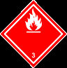

# TOPCOAT 400 1772 NEGRO

> **Documento fuente:** FDS 81 - TOPCOAT 400 1772 NEGRO - INTERNATIONAL - AKSONOBEL.pdf
> **Fabricante:** AKSONOBEL
> **Versión / fecha:** 2-5-2024
> **Páginas:** 15

## Mapa de secciones FDS

| # | Sección | Página | Estado |
|---|---|---|---|
| 1 | IDENTIFICACION | 1 | OK |
| 2 | COMPOSICION/INFORMACION SOBRE LOS COMPONENTES | 3 | OK |
| 3 | IDENTIFICACION DE LOS PELIGROS | 2 | OK |
| 4 | PRIMEROS AUXILIOS | 3 | OK |
| 5 | MEDIDAS DE LUCHA CONTRA INCENDIOS | 5 | OK |
| 6 | MEDIDAS EN CASO DE VERTIDO ACCIDENTAL | 5 | OK |
| 7 | MANIPULACION Y ALMACENAMIENTO | 6 | OK |
| 8 | CONTROLES DE EXPOSICION/PROTECCION INDIVIDUAL | 6 | OK |
| 9 | PROPIEDADES FISICAS Y QUIMICAS Y CARACTERISTICAS DE | 8 | OK |
| 10 | ) Y COMIDA Y BEBIDA. GUARDAR BAJO LLAVE. ELIMINAR TODAS LAS FUENTES DE | 6 | OK |
| 11 | INFORMACION TOXICOLOGICA | 9 | OK |
| 12 | INFORMACION ECOLOGICA | 12 | OK |
| 13 | CONSIDERACIONES RELATIVAS A LA ELIMINACION | 13 | OK |
| 14 | INFORMACION RELATIVA AL TRANSPORTE | 13 | OK |
| 15 | INFORMACION REGLAMENTARIA | 14 | OK |
| 16 | LA INFORMACION ADICIONAL SOBRE MEDIDAS HIGIENICAS. | 6 | OK |

---

### Página 1

Fecha de emisión/Fecha de revisión
Fecha de la emisión anterior
: 2-5-2024
: No hay validación anterior
Versión  : 1
1/15
Todos los demás usos
Usos contraindicados
Uso profesional
Uso industrial
Uso por el consumidor
Usos identificados
FICHA DE DATOS DE SEGURIDAD
TOPCOAT 400 1772 NEGRO
Identificador SGA del
producto
: TOPCOAT 400 1772 NEGRO
SDS code
: 95
Usos pertinentes identificados de la sustancia o de la mezcla y usos desaconsejados
Uso del producto
: Recubrimiento base disolvente para uso interior y exterior.
Datos sobre el proveedor
Compañía Global de Pinturas S.A.S.
Autopista Medellín Bogotá Km 37.
Vía Belén Rionegro Km 1.
054040 Rionegro - Antioquia - Colombia
01 8000 111 247
Medellín 604 325 2523
www.pintuco.com
Dirección de e-mail de la
persona responsable de
esta FDS
: PSRA.southamerica@akzonobel.com
Teléfono de emergencias
(con horas de
funcionamiento)
: CISTEMA SURA Colombia al 018000 51 14 14, fuera de Colombia (0574) 4444578
24 horas
## 1. IDENTIFICACION

*Imagen técnica — documento: FDS 81 - TOPCOAT 400 1772 NEGRO - INTERNATIONAL - AKSONOBEL.pdf.pdf, página 1, sección: 1.*

*Imagen técnica — documento: FDS 81 - TOPCOAT 400 1772 NEGRO - INTERNATIONAL - AKSONOBEL.pdf.pdf, página 1, sección: 1.*

### Página 2

Fecha de emisión/Fecha de revisión
Fecha de la emisión anterior
: 2-5-2024
: No hay validación anterior
Versión  : 1
2/15
Clasificación de la
sustancia o de la mezcla
: LÍQUIDOS INFLAMABLES - Categoría 3
IRRITACIÓN CUTÁNEA - Categoría 2
LESIÓN OCULAR GRAVE - Categoría 1
SENSIBILIZACIÓN RESPIRATORIA - Categoría 1
SENSIBILIZACIÓN CUTÁNEA - Categoría 1
MUTAGENICIDAD EN CÉLULAS GERMINALES - Categoría 1B
CARCINOGENICIDAD - Categoría 1B
TOXICIDAD PARA LA REPRODUCCIÓN - Categoría 1B
TOXICIDAD ESPECÍFICA EN DETERMINADOS ÓRGANOS (STOT) -
EXPOSICIONES REPETIDAS - Categoría 1
PELIGRO ACUÁTICO A CORTO PLAZO (AGUDO) - Categoría 3
Elementos de las etiquetas del SGA
Pictogramas de peligro
:
Palabra de advertencia
: Peligro
Indicaciones de peligro
: H226 - Líquidos y vapores inflamables.
H315 - Provoca irritación cutánea.
H317 - Puede provocar una reacción alérgica en la piel.
H318 - Provoca lesiones oculares graves.
H334 - Puede provocar síntomas de alergia o asma o dificultades respiratorias en
caso de inhalación.
H340 - Puede provocar defectos genéticos.
H350 - Puede provocar cáncer.
H360 - Puede perjudicar la fertilidad o dañar al feto.
H372 - Provoca daños en los órganos tras exposiciones prolongadas o repetidas.
(sistema nervioso central (SNC))
H402 - Nocivo para los organismos acuáticos.
Consejos de prudencia
General
: P102 - Mantener fuera del alcance de los niños.
P101 - Si se necesita consejo médico, tener a mano el envase o la etiqueta.
Prevención
: P201 - Solicitar instrucciones especiales antes del uso.
P280 - Usar guantes de protección, ropa de protección e equipo de protección para
la cara o los ojos.
P284 - Llevar equipo de protección respiratoria.
P210 - Mantener alejado del calor, de superficies calientes, de chispas, de llamas
abiertas y de cualquier otra fuente de ignición. No fumar.
P273 - Evitar su liberación al medio ambiente.
P260 - No respirar los vapores.
P270 - No comer, beber ni fumar durante su utilización.
P264 - Lavarse las manos concienzudamente tras la manipulación.
Respuesta
: P308 + P313 - EN CASO DE exposición manifiesta o presunta: Consultar a un
médico.
P304 + P340 - EN CASO DE INHALACIÓN: Transportar a la persona al aire libre y
mantenerla en una posición que le facilite la respiración.
P342 + P311 - En caso de síntomas respiratorios: Llamar a un CENTRO DE
INFORMACIÓN TOXICOLÓGICA o a un médico.
P362 + P364 - Quitar las prendas contaminadas y lavarlas antes de volver a usarlas.
P302 + P352 - EN CASO DE CONTACTO CON LA PIEL: Lavar con abundante
agua.
P333 + P313 - En caso de irritación o erupción cutánea: Consultar a un médico.
P305 + P351 + P338 + P310 - EN CASO DE CONTACTO CON LOS OJOS: Aclarar
cuidadosamente con agua durante varios minutos. Quitar las lentes de contacto, si
lleva y resulta fácil. Seguir aclarando. Llamar inmediatamente a un CENTRO DE
INFORMACION TOXICOLOGICA o a un médico.
## 2. IDENTIFICACION DE LOS PELIGROS

TOPCOAT 400 1772 NEGRO

*Imagen técnica — documento: FDS 81 - TOPCOAT 400 1772 NEGRO - INTERNATIONAL - AKSONOBEL.pdf.pdf, página 2, sección: 2.*

*Imagen técnica — documento: FDS 81 - TOPCOAT 400 1772 NEGRO - INTERNATIONAL - AKSONOBEL.pdf.pdf, página 2, sección: 2.*

*Imagen técnica — documento: FDS 81 - TOPCOAT 400 1772 NEGRO - INTERNATIONAL - AKSONOBEL.pdf.pdf, página 2, sección: 2.*

*Imagen técnica — documento: FDS 81 - TOPCOAT 400 1772 NEGRO - INTERNATIONAL - AKSONOBEL.pdf.pdf, página 2, sección: 2.*

### Página 3

Fecha de emisión/Fecha de revisión
Fecha de la emisión anterior
: 2-5-2024
: No hay validación anterior
Versión  : 1
3/15
## 4. PRIMEROS AUXILIOS

Almacenamiento
: P405 - Guardar bajo llave.
P403 + P235 - Almacenar en un lugar bien ventilado. Mantener en lugar fresco.
Eliminación
: P501 - Eliminar el contenido / el recipiente en conformidad con las
reglamentaciones locales y nacionales.
Otros peligros que no
conducen a una
clasificación
: No se conoce ninguno.
Sustancia/preparado
: Mezcla
Otros medios de
identificación
: No disponible.
Nombre del ingrediente
Número de CAS
Concentración
disolvente de Stoddard
8052-41-3
≥10 - <25
ácidos grasos, aceite de resina
61790-12-3
≥10 - ≤25
anhídrido ftalico
85-44-9
<10
ligroína
8032-32-4
≤3
bis(2-etilhexanoato) de cobalto
136-52-7
<1
No hay ningún ingrediente adicional presente que, bajo el conocimiento actual del proveedor y en las
concentraciones aplicables, sea clasificado como de riesgo para la salud o el medio ambiente y por lo tanto
deban ser reportados en esta sección.
Los límites de exposición laboral, en caso de existir, figuran en la sección 8.
Descripción de los primeros auxilios necesarios
Contacto con los ojos
Por inhalación
Contacto con la piel
: Obtenga atención médica inmediatamente. Llamar a un centro de información
toxicológica o a un médico. Enjuaguar los ojos inmediatamente con mucha agua,
levantando de vez en cuando los párpados superior e inferior. Verificar si la víctima
lleva lentes de contacto y en este caso, retirárselas. Continúe enjuagando por lo
menos durante 10 minutos. Las quemaduras químicas se deben tratar
inmediatamente por un médico.
: Obtenga atención médica inmediatamente. Llamar a un centro de información
toxicológica o a un médico. Transportar a la víctima al exterior y mantenerla en
reposo en una posición confortable para respirar. Si se sospecha que los vapores
continúan presentes, la persona encargada del rescate deberá usar una máscara
adecuada o un aparato de respiración autónoma. Si no hay respiración, ésta es
irregular u ocurre un paro respiratorio, el personal capacitado debe proporcionar
respiración artificial u oxígeno. Puede ser peligroso para la persona que
proporcione ayuda al dar respiración boca a boca. Si está inconsciente, coloque en
posición de recuperación y consiga atención médica inmediatamente. Asegure una
buena circulación de aire. Aflojar todo lo que pudiera estar apretado, como el cuello
de una camisa, una corbata, un cinturón. En el caso de que existan molestias o
síntomas, evite más exposición.
: Obtenga atención médica inmediatamente. Llamar a un centro de información
toxicológica o a un médico. Lavar con agua y jabón abundantes. Quítese la ropa y
calzado contaminados. Lave bien la ropa contaminada con agua antes de
quitársela, o use guantes. Continúe enjuagando por lo menos durante 10 minutos.
Las quemaduras químicas se deben tratar inmediatamente por un médico. En el
caso de que existan molestias o síntomas, evite más exposición. Lavar la ropa
antes de volver a usarla. Limpiar completamente el calzado antes de volver a
usarlo.
## 2. IDENTIFICACION DE LOS PELIGROS

TOPCOAT 400 1772 NEGRO
## 3. COMPOSICION/INFORMACION SOBRE LOS COMPONENTES

#### Tabla 1 (página 3, sección 3)

| Nombre del ingrediente | Número de CAS | Concentración|
|---|---|---|
| disolvente de Stoddard ácidos grasos, aceite de resina anhídrido ftalico ligroína bis(2-etilhexanoato) de cobalto | 8052-41-3 61790-12-3 85-44-9 8032-32-4 136-52-7 | ≥10 - <25 ≥10 - ≤25 <10 ≤3 <1|

*Imagen técnica — documento: FDS 81 - TOPCOAT 400 1772 NEGRO - INTERNATIONAL - AKSONOBEL.pdf.pdf, página 3, sección: 3.*

*Imagen técnica — documento: FDS 81 - TOPCOAT 400 1772 NEGRO - INTERNATIONAL - AKSONOBEL.pdf.pdf, página 3, sección: 3.*

### Página 4

Fecha de emisión/Fecha de revisión
Fecha de la emisión anterior
: 2-5-2024
: No hay validación anterior
Versión  : 1
4/15
Ingestión
: Obtenga atención médica inmediatamente. Llamar a un centro de información
toxicológica o a un médico. Lave la boca con agua. Retirar las prótesis dentales si
es posible. Si se ha ingerido material y la persona expuesta está consciente,
suminístrele pequeñas cantidades de agua para beber. Deje de proporcionarle
agua si la persona expuesta se encuentra mal ya que los vómitos pueden ser
peligrosos. No inducir al vómito a menos que lo indique expresamente el personal
médico. Si vomita, mantener la cabeza baja de manera que el vómito no entre en
los pulmones. Las quemaduras químicas se deben tratar inmediatamente por un
médico. No suministrar nada por vía oral a una persona inconsciente. Si está
inconsciente, coloque en posición de recuperación y consiga atención médica
inmediatamente. Asegure una buena circulación de aire. Aflojar todo lo que
pudiera estar apretado, como el cuello de una camisa, una corbata, un cinturón.
Síntomas/efectos más importantes, agudos o retardados
Efectos agudos potenciales para la salud
Contacto con los ojos
: Provoca lesiones oculares graves.
Por inhalación
: Puede provocar síntomas de alergia o asma o dificultades respiratorias en caso de
inhalación.
Contacto con la piel
: Provoca irritación cutánea. Puede provocar una reacción alérgica en la piel.
Ingestión
: No se conocen efectos significativos o riesgos críticos.
Signos/síntomas de sobreexposición
Contacto con los ojos
: Los síntomas adversos pueden incluir los siguientes:
dolor
lagrimeo
rojez
Por inhalación
Contacto con la piel
Ingestión
: Los síntomas adversos pueden incluir los siguientes:
Jadeos y dificultades para respirar
asma
reducción de peso fetal
incremento de muertes fetales
malformaciones esqueléticas
: Los síntomas adversos pueden incluir los siguientes:
dolor o irritación
rojez
puede provocar la formación de ampollas
reducción de peso fetal
incremento de muertes fetales
malformaciones esqueléticas
: Los síntomas adversos pueden incluir los siguientes:
dolores gástricos
reducción de peso fetal
incremento de muertes fetales
malformaciones esqueléticas
Indicación de la necesidad de recibir atención médica inmediata y, en su caso, de tratamiento especial
Notas para el médico
: Tratar sintomáticamente. Contactar un especialista en tratamientos de
envenenamientos inmediatamente si se ha ingerido o inhalado una gran cantidad.
Tratamientos específicos
: No hay un tratamiento específico.
Protección del personal de
primeros auxilios
: No se debe realizar ninguna acción que suponga un riesgo personal o sin formación
adecuada. Si se sospecha que los vapores continúan presentes, la persona
encargada del rescate deberá usar una máscara adecuada o un aparato de
respiración autónoma. Puede ser peligroso para la persona que proporcione ayuda
al dar respiración boca a boca. Lave bien la ropa contaminada con agua antes de
quitársela, o use guantes.
Vea la sección 11 para la Información Toxicológica
## 4. PRIMEROS AUXILIOS

TOPCOAT 400 1772 NEGRO

### Página 5

Fecha de emisión/Fecha de revisión
Fecha de la emisión anterior
: 2-5-2024
: No hay validación anterior
Versión  : 1
5/15
Medios de extinción
Medios de extinción
apropiados
Medios de extinción no
apropiados
: Utilizar polvos químicos secos, CO₂, agua pulverizada (niebla de agua) o espuma.
: No usar chorro de agua.
Peligros específicos del
producto químico
Productos de
descomposición térmica
peligrosos
: Líquidos y vapores inflamables. Los residuos líquidos que se filtran en el
alcantarillado pueden causar un riesgo de incendio o de explosión. La presión
puede aumentar y el contenedor puede explotar en caso de calentamiento o
incendio, con el riesgo de producirse una explosión. Este material es nocivo para la
vida acuática. Se debe impedir que el agua de extinción de incendios contaminada
con este material entre en vías de agua, drenajes o alcantarillados.
: Los productos de descomposición pueden incluir los siguientes materiales:
dióxido de carbono
monóxido de carbono
compuestos halogenados
óxido/óxidos metálico/metálicos
Medidas especiales que
deben tomar los equipos de
lucha contra incendios
Equipo de protección
especial para el personal de
lucha contra incendios
: En caso de incendio, aislar rápidamente la zona, evacuando a todas las personas
de las proximidades del lugar del incidente. No se debe realizar ninguna acción que
suponga un riesgo personal o sin formación adecuada. Desplazar los contenedores
lejos del incendio si puede hacerse sin peligro. Use agua pulverizada para
refrigerar los envases expuestos al fuego.
: Los bomberos deben llevar equipo de protección apropiado y un equipo de
respiración autónomo con una máscara facial completa que opere en modo de
presión positiva.
Precauciones personales, equipo de protección y procedimientos de emergencia
Para el personal que no
forma parte de los
servicios de emergencia
Para el personal de
emergencia
: No se debe realizar ninguna acción que suponga un riesgo personal o sin formación
adecuada. Evacuar los alrededores. No deje que entre el personal innecesario y
sin protección. No toque o camine sobre el material derramado. Apagar todas las
fuentes de ignición. Ni bengalas, ni humo, ni llamas en en el área de riesgo. No
respire los vapores o nieblas. Proporcione ventilación adecuada. Llevar un aparato
de respiración apropiado cuando el sistema de ventilación sea inadecuado. Llevar
puesto un equipo de protección individual adecuado.
: Si se necesitan prendas especiales para gestionar el vertido, tomar en cuenta las
informaciones recogidas en la Sección 8 en relación a los materiales adecuados y
no adecuados. Consultar también la información mencionada en “Para el personal
que no forma parte de los servicios de emergencia”.
Precauciones relativas al
medio ambiente
: Evitar la dispersión del material derramado, su contacto con el suelo, las vias
fluviales, las tuberías de desagüe y las alcantarillas. Informar a las autoridades
pertinentes si el producto ha causado contaminación medioambiental (alcantarillas,
vias fluviales, suelo o aire). Material contaminante del agua. Puede ser dañino
para el medio ambiente si es liberado en cantidades grandes.
Métodos y material de contención y de limpieza
Derrame pequeño
: Detener la fuga si esto no presenta ningún riesgo. Retire los envases del área del
derrame. Use herramientas a prueba de chispas y equipo a prueba de explosión.
Diluir con agua y fregar si es soluble en agua. Alternativamente, o si es insoluble
en agua, absorber con un material seco inerte y colocar en un contenedor de
residuos adecuado. Elimine por medio de un contratista autorizado para la
eliminación.
## 5. MEDIDAS DE LUCHA CONTRA INCENDIOS

TOPCOAT 400 1772 NEGRO
## 6. MEDIDAS EN CASO DE VERTIDO ACCIDENTAL

### Página 6

Fecha de emisión/Fecha de revisión
Fecha de la emisión anterior
: 2-5-2024
: No hay validación anterior
Versión  : 1
6/15
Gran derrame
: Detener la fuga si esto no presenta ningún riesgo. Retire los envases del área del
derrame. Use herramientas a prueba de chispas y equipo a prueba de explosión.
Aproximarse al vertido en el sentido del viento. Evite que se introduzca en
alcantarillas, canales de agua, sótanos o áreas reducidas. Lave los vertidos hacia
una planta de tratamiento de efluentes o proceda como se indica a continuación.
Detener y recoger los derrames con materiales absorbentes no combustibles, como
arena, tierra, vermiculita o tierra de diatomeas, y colocar el material en un envase
para desecharlo de acuerdo con las normativas locales (ver Sección 13). Elimine
por medio de un contratista autorizado para la eliminación. El material absorbente
contaminado puede presentar el mismo riesgo que el producto derramado. Nota:
Ver la Sección 1 para información sobre los contactos de emergencia y la Sección
13 para la eliminación de los residuos.
Precauciones para una manipulación segura
Medidas de protección
Información relativa a
higiene en el trabajo de
forma general
Condiciones de
almacenamiento seguro,
incluidas posibles
incompatibilidades
: Usar un equipo de proteccion personal adecuado (Consultar Sección 8). Personas
con un historial de problemas de sensibilización de la piel o asma, alergias o
enfermedades respiratorias crónicas o recurrentes no deberían ser empleadas en
cualquier proceso en el cual este producto es utilizado. Evítese la exposición -
recábense instrucciones especiales antes del uso. Evite la exposición durante el
embarazo. No manipular la sustancia antes de haber leído y comprendido todas las
instrucciones de seguridad. No introducir en ojos en la piel o en la ropa. No respire
los vapores o nieblas. No ingerir. Evitar su liberación al medio ambiente. Use sólo
con ventilación adecuada. Llevar un aparato de respiración apropiado cuando el
sistema de ventilación sea inadecuado. No entre en áreas de almacenamiento y
espacios cerrados a menos que estén ventilados adecuadamente. Consérvese en
su envase original o en uno alternativo aprobado fabricado en un material
compatible, manteniéndose bien cerrado cuando no esté en uso. Mantener alejado
del calor, chispas, llamas al descubierto, o de cualquier otra fuente de ignición. Use
equipo eléctrico (de ventilación, iluminación y manipulación de materiales) a prueba
de explosiones. Utilizar únicamente herramientas que no produzcan chispas. Tomar
medidas de precaución contra la acumulación de cargas electrostáticas. Los
envases vacíos retienen resíduos del producto y pueden ser peligrosos. No vuelva
a usar el envase.
: Deberá prohibirse comer, beber o fumar en los lugares donde se manipula,
almacena o trata este producto. Los trabajadores deberan lavarse las manos y la
cara antes de comer, beber o fumar. Retirar el equipo de protección y las ropas
contaminadas antes de acceder a zonas donde se coma. Consultar también en la
## 8. LA INFORMACION ADICIONAL SOBRE MEDIDAS HIGIENICAS.

: Almacenar conforme a las normativas locales. Almacenar en un área separada y
homologada. Almacenar en el contenedor original protegido de la luz directa del sol
en un área seca, fresca y bien ventilada, separado de materiales incompatibles (ver
## 10. ) Y COMIDA Y BEBIDA. GUARDAR BAJO LLAVE. ELIMINAR TODAS LAS FUENTES DE

ignición. Manténgase alejado de los materiales oxidantes. Mantener el contenedor
bien cerrado y sellado hasta el momento de usarlo. Los envases abiertos deben
cerrarse perfectamente con cuidado y mantenerse en posición vertical para evitar
derrames. No almacenar en contenedores sin etiquetar. Utilícese un envase de
seguridad adecuado para evitar la contaminación del medio ambiente. Antes de
manipularlo o utilizarlo vea en la sección 10 los materiales incompatibles.
Parámetros de control
Límites de exposición profesional
## 6. MEDIDAS EN CASO DE VERTIDO ACCIDENTAL

TOPCOAT 400 1772 NEGRO
## 7. MANIPULACION Y ALMACENAMIENTO

## 8. CONTROLES DE EXPOSICION/PROTECCION INDIVIDUAL

### Página 7

Fecha de emisión/Fecha de revisión
Fecha de la emisión anterior
: 2-5-2024
: No hay validación anterior
Versión  : 1
7/15
TOPCOAT 400 1772 NEGRO
## 8. CONTROLES DE EXPOSICION/PROTECCION INDIVIDUAL

Nombre del ingrediente
Límites de exposición
disolvente de Stoddard
ácidos grasos, aceite de resina
anhídrido ftalico
ligroína
bis(2-etilhexanoato) de cobalto
ACGIH TLV (Estados Unidos, 1/2022).
TWA: 525 mg/m³ 8 horas.
TWA: 100 ppm 8 horas.
ACGIH TLV (Estados Unidos).
TWA: 5 mg/m³ 8 horas.
STEL: 10 mg/m³ 15 minutos.
ACGIH TLV (Estados Unidos, 1/2022).
Absorbido a través de la piel.
Sensibilizante por contacto con la piel.
Sensibilizante si se inhala.
TWA: 0.002 mg/m³ 8 horas. Forma:
Inhalable fraction and vapor
STEL: 0.005 mg/m³ 15 minutos. Forma:
Inhalable fraction and vapor
ACGIH TLV (Estados Unidos).
TWA: 300 ppm 8 horas.
ACGIH TLV (Estados Unidos, 1/2022).
[cobalt and inorganic compounds]
Sensibilizante por contacto con la piel.
Sensibilizante si se inhala.
TWA: 0.02 mg/m³, (as Co) 8 horas.
Controles técnicos
apropiados
Controles de exposición
medioambiental
: Use sólo con ventilación adecuada. Utilizar aislamientos de áreas de producción,
sistemas de ventilación locales, u otros procedimientos de ingeniería para mantener
la exposición del obrero a los contaminantes aerotransportados por debajo de todos
los límites recomendados o estatutarios. Los controles de ingeniería también
deben mantener el gas, vapor o polvo por debajo del menor límite de explosión.
Utilizar equipo de ventilación anti-explosión.
: Se deben verificar las emisiones de los equipos de ventilación o de los procesos de
trabajo para verificar que cumplen con los requisitos de la legislación de protección
del medio ambiente. En algunos casos para reducir las emisiones hasta un nivel
aceptable, será necesario usar depuradores de humo, filtros o modificar el diseño
del equipo del proceso.
Medidas de protección individual
Medidas higiénicas
: Lave las manos, antebrazos y cara completamente después de manejar productos
químicos, antes de comer, fumar y usar el lavabo y al final del período de trabajo.
Usar las técnicas apropiadas para eliminar ropa contaminada. Las prendas de
trabajo contaminadas no podrán sacarse del lugar de trabajo. Lavar las ropas
contaminadas antes de volver a usarlas. Verifique que las estaciones de lavado de
ojos y duchas de seguridad se encuentren cerca de las estaciones de trabajo.
Protección de los ojos/la
cara
Protección de la piel
Protección de las manos
: Se debe usar un equipo protector ocular que cumpla con las normas aprobadas
cuando una evaluación del riesgo indique que es necesario, a fin de evitar toda
exposición a salpicaduras del líquido, lloviznas, gases o polvos. Si es posible el
contacto, se debe utilizar la siguiente protección, salvo que la valoración indique un
grado de protección más alto: gafas contra salpicaduras químicas y/o pantalla
facial. Si existe riesgo de inhalación, puede ser necesario utilizar en su lugar un
respirador con careta completa.
: Si una evaluación del riesgo indica que es necesario, se deben usar guantes
químico-resistentes e impenetrables que cumplan con las normas aprobadas
siempre que se manejen productos químicos. Tomando en consideración los
parámetros especificados por el fabricante de los guantes, comprobar durante el
uso que los guantes siguen conservando sus propiedades protectoras. Hay que
observar que el tiempo de paso de cualquier material utilizado con guantes puede
ser diferente para distintos fabricantes de guantes. En el caso de mezclas,
consistentes en varias sustancias, no es posible estimar de manera exacta, el

#### Tabla 1 (página 7, sección 8)

| TOPCOAT 400 1772 NEGRO |  | |
|---|---|---|
| Sección 8. Controles de exposición/protección individual |  | |
|  | Nombre del ingrediente | Límites de exposición|
|  | disolvente de Stoddard ácidos grasos, aceite de resina anhídrido ftalico ligroína bis(2-etilhexanoato) de cobalto | ACGIH TLV (Estados Unidos, 1/2022). TWA: 525 mg/m³ 8 horas. TWA: 100 ppm 8 horas. ACGIH TLV (Estados Unidos). TWA: 5 mg/m³ 8 horas. STEL: 10 mg/m³ 15 minutos. ACGIH TLV (Estados Unidos, 1/2022). Absorbido a través de la piel. Sensibilizante por contacto con la piel. Sensibilizante si se inhala. TWA: 0.002 mg/m³ 8 horas. Forma: Inhalable fraction and vapor STEL: 0.005 mg/m³ 15 minutos. Forma: Inhalable fraction and vapor ACGIH TLV (Estados Unidos). TWA: 300 ppm 8 horas. ACGIH TLV (Estados Unidos, 1/2022). [cobalt and inorganic compounds] Sensibilizante por contacto con la piel. Sensibilizante si se inhala. TWA: 0.02 mg/m³, (as Co) 8 horas.|

### Página 8

Fecha de emisión/Fecha de revisión
Fecha de la emisión anterior
: 2-5-2024
: No hay validación anterior
Versión  : 1
8/15
Protección corporal
tiempo de protección que ofrecen los guantes.
: Antes de utilizar este producto se debe seleccionar equipo protector personal para
el cuerpo basándose en la tarea a ejecutar y los riesgos involucrados y debe ser
aprobado por un especialista. Cuando haya riesgo de ignición a consecuencia de
cargas electrostáticas, utilizar indumentaria de protección antiestática. Para ofrecer
la máxima protección frente a descargas electrostáticas, la indumentaria debe
incluir monos, botas y guantes con propiedades antiestáticas.
Otro tipo de protección
cutánea
: Se deben elegir el calzado adecuado y cualquier otra medida de protección cutánea
necesaria dependiendo de la tarea que se lleve a cabo y de los riesgos implicados.
Tales medidas deben ser aprobadas por un especialista antes de proceder a la
manipulación de este producto.
Protección respiratoria
: Basándose en la evaluación de los riesgos y la exposición, seleccionar un
respirador que satisfaga los estándares o certificaciones apropiados. Los
respiradores deben usarse de conformidad con un programa de protección
respiratoria para asegurar su adecuación, formación y otros aspectos del buen uso.
Llevar un respirador conforme a la norma EN140 con filtro de tipo A/P2 o mejor.
El lijado en seco, el cortado con llama y/o el soldado de películas secas de pintura
producirá polvo y/o humos nocivos. Un lijado o matizado húmedos son preferibles si
es posible. Si no puede evitarse la exposición por la ventilación de extracción debe
usarse adecuado equipo de protección respiratoria.
Las condiciones de medición de todas las propiedades son a temperatura y presión estándar a menos que se indique
lo contrario.
Aspecto
Estado físico
Color
Olor
Umbral olfativo
pH
Punto de fusión/punto de
congelación
: Líquido.
: Negro.
: Característico.
: No disponible.
: No disponible.
: No disponible.
Punto de ebullición, punto
de ebullición inicial e
intervalo de ebullición
: 146°C (294.8°F)
Punto de inflamación
: Vaso cerrado: 56°C (132.8°F)
Tasa de evaporación
: No disponible.
Inflamabilidad
: No disponible.
Límite superior e inferior de
explosividad
Presión de vapor
Densidad de vapor relativa
: Intervalo más amplio conocido: Punto mínimo: 0.6% Punto maximo: 8% (disolvente
de Stoddard)
:
Nombre del ingrediente
Presión de vapor a 20 ºC
mm Hg
kPa
Método
ligroína
2 a 20
0.27 a 2.7
nafta disolvente (petróleo),
fracción alifática intermedia
1.5 a 4.5
0.2 a 0.6
nafta disolvente (petróleo),
fracción alifática intermedia
1.5 a 4.5
0.2 a 0.6
: No disponible.
Densidad
: 0.916 g/cm³
Solubilidad(es)
:
## 8. CONTROLES DE EXPOSICION/PROTECCION INDIVIDUAL

TOPCOAT 400 1772 NEGRO
## 9. PROPIEDADES FISICAS Y QUIMICAS Y CARACTERISTICAS DE

seguridad

#### Tabla 1 (página 8, sección 9)

| Nombre del ingrediente | Presión de vapor a 20 ºC |  | |
|---|---|---|---|
|  | mm Hg | kPa | Método|
| ligroína nafta disolvente (petróleo), fracción alifática intermedia nafta disolvente (petróleo), fracción alifática intermedia | 2 a 20 1.5 a 4.5 1.5 a 4.5 | 0.27 a 2.7 0.2 a 0.6 0.2 a 0.6 | |

*Imagen técnica — documento: FDS 81 - TOPCOAT 400 1772 NEGRO - INTERNATIONAL - AKSONOBEL.pdf.pdf, página 8, sección: 9.*

### Página 9

Fecha de emisión/Fecha de revisión
Fecha de la emisión anterior
: 2-5-2024
: No hay validación anterior
Versión  : 1
9/15
## 10. ESTABILIDAD Y REACTIVIDAD

TOPCOAT 400 1772 NEGRO
## 9. PROPIEDADES FISICAS Y QUIMICAS Y CARACTERISTICAS DE

seguridad
Soporte
Resultado
agua fría
No soluble [OECD (TG 105)]
Coeficiente de reparto: n-
octanol/agua
Temperatura de auto-
inflamación
: No aplicable.
:
Nombre del ingrediente
°C
°F
disolvente de Stoddard
230 a 240
446 a 464
nafta disolvente (petróleo), fracción alifática
>220
>428
intermedia
nafta disolvente (petróleo), fracción alifática
>220
>428
intermedia
Temperatura de
descomposición
: No disponible.
Viscosidad
: Cinemática (temperatura ambiente): 1249 mm2/s (1249 cSt)
Cinemática (40°C (104°F)): 201 mm2/s (201 cSt)
Características de las partículas
Tamaño de partícula medio
: No aplicable.
Porcentaje de partículas
: 0
con diámetro aerodinámico
≤ 10 μm
Reactividad
: No hay datos de ensayo disponibles sobre la reactividad de este producto o sus
componentes.
Estabilidad química
: El producto es estable.
Posibilidad de reacciones
peligrosas
: En condiciones normales de almacenamiento y uso, no se producen reacciones
peligrosas.
Condiciones que deben
evitarse
: Evitar todas las fuentes posibles de ignición (chispa o llama). No someta a presión,
corte, suelde, suelde con latón, taladre, esmerile o exponga los envases al calor o
fuentes térmicas.
Materiales incompatibles
: Reactivo o incompatible con los siguientes materiales:
materiales oxidantes
Productos de
descomposición peligrosos
: En condiciones normales de almacenamiento y uso, no se deberían formar
productos de descomposición peligrosos.
Información sobre los efectos toxicológicos
Toxicidad aguda
## 11. INFORMACION TOXICOLOGICA

#### Tabla 1 (página 9, sección 11)

| TOPCOAT 400 1772 NEGRO |  | |
|---|---|---|
| Sección 9. Propiedades físicas y químicas y características de seguridad |  | |
|  | Soporte | Resultado|
|  | agua fría | No soluble [OECD (TG 105)]|

#### Tabla 2 (página 9, sección 11)

| Nombre del ingrediente | °C | °F | |
|---|---|---|---|
| disolvente de Stoddard nafta disolvente (petróleo), fracción alifática intermedia nafta disolvente (petróleo), fracción alifática intermedia | 230 a 240 >220 >220 | 446 a 464 >428 >428 | |

### Página 10

Fecha de emisión/Fecha de revisión
Fecha de la emisión anterior
: 2-5-2024
: No hay validación anterior
Versión  : 1
10/15
TOPCOAT 400 1772 NEGRO
## 11. INFORMACION TOXICOLOGICA

Nombre del producto o
Resultado
Especies
Dosis
Exposición
ingrediente
ácidos grasos, aceite de
DL50 Oral
Rata
>10000 mg/kg
-
resina
anhídrido ftalico
DL50 Intraperitoneal
Cobaya
100 mg/kg
-
DL50 Oral
Ratón
1500 mg/kg
-
DL50 Oral
Rata
1530 mg/kg
-
DL50 Rectal
Ratón
400 mg/kg
-
ligroína
CL50 Por inhalación Gas.
Rata
3400 ppm
4 horas
DL50 Intravenosa
Ratón
40 mg/kg
-
bis(2-etilhexanoato) de
DL50 Cutánea
Conejo
>5 g/kg
-
cobalto
DL50 Oral
Rata
1.22 g/kg
-
butanona-oxima
DL50 Cutánea
Conejo
200 uL/kg
-
DL50 Intraperitoneal
Ratón
200 mg/kg
-
DL50 Oral
Ratón
1 g/kg
-
DL50 Oral
Rata
930 mg/kg
-
DL50 Subcutánea
Ratón
2700 mg/kg
-
DL50 Subcutánea
Rata
2702 mg/kg
-
Irritación/Corrosión
Nombre del producto o
ingrediente
Resultado
Especies
Puntuación Exposición
Observación
disolvente de Stoddard
anhídrido ftalico
butanona-oxima
Ojos - Irritante moderado
Ojos - Irritante moderado
Ojos - Muy irritante
Conejo
Conejo
Conejo
-
-
-
24 horas 500
mg
24 horas 50
mg
100 Ul
-
-
-
Sensibilización
No disponible.
Mutagénesis
No disponible.
Carcinogenicidad
No disponible.
Clasificación
Nombre del producto o ingrediente
IARC
bis(2-etilhexanoato) de cobalto
2B
Toxicidad para la reproducción
No disponible.
Teratogenicidad
No disponible.
Toxicidad específica en determinados órganos (STOT) – exposición única
Nombre
Categoría
Vía de
exposición
Órganos destino
anhídrido ftalico
butanona-oxima
Categoría 3
Categoría 1
Categoría 3
-
-
Irritación de las
vías respiratorias
tracto respiratorio
superior
Efectos narcóticos
Toxicidad específica en determinados órganos (STOT) – exposición repetida

#### Tabla 1 (página 10, sección 11)

| TOPCOAT 400 1772 NEGRO |  |  |  |  | |
|---|---|---|---|---|---|
| Sección 11. Información toxicológica |  |  |  |  | |
|  | Nombre del producto o ingrediente | Resultado | Especies | Dosis | Exposición|
|  | ácidos grasos, aceite de resina anhídrido ftalico ligroína bis(2-etilhexanoato) de cobalto butanona-oxima | DL50 Oral DL50 Intraperitoneal DL50 Oral DL50 Oral DL50 Rectal CL50 Por inhalación Gas. DL50 Intravenosa DL50 Cutánea DL50 Oral DL50 Cutánea DL50 Intraperitoneal DL50 Oral DL50 Oral DL50 Subcutánea DL50 Subcutánea | Rata Cobaya Ratón Rata Ratón Rata Ratón Conejo Rata Conejo Ratón Ratón Rata Ratón Rata | >10000 mg/kg 100 mg/kg 1500 mg/kg 1530 mg/kg 400 mg/kg 3400 ppm 40 mg/kg >5 g/kg 1.22 g/kg 200 uL/kg 200 mg/kg 1 g/kg 930 mg/kg 2700 mg/kg 2702 mg/kg | - - - - - 4 horas - - - - - - - - -|

#### Tabla 2 (página 10, sección 11)

| Nombre del producto o ingrediente | Resultado | Especies | Puntuación | Exposición | Observación|
|---|---|---|---|---|---|
| disolvente de Stoddard anhídrido ftalico butanona-oxima | Ojos - Irritante moderado Ojos - Irritante moderado Ojos - Muy irritante | Conejo Conejo Conejo | - - - | 24 horas 500 mg 24 horas 50 mg 100 Ul | - - -|

#### Tabla 3 (página 10, sección 11)

| Nombre del producto o ingrediente | IARC|
|---|---|
| bis(2-etilhexanoato) de cobalto | 2B|

#### Tabla 4 (página 10, sección 11)

| Nombre | Categoría | Vía de exposición | Órganos destino|
|---|---|---|---|
| anhídrido ftalico butanona-oxima | Categoría 3 Categoría 1 Categoría 3 | - - | Irritación de las vías respiratorias tracto respiratorio superior Efectos narcóticos|

### Página 11

Fecha de emisión/Fecha de revisión
Fecha de la emisión anterior
: 2-5-2024
: No hay validación anterior
Versión  : 1
11/15
TOPCOAT 400 1772 NEGRO
## 11. INFORMACION TOXICOLOGICA

Nombre
Categoría
Vía de
Órganos destino
exposición
disolvente de Stoddard
nafta disolvente (petróleo), fracción alifática intermedia
butanona-oxima
Categoría 1
Categoría 1
Categoría 2
inhalación
-
-
sistema nervioso
central (SNC)
sistema nervioso
central (SNC)
sistema sanguíneo
Peligro de aspiración
Nombre
Resultado
disolvente de Stoddard
PELIGRO POR ASPIRACIÓN - Categoría 1
nafta disolvente (petróleo), fracción alifática intermedia
PELIGRO POR ASPIRACIÓN - Categoría 1
nafta disolvente (petróleo), fracción alifática intermedia
PELIGRO POR ASPIRACIÓN - Categoría 1
ligroína
PELIGRO POR ASPIRACIÓN - Categoría 1
Información sobre posibles
vías de exposición
: No disponible.
Efectos agudos potenciales para la salud
Contacto con los ojos
: Provoca lesiones oculares graves.
Por inhalación
: Puede provocar síntomas de alergia o asma o dificultades respiratorias en caso de
inhalación.
Contacto con la piel
: Provoca irritación cutánea. Puede provocar una reacción alérgica en la piel.
Ingestión
: No se conocen efectos significativos o riesgos críticos.
Síntomas relacionados con las características físicas, químicas y toxicológicas
Contacto con los ojos
: Los síntomas adversos pueden incluir los siguientes:
dolor
lagrimeo
rojez
Por inhalación
Contacto con la piel
Ingestión
: Los síntomas adversos pueden incluir los siguientes:
Jadeos y dificultades para respirar
asma
reducción de peso fetal
incremento de muertes fetales
malformaciones esqueléticas
: Los síntomas adversos pueden incluir los siguientes:
dolor o irritación
rojez
puede provocar la formación de ampollas
reducción de peso fetal
incremento de muertes fetales
malformaciones esqueléticas
: Los síntomas adversos pueden incluir los siguientes:
dolores gástricos
reducción de peso fetal
incremento de muertes fetales
malformaciones esqueléticas
Efectos retardados e inmediatos, así como efectos crónicos producidos por una exposición a corto y largo
plazo
Exposición a corto plazo
Posibles efectos
inmediatos
Posibles efectos
retardados
: No disponible.
: No disponible.

#### Tabla 1 (página 11, sección 11)

| TOPCOAT 400 1772 NEGRO |  |  |  | |
|---|---|---|---|---|
| Sección 11. Información toxicológica |  |  |  | |
|  | Nombre | Categoría | Vía de exposición | Órganos destino|
|  | disolvente de Stoddard nafta disolvente (petróleo), fracción alifática intermedia butanona-oxima | Categoría 1 Categoría 1 Categoría 2 | inhalación - - | sistema nervioso central (SNC) sistema nervioso central (SNC) sistema sanguíneo|

#### Tabla 2 (página 11, sección 11)

| Nombre | Resultado|
|---|---|
| disolvente de Stoddard nafta disolvente (petróleo), fracción alifática intermedia nafta disolvente (petróleo), fracción alifática intermedia ligroína | PELIGRO POR ASPIRACIÓN - Categoría 1 PELIGRO POR ASPIRACIÓN - Categoría 1 PELIGRO POR ASPIRACIÓN - Categoría 1 PELIGRO POR ASPIRACIÓN - Categoría 1|

### Página 12

Fecha de emisión/Fecha de revisión
Fecha de la emisión anterior
: 2-5-2024
: No hay validación anterior
Versión  : 1
12/15
## 12. INFORMACION ECOLOGICA

Exposición a largo plazo
Posibles efectos
inmediatos
Posibles efectos
retardados
: No disponible.
: No disponible.
Efectos crónicos potenciales para la salud
No disponible.
General
:
Carcinogenicidad
:
Mutagénesis
:
Provoca daños en los órganos tras exposiciones prolongadas o repetidas. Una vez
producida la sensibilización, podría observarse una reacción alérgica grave al
exponerse posteriormente a niveles muy bajos.
Puede provocar cáncer. El riesgo de cáncer depende de la duración y el grado de
exposición.
Puede provocar defectos genéticos.
Toxicidad para la
reproducción
: Puede perjudicar la fertilidad o dañar al feto.
Medidas numéricas de toxicidad
Estimaciones de toxicidad aguda
Nombre del producto o ingrediente
Oral (mg/
kg)
Cutánea
(mg/kg)
Inhalación
(gases)
(ppm)
Inhalación
(vapores)
(mg/l)
Inhalación
(polvos y
nieblas)
(mg/l)
Producto tal y como suministrado
nafta disolvente (petróleo), fracción alifática
intermedia
anhídrido ftalico
butanona-oxima
5067
N/A
500
100
8900.6
1100
N/A
1100
N/A
N/A
N/A
N/A
89
11
N/A
N/A
N/A
N/A
N/A
N/A
Toxicidad
Nombre del producto o
ingrediente
Resultado
Especies
Exposición
anhídrido ftalico
butanona-oxima
Agudo EC50 4140 µg/l Agua fresca
Agudo EC50 78530 µg/l Agua fresca
Agudo EC50 147 µg/l Agua fresca
Agudo CL50 843000 µg/l Agua fresca
Algas - Pseudokirchneriella
subcapitata
Algas - Pseudokirchneriella
subcapitata
Algas - Pseudokirchneriella
subcapitata
Pescado - Pimephales promelas
96 horas
96 horas
96 horas
96 horas
Persistencia/degradabilidad
No disponible.
Potencial de bioacumulación
## 11. INFORMACION TOXICOLOGICA

TOPCOAT 400 1772 NEGRO

#### Tabla 1 (página 12, sección 11)

| Nombre del producto o ingrediente | Oral (mg/ kg) | Cutánea (mg/kg) | Inhalación (gases) (ppm) | Inhalación (vapores) (mg/l) | Inhalación (polvos y nieblas) (mg/l)|
|---|---|---|---|---|---|
| Producto tal y como suministrado nafta disolvente (petróleo), fracción alifática intermedia anhídrido ftalico butanona-oxima | 5067 N/A 500 100 | 8900.6 1100 N/A 1100 | N/A N/A N/A N/A | 89 11 N/A N/A | N/A N/A N/A N/A|

#### Tabla 2 (página 12, sección 11)

| Nombre del producto o ingrediente | Resultado | Especies | Exposición|
|---|---|---|---|
| anhídrido ftalico butanona-oxima | Agudo EC50 4140 µg/l Agua fresca Agudo EC50 78530 µg/l Agua fresca Agudo EC50 147 µg/l Agua fresca Agudo CL50 843000 µg/l Agua fresca | Algas - Pseudokirchneriella subcapitata Algas - Pseudokirchneriella subcapitata Algas - Pseudokirchneriella subcapitata Pescado - Pimephales promelas | 96 horas 96 horas 96 horas 96 horas|

### Página 13

Fecha de emisión/Fecha de revisión
Fecha de la emisión anterior
: 2-5-2024
: No hay validación anterior
Versión  : 1
13/15
TOPCOAT 400 1772 NEGRO
## 12. INFORMACION ECOLOGICA

Nombre del producto o
ingrediente
LogPow
FBC
Potencial
disolvente de Stoddard
3.16 a 7.06
-
alta
anhídrido ftalico
1.6
3.4
bajo
ligroína
-
10 a 2500
alta
bis(2-etilhexanoato) de
-
15600
alta
cobalto
butanona-oxima
0.63
2.5 a 5.8
bajo
Movilidad en el suelo
Coeficiente de partición
tierra/agua (KOC)
: No disponible.
Otros efectos adversos
: No se conocen efectos significativos o riesgos críticos.
Métodos de eliminación
: Evitar o minimizar la generación de residuos cuando sea posible. La eliminación de
este producto, sus soluciones y cualquier derivado deben cumplir siempre con los
requisitos de la legislación de protección del medio ambiente y eliminación de
desechos y todos los requisitos de las autoridades locales. Desechar los sobrantes
y productos no reciclables por medio de un constratista autorizado a su eliminación.
Los residuos no se deben tirar por la alcantarilla sin tratar a menos que sean
compatibles con los requisitos de todas las autoridades con jurisdicción. Los
envases residuales deben reciclarse. Sólo se deben contemplar la incineración o el
enterramiento cuando el reciclaje no sea factible. Elimínense los residuos del
producto y sus recipientes con todas las precauciones posibles. Deben tomarse
precauciones cuando se manipulen recipientes vaciados que no hayan sido
limpiados o enjuagados. Los envases vacíos o los revestimentos pueden retener
residuos del producto. El vapor procedente de residuos del producto puede crear
una atmósfera altamente inflamable o explosiva en el interior del recipiente. No
cortar, soldar ni esmerilar recipientes usados salvo que se hayan limpiado a fondo
por dentro. Evitar la dispersión del material derramado, su contacto con el suelo,
las vias fluviales, las tuberías de desagüe y las alcantarillas.
## 14. INFORMACION RELATIVA AL TRANSPORTE

Carretera - UN
Marítimo - IMDG
Aéreo - IATA
Número ONU
UN1263
UN1263
UN1263
Designación
oficial de
transporte de las
Naciones Unidas
PINTURAS
PINTURAS
PAINT
Clase(s) de
peligro para el
transporte
3
3
3
Grupo de embalaje III
III
III
Peligros para el
medio ambiente
No.
No.
No.
Información adicional
IMDG
:
Programas de emergencia F-E, _S-E_
## 13. CONSIDERACIONES RELATIVAS A LA ELIMINACION

#### Tabla 1 (página 13, sección 13)

| TOPCOAT 400 1772 NEGRO |  |  | |
|---|---|---|---|
| Sección 12. Información ecológica |  |  | |
| Nombre del producto o ingrediente | LogP ow | FBC | Potencial|
| disolvente de Stoddard anhídrido ftalico ligroína bis(2-etilhexanoato) de cobalto butanona-oxima | 3.16 a 7.06 1.6 - - 0.63 | - 3.4 10 a 2500 15600 2.5 a 5.8 | alta bajo alta alta bajo|

#### Tabla 2 (página 13, sección 13)

| Sección 14. Información relativa al transporte |  |  | |
|---|---|---|---|
|  | Carretera - UN | Marítimo - IMDG | Aéreo - IATA|
| Número ONU | UN1263 | UN1263 | UN1263|
| Designación oficial de transporte de las Naciones Unidas | PINTURAS | PINTURAS | PAINT|
| Clase(s) de peligro para el transporte | 3 | 3 | 3|
| Grupo de embalaje | III | III | III|
| Peligros para el medio ambiente | No. | No. | No.|

*Imagen técnica — documento: FDS 81 - TOPCOAT 400 1772 NEGRO - INTERNATIONAL - AKSONOBEL.pdf.pdf, página 13, sección: 13.*

### Página 14

Fecha de emisión/Fecha de revisión
Fecha de la emisión anterior
: 2-5-2024
: No hay validación anterior
Versión  : 1
14/15
Excepción de líquido viscoso Este líquido viscoso de clase 3 no está sujeto a
regulación en embalajes de hasta 450 l según 2.3.2.5.
Precauciones particulares
para los usuarios
: Transporte dentro de las premisas de usuarios: siempre transporte en
recipientes cerrados que estén verticales y seguros. Asegurar que las personas que
transportan el producto conocen qué hacer en caso de un accidente o derrame.
Transporte a granel según
los instrumentos de la IMO
: No disponible.
Lista de inventario
Australia
: No determinado.
Canadá
: No determinado.
China
: No determinado.
Unión Económica
Euroasiática
: Inventario de la Federación Rusa: No determinado.
Japón
: Inventario de Sustancias de Japón (CSCL): No determinado.
Inventario de Sustancias de Japón (ISHL): No determinado.
Nueva Zelandia
: No determinado.
Filipinas
: No determinado.
República de Corea
: No determinado.
Taiwán
: No determinado.
Tailandia
: No determinado.
Turquía
: No determinado.
Estados Unidos
: No determinado.
Vietnam
: No determinado.
Regulaciones Nacionales: El receptor debería verificar la posible existencia de regulaciones locales aplicables
al producto químico.
Decreto 1496 del 2018 Por el cual se adopta el Sistema Globalmente Armonizado de Clasificación y Etiquetado
de Productos Químicos y se dictan otras disposiciones en materia de seguridad química.
Decreto 0773 del 2021 Por la cual se definen las acciones que deben desarrollar los empleadores para la
aplicación del Sistema Globalmente Armonizado (SGA) de Clasificación y Etiquetado de Productos Químicos
en los lugares de trabajo y se dictan otras disposiciones en materia de seguridad química.
Historial
Fecha de impresión
Fecha de emisión/ Fecha
de revisión
Fecha de la emisión
anterior
: 6-5-2024
: 2-5-2024
: No hay validación anterior
Versión
: 1
Unique ID
: 4E8F22E7220C1EEF828BFFD799A8C33F
Clave para las
abreviaciones
: ETA = Estimación de Toxicidad Aguda
FBC = Factor de Bioconcentración
SGA - Sistema Globalmente Armonizado de clasificación y etiquetado de productos
químicos
IATA = Asociación de Transporte Aéreo Internacional
IBC = Contenedor Intermedio para Productos a Granel
IMDG = Código Marítimo Internacional de Mercancías Peligrosas
Log Kow = logaritmo del coeficiente de reparto octanol/agua
## 14. INFORMACION RELATIVA AL TRANSPORTE

TOPCOAT 400 1772 NEGRO
## 15. INFORMACION REGLAMENTARIA

## 16. OTRA INFORMACION

### Página 15

Fecha de emisión/Fecha de revisión
Fecha de la emisión anterior
: 2-5-2024
: No hay validación anterior
Versión  : 1
15/15
MARPOL = Convenio Internacional para Prevenir la Contaminación por los Buques,
1973 con el Protocolo de 1978. ("Marpol" = polución marina)
N/A = No disponible
SGG = Grupo de segregación
ONU = Organización de las Naciones Unidas
Procedimiento utilizado para obtener la clasificación
Clasificación
Justificación
LÍQUIDOS INFLAMABLES - Categoría 3
IRRITACIÓN CUTÁNEA - Categoría 2
LESIÓN OCULAR GRAVE - Categoría 1
SENSIBILIZACIÓN RESPIRATORIA - Categoría 1
SENSIBILIZACIÓN CUTÁNEA - Categoría 1
MUTAGENICIDAD EN CÉLULAS GERMINALES - Categoría 1B
CARCINOGENICIDAD - Categoría 1B
TOXICIDAD PARA LA REPRODUCCIÓN - Categoría 1B
TOXICIDAD ESPECÍFICA EN DETERMINADOS ÓRGANOS (STOT) -
EXPOSICIONES REPETIDAS - Categoría 1
PELIGRO ACUÁTICO A CORTO PLAZO (AGUDO) - Categoría 3
En base a datos de ensayos
Método de cálculo
Método de cálculo
Método de cálculo
Método de cálculo
Método de cálculo
Método de cálculo
Método de cálculo
Método de cálculo
Método de cálculo
 Indica la información que ha cambiado desde la edición de la versión anterior.
Aviso al lector
PARA USO PROFESIONAL SOLAMENTE
NOTA IMPORTANTE: La información en esta hoja de datos no pretende ser exhaustiva y está basada en el estado
actual de nuestro conocimiento y en las leyes vigentes : cualquier persona usando el producto para cualquier otro
propósito que el especificamente recomendado en la hoja técnica de datos, sin primero obtener nuestra confirmación
escrita de la idoneidad para el propósito pretendido, lo hará bajo su propia cuenta y riesgo. Es siempre
responsabilidad del usuario seguir todos los pasos necesarios para cumplir toda la serie de demandas de las leyes
locales y la legislación. Siempre lea la hoja de datos de seguridad y la hoja técnica de datos para este producto, si
están disponibles. Todo consejo que demos o cualquier declaración hecha por nosotros acerca del producto (tanto en
esta hoja técnica o en otro lugar distinto) es correcto según nuestro mejor conocimiento pero nosotros no tenemos
control sobre la calidad o el estado del substrato ni de los muchos factores que afectan al uso y aplicación del
producto. Por consiguiente, a menos que especificamente lo acordemos por escrito de otro modo, no aceptamos
ninguna responsabilidad en todo lo que sea relacionado con las prestaciones técnicas del producto o por cualquier
pérdida o daño emanado del uso del producto. Todos los productos suministrados y los consejos técnicos dados están
sujetos a nuestros plazos de tiempo normales y condiciones de venta. Debería solicitar una copia de este documento
y revisarlo cuidadosamente. La información contenida en esta hoja técnica está sujeta a modificación de cuando en
cuando a las luces de la experencia y de nuestra política de continuo desarrollo. Es responsabilidad del usuario
verificar que esta hoja técnica es la actual antes de usar el producto.
Las marcas de fábrica mencionadas en esta hoja técnica son marcas registradas o licenciatarias de Akzo Nobel.
## 16. OTRA INFORMACION

TOPCOAT 400 1772 NEGRO

#### Tabla 1 (página 15, sección 16)

| Clasificación | Justificación|
|---|---|
| LÍQUIDOS INFLAMABLES - Categoría 3 IRRITACIÓN CUTÁNEA - Categoría 2 LESIÓN OCULAR GRAVE - Categoría 1 SENSIBILIZACIÓN RESPIRATORIA - Categoría 1 SENSIBILIZACIÓN CUTÁNEA - Categoría 1 MUTAGENICIDAD EN CÉLULAS GERMINALES - Categoría 1B CARCINOGENICIDAD - Categoría 1B TOXICIDAD PARA LA REPRODUCCIÓN - Categoría 1B TOXICIDAD ESPECÍFICA EN DETERMINADOS ÓRGANOS (STOT) - EXPOSICIONES REPETIDAS - Categoría 1 PELIGRO ACUÁTICO A CORTO PLAZO (AGUDO) - Categoría 3 | En base a datos de ensayos Método de cálculo Método de cálculo Método de cálculo Método de cálculo Método de cálculo Método de cálculo Método de cálculo Método de cálculo Método de cálculo|
