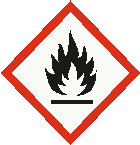

# Esmalte Epóxico Part A

> **Documento fuente:** FDS 87 - Esmalte Epóxico Part A - SIKA.pdf
> **Fabricante:** Sika Colombia S.A.S.
> **Versión / fecha:** N/D (no inferir)
> **Páginas:** 13

## Mapa de secciones FDS

| # | Sección | Página | Estado |
|---|---|---|---|
| 1 | IDENTIFICACION DE LA SUSTANCIA QUIMICA PELIGROSA O MEZCLA Y DEL | 1 | OK |
| 2 | COMPOSICION/INFORMACION SOBRE LOS INGREDIENTES | 3 | OK |
| 3 | IDENTIFICACION DE LOS PELIGROS | 1 | OK |
| 4 | PRIMEROS AUXILIOS | 3 | OK |
| 5 | MEDIDAS CONTRA INCENDIOS | 4 | OK |
| 6 | MEDIDAS QUE DEBEN TOMARSE EN CASO DE DERRAME ACCIDENTAL O FUGA | 4 | OK |
| 7 | MANEJO Y ALMACENAMIENTO | 5 | OK |
| 8 | CONTROLES DE EXPOSICION/PROTECCION PERSONAL | 5 | OK |
| 9 | PROPIEDADES FISICAS Y QUIMICAS | 7 | OK |
| 10 | ESTABILIDAD Y REACTIVIDAD | 8 | OK |
| 11 | INFORMACION TOXICOLOGICA | 8 | OK |
| 12 | INFORMACION ECOTOXICOLOGICA | 9 | OK |
| 13 | ). | 5 | OK |
| 14 | INFORMACION RELATIVA AL TRANSPORTE | 10 | OK |
| 15 | INFORMACION REGLAMENTARIA | 11 | OK |
| 16 | OTRA INFORMACION INCLUIDAS LAS RELATIVAS A LA PREPARACION Y | 11 | OK |

---

### Página 1

FICHA DE DATOS DE SEGURIDAD
Esmalte Epóxico  Part A
Versión 2.0
Número de HDS: 000000613416
Fecha de revisión: 2024/04/08
1 / 13
## 1. IDENTIFICACION DE LA SUSTANCIA QUIMICA PELIGROSA O MEZCLA Y DEL

PROVEEDOR O FABRICANTE
Nombre del producto
: Esmalte Epóxico  Part A
Informaciones sobre el fabricante o el proveedor
Compañía
:
Sika Colombia S.A.S.
Vereda Canavita km 20,5 Autopista Norte
Tocancipá, Cundinamarca
Colombia
Teléfono
:
(57-1) 8786333
Teléfono de emergencia
:
CISPROQUIM
Bogotá: 2886012 / 2886355
Resto del país: 01 8000 916012
Dirección de correo electróni-
co
:
controlcalidad.lab@co.sika.com
Fax
:
(57-1) 8786660
## 2. IDENTIFICACION DE LOS PELIGROS

Clasificación según SGA (GHS)
Líquidos Inflamables
:
Categoría 2
Corrosión/irritación cutáneas
:
Categoría 2
Lesiones oculares gra-
ves/irritación ocular
:
Categoría 2A
Sensibilización cutánea
:
Categoría 1
Toxicidad a la reproducción
:
Categoría 2
Toxicidad sistémica específi-
ca de órganos blanco - Expo-
siciones repetidas
:
Categoría 2
Peligro de aspiración
:
Categoría 1
Peligro a corto plazo (agudo)
para el medio ambiente acuá-
tico
:
Categoría 3
Etiqueta SGA (GHS)
Pictogramas de peligro
:

*Imagen técnica — documento: FDS 87 - Esmalte Epóxico Part A - SIKA.pdf.pdf, página 1, sección: 2.*

*Imagen técnica — documento: FDS 87 - Esmalte Epóxico Part A - SIKA.pdf.pdf, página 1, sección: 2.*

*Imagen técnica — documento: FDS 87 - Esmalte Epóxico Part A - SIKA.pdf.pdf, página 1, sección: 2.*

*Imagen técnica — documento: FDS 87 - Esmalte Epóxico Part A - SIKA.pdf.pdf, página 1, sección: 2.*

### Página 2

FICHA DE DATOS DE SEGURIDAD
Esmalte Epóxico  Part A
Versión 2.0
Número de HDS: 000000613416
Fecha de revisión: 2024/04/08
2 / 13
Palabra de advertencia
:
Peligro
Indicaciones de peligro
:
H225 Líquido y vapores muy inflamables.
H304 Puede ser mortal en caso de ingestión y de penetración
en las vías respiratorias.
H315 Provoca irritación cutánea.
H317 Puede provocar una reacción cutánea alérgica.
H319 Provoca irritación ocular grave.
H361f Susceptible de perjudicar la fertilidad.
H373 Puede provocar daños en los órganos tras exposiciones
prolongadas o repetidas.
H402 Nocivo para los organismos acuáticos.
Consejos de prudencia
:
Prevención:
P201 Procurarse las instrucciones antes del uso.
P202 No manipular antes de haber leído y comprendido todas
las precauciones de seguridad.
P210 Mantener alejado del calor, chispas, llamas al descubier-
to, superficies calientes y otras fuentes de ignición. No fumar.
P233 Mantener el recipiente herméticamente cerrado.
P240 Toma de tierra y enlace equipotencial del recipiente y del
equipo receptor.
P241 Utilizar material eléctrico, de ventilación o de iluminación/
antideflagrante.
P242 No utilizar herramientas que produzcan chispas.
P243 Tomar medidas de precaución contra las descargas elec-
trostáticas.
P260 No respirar nieblas o vapores.
P264 Lavarse la piel cuidadosamente después de la manipula-
ción.
P272 La ropa de trabajo contaminada no debe salir del lugar
de trabajo.
P273 No dispersar en el medio ambiente.
P280 Usar guantes/ ropa de protección/ equipo de protección
para los ojos/ la cara.
Intervención:
P301 + P310 EN CASO DE INGESTIÓN: Llamar inmediata-
mente a un CENTRO DE TOXICOLOGÍA o a un médico.
P303 + P361 + P353 EN CASO DE CONTACTO CON LA PIEL
(o el pelo): Quitar inmediatamente toda la ropa contaminada.
Enjuagar la piel con agua.
P305 + P351 + P338 EN CASO DE CONTACTO CON LOS
OJOS: Enjuagar con agua cuidadosamente durante varios
minutos. Quitar las lentes de contacto cuando estén presentes
y pueda hacerse con facilidad. Proseguir con el lavado.
P308 + P313 EN CASO DE exposición demostrada o supues-
ta: consultar a un médico.
P331 NO provocar el vómito.
P333 + P313 En caso de irritación cutánea o sarpullido: consul-
tar a un médico.
P337 + P313 Si la irritación ocular persiste, consultar a un mé-
dico.
P362 + P364 Quitar la ropa contaminada y lavarla antes de
volverla a usar.
P370 + P378 En caso de incendio: Utilizar arena seca, produc-
to químico seco o espuma resistente al alcohol para la extin-

### Página 3

FICHA DE DATOS DE SEGURIDAD
Esmalte Epóxico  Part A
Versión 2.0
Número de HDS: 000000613416
Fecha de revisión: 2024/04/08
3 / 13
ción.
Almacenamiento:
P403 + P235 Almacenar en un lugar bien ventilado. Mantener
fresco.
P405 Guardar bajo llave.
Eliminación:
P501 Eliminar el contenido/ recipiente en una planta de elimi-
nación de residuos aprobada.
Otros peligros no clasificables
No conocidos.
## 3. COMPOSICION/INFORMACION SOBRE LOS INGREDIENTES

Sustancia / mezcla
:  Mezcla
Componentes
Nombre químico
CAS No.
Concentración (% w/w)
Producto de reacción: bisfenol-A-
(epiclorhidrina); resina epoxídica (peso molecu-
lar medio en número ≤ 700)
25068-38-6
>= 50 -< 70
o-xileno
95-47-6
>= 10 -< 20
acetato de n-butilo
123-86-4
>= 5 -< 10
xileno
1330-20-7
>= 5 -< 10
melamina
108-78-1
>= 1 -< 5
di-n-butilamina
111-92-2
>= 0,1 -< 1
## 4. PRIMEROS AUXILIOS

Consejos generales
:
Retire a la persona de la zona peligrosa.
Consulte a un médico.
Muéstrele esta hoja de seguridad al doctor que esté de servi-
cio.
En caso de inhalación
:
Salga al aire libre.
Consultar a un médico después de una exposición importan-
te.
En caso de contacto con la
piel
:
Quítese inmediatamente la ropa y zapatos contaminados.
Elimínelo lavando con jabón y mucha agua.
Si persisten los síntomas, llame a un médico.
En caso de contacto con los
ojos
:
Enjuagar inmediatamente los ojos con agua abundante.
Quítese los lentes de contacto.
Manténgase el ojo bien abierto mientras se lava.
Si persiste la irritación de los ojos, consulte a un especialista.
En caso de ingestión
:
Lávese la boca con agua y después beba agua abundante.
No provoque vómitos.
No dé leche ni bebidas alcohólicas.
Nunca debe administrarse nada por la boca a una persona
inconsciente.
Lleve al afectado enseguida a un hospital.

#### Tabla 1 (página 3, sección 4)

| Nombre químico |  |  | CAS No. |  | Concentración (% w/w) | |
|---|---|---|---|---|---|---|
| Producto de reacción: bisfenol-A- (epiclorhidrina); resina epoxídica (peso molecu- lar medio en número ≤ 700) |  | 25068-38-6 |  | >= 50 -< 70 |  | |
| o-xileno |  | 95-47-6 |  | >= 10 -< 20 |  | |
| acetato de n-butilo |  | 123-86-4 |  | >= 5 -< 10 |  | |
| xileno |  | 1330-20-7 |  | >= 5 -< 10 |  | |
| melamina |  | 108-78-1 |  | >= 1 -< 5 |  | |
| di-n-butilamina |  | 111-92-2 |  | >= 0,1 -< 1 |  | |

### Página 4

FICHA DE DATOS DE SEGURIDAD
Esmalte Epóxico  Part A
Versión 2.0
Número de HDS: 000000613416
Fecha de revisión: 2024/04/08
4 / 13
Síntomas y efectos más im-
portante, agudos y retarda-
dos
:
Puede ser mortal en caso de ingestión y de penetración en
las vías respiratorias.
Provoca irritación cutánea.
Puede provocar una reacción cutánea alérgica.
Provoca irritación ocular grave.
Susceptible de perjudicar la fertilidad.
Puede provocar daños en los órganos tras exposiciones pro-
longadas o repetidas.
Riesgo de lesiones pulmonares graves (por aspiración).
efectos irritantes
efectos sensibilizantes
Su inhalación puede causar edema pulmonar y neumonía.
Reacciones alérgicas
Lacrimación excesiva
Dermatitis
Vea la Sección 11 para obtener información detallada sobre la
salud y los síntomas.
Notas especiales para un
medico tratante
:
Trate sintomáticamente.
## 5. MEDIDAS CONTRA INCENDIOS

Medios de extinción apropia-
dos
:
Espuma resistente a los alcoholes
Dióxido de carbono (CO2)
Producto químico seco
Agentes de extinción inapro-
piados
:
Agua
Chorro de agua de gran volumen
Peligros específicos durante
la extincion de incendios
:
No use un chorro compacto de agua ya que puede dispersar
y extender el fuego.
Productos de combustión
peligrosos
:  No se conocen productos de combustión peligrosos
Métodos específicos de ex-
tinción
:
Utilice rocío de agua para enfriar los recipientes cerrados.
Equipo de protección espe-
cial para los bomberos
:
En caso de incendio, utilice un equipo respiratorio autónomo.
## 6. MEDIDAS QUE DEBEN TOMARSE EN CASO DE DERRAME ACCIDENTAL O FUGA

ACCIDENTAL
Precauciones personales,
equipo de protección y pro-
cedimientos de emergencia
:
Utilice equipo de protección personal.
Retire todas las fuentes de ignición.
Negar el acceso a personas sin protección.
Precauciones relativas al
medio ambiente
:
Evite que el producto vaya al alcantarillado.
Si el producto contamina los ríos, lagos o alcantarillados, in-
formar a las autoridades respectivas.
Métodos y materiales de
:
Contener y recoger el derrame con material absorbente que

### Página 5

FICHA DE DATOS DE SEGURIDAD
Esmalte Epóxico  Part A
Versión 2.0
Número de HDS: 000000613416
Fecha de revisión: 2024/04/08
5 / 13
contención y limpieza
no sea combustible (p. ej. arena, tierra, barro de diatomeas,
vermiculita), y meterlo en un envase para su eliminación de
acuerdo con las reglamentaciones locales y nacionales (ver
## 13. ).

## 7. MANEJO Y ALMACENAMIENTO

Sugerencias para la protec-
ción contra incendios y ex-
plosiones
:  Utilice un equipo a prueba de explosiones.
Mantener alejado del calor/ de chispas/ de llamas al descu-
bierto/ de superficies calientes. No fumar.
Tomar medidas de precaución contra la acumulación de car-
gas electrostáticas.
Consejos para una manipu-
lación segura
:
No respire los vapores ni la niebla de la pulverización.
Evitar sobrepasar los límites dados de exposición profesional
(ver sección 8).
Evitar todo contacto con los ojos, la piel o la ropa.
Ver sección 8 para el equipo de protección personal.
Las personas que hayan tenido problemas de sensibilisación
de la piel, asma, alergías, enfermedades respiratorias cróni-
cas o recurrentes, no deben ser empleadas en ninguna parte
del proceso en la cual esté utilizada esta preparación.
Fumar, comer y beber debe prohibirse en el área de aplica-
ción.
Tomar medidas de precaución contra las descargas electros-
táticas.
Abra el tambor con precaución, ya que el contenido puede
estar presurizado.
Adopte las acciones necesarias para evitar descargas de
electricidad estática (que podrían ocasionar la inflamación de
los vapores orgánicos).
Cuando se manejen productos químicos, siga las medidas
estándar de higiene.
Condiciones para el almace-
namiento seguro
:
Almacénelo en el envase original.
Almacénelo en un lugar fresco.
Mantenga en un lugar bien ventilado.
Los contenedores que se abren deben ser cuidadosamente
resellados y mantenerlos en posición vertical para evitar fu-
gas.
Observar las indicaciones de la etiqueta.
Almacenar en conformidad con la reglamentación local.
## 8. CONTROLES DE EXPOSICION/PROTECCION PERSONAL

Componentes con parámetros de control en el área de trabajo
Componentes
CAS No.
Tipo de valor
(Forma de
exposición)
Parámetros de
control / Concen-
tración permisible
Bases
o-xileno
95-47-6
TWA
20 ppm
ACGIH
acetato de n-butilo
123-86-4
TWA
50 ppm
ACGIH
STEL
150 ppm
ACGIH
xileno
1330-20-7
TWA
20 ppm
ACGIH

#### Tabla 1 (página 5, sección 8)

| Componentes | CAS No. |  | Tipo de valor |  |  | Parámetros de |  | Bases|
|---|---|---|---|---|---|---|---|---|
|  |  |  | (Forma de |  |  | control / Concen- |  | |
|  |  |  | exposición) |  |  | tración permisible |  | |
| o-xileno | 95-47-6 | TWA |  |  | 20 ppm |  |  | ACGIH|
| a cetato de n-butilo | 1 23-86-4 | TWA |  |  | 50 ppm |  |  | ACGIH|
|  |  | STEL |  |  | 150 ppm |  |  | ACGIH|
| xileno | 1330-20-7 | TWA |  |  | 20 ppm |  |  | ACGIH|

### Página 6

FICHA DE DATOS DE SEGURIDAD
Esmalte Epóxico  Part A
Versión 2.0
Número de HDS: 000000613416
Fecha de revisión: 2024/04/08
6 / 13
Límites biológicos de exposición ocupacional
Componentes
CAS No.
Parámetros
de control
Análisis
biológico
Tiempo
de toma
de mues-
tras
Concentra-
ción permisi-
ble
Bases
o-xileno
95-47-6
Acidos me-
tilhipúricos
Orina
Al final
del turno
(Tan
pronto
como sea
posible
después
de que
cese la
exposi-
ción)
1.5 g/g crea-
tinina
ACGIH
BEI
Acidos me-
tilhipúricos
<** Phrase
language
not avai-
lable: [ 1X
] CUST -
TD-95185
**>
Al final
del turno
(Tan
pronto
como sea
posible
después
de que
cese la
exposi-
ción)
1.500 mg/g
xileno
1330-20-7 Acidos me-
tilhipúricos
Orina
Al final
del turno
(Tan
pronto
como sea
posible
después
de que
cese la
exposi-
ción)
1.5 g/g crea-
tinina
ACGIH
BEI
Protección personal
Protección respiratoria
:
Utilice protección respiratoria a menos que exista una venti-
lación de escape adecuada o que la evaluación de la exposi-
ción indique que el nivel de exposición está dentro de las
pautas recomendadas.
La clase de filtro para el respirador debe ser adecuada para
la concentración máxima prevista del contaminante
(gas/vapor/aerosol/partículas) que puede presentarse al ma-
nejar el producto. Si se excede esta concentración, se debe
utilizar un aparato respiratorio autónomo.
Protección de las manos
:
Guantes químico-resistentes e impermeables que cumplan
con estándares aprobados deben ser utilizados cuando se
manejen productos químicos y la evaluación del riesgo indica
que es necesario.
Protección de los ojos
:
Equipo de protección ocular que cumpla con estándares
aprobados debe ser utilizado cuando la evaluación del riesgo

#### Tabla 1 (página 6, sección indeterminada)

| Componentes | CAS No. | Parámetros de control | Análisis biológico | Tiempo de toma de mues- tras | Concentra- ción permisi- ble | Concentra- | Bases|
|---|---|---|---|---|---|---|---|
|  |  |  |  |  |  | ción permisi- | |
|  |  |  |  |  |  | ble | |
| o-xileno | 95-47-6 | Acidos me- tilhipúricos | Orina | Al final del turno (Tan pronto como sea posible después de que cese la exposi- ción) | 1.5 g/g crea- tinina |  | ACGIH BEI|
|  |  | Acidos me- tilhipúricos | <** Phrase language not avai- lable: [ 1X ] CUST - TD-95185 **> | Al final del turno (Tan pronto como sea posible después de que cese la exposi- ción) | 1.500 mg/g |  | |
| xileno | 1330-20-7 | Acidos me- tilhipúricos | Orina | Al final del turno (Tan pronto como sea posible después de que cese la exposi- ción) | 1.5 g/g crea- tinina |  | ACGIH BEI|

### Página 7

FICHA DE DATOS DE SEGURIDAD
Esmalte Epóxico  Part A
Versión 2.0
Número de HDS: 000000613416
Fecha de revisión: 2024/04/08
7 / 13
indica que es necesario.
Protección de la piel y del
cuerpo
:
Elegir la protección para el cuerpo según sus caraterísticas,
la concentración y la cantidad de sustancias peligrosas, y el
lugar específico de trabajo.
Medidas de higiene
:
Manipúlelo con las precauciones de higiene industrial ade-
cuadas, y respete las prácticas de seguridad.
No coma ni beba durante su utilización.
No fume durante su utilización.
Lavarse las manos antes de los descansos y después de
terminar la jornada laboral.
## 9. PROPIEDADES FISICAS Y QUIMICAS

Aspecto
:
líquido
Color
:  varios
Olor
:  característico
Umbral de olor
:  Sin datos disponibles
pH
:
No aplicable
Punto de fusión/rango / Punto
de congelación
:
Sin datos disponibles
Punto / intervalo de ebullición
:
Sin datos disponibles
Punto de inflamación
:
12,5 °C (12,5 °C)
(Método: copa cerrada)
Tasa de evaporación
:  Sin datos disponibles
Inflamabilidad (sólido, gas)
:
Sin datos disponibles
Límite superior de explosivi-
dad / Límite de inflamabilidad
superior
:
7 %(v)
Límite inferior de explosividad
/ Límite de inflamabilidad infe-
rior
:
1 %(v)
Presión de vapor
:
12,4989 hPa
Densidad relativa de vapor
:
Sin datos disponibles
Densidad
:
1,03 g/cm3 (20 °C (20 °C))
Solubilidad
Hidrosolubilidad
:
insoluble
Solubilidad en otros disol-
ventes
:
Sin datos disponibles
Coeficiente de reparto n-
:
Sin datos disponibles

### Página 8

FICHA DE DATOS DE SEGURIDAD
Esmalte Epóxico  Part A
Versión 2.0
Número de HDS: 000000613416
Fecha de revisión: 2024/04/08
8 / 13
octanol/agua
Temperatura de ignición es-
pontánea
:
415 °C
Temperatura de descomposi-
ción
:  Sin datos disponibles
Viscosidad
Viscosidad, dinámica
:
Sin datos disponibles
Viscosidad, cinemática
:
582,524 mm2/s ( 20 °C (20 °C))
Propiedades explosivas
:
Sin datos disponibles
Propiedades comburentes
:
Sin datos disponibles
## 10. ESTABILIDAD Y REACTIVIDAD

Reactividad
:  No se conoce ninguna reacción peligrosa bajo condiciones de
uso normal.
Estabilidad química
:  El producto es químicamente estable.
Posibilidad de reacciones
peligrosas
:
Estable bajo las condiciones de almacenamiento recomenda-
das.
Los vapores pueden formar una mezcla explosiva con el aire.
Condiciones que deben evi-
tarse
:
Calor, llamas y chispas.
Materiales incompatibles
:  Sin datos disponibles
Productos de descomposición
peligrosos
:   No se conocen productos de descomposición peligrosos.
## 11. INFORMACION TOXICOLOGICA

Toxicidad aguda
No se clasifica debido a la falta de datos.
Componentes:
acetato de n-butilo:
Toxicidad oral aguda
:  DL50 Oral (Rata): > 5.000 mg/kg
Toxicidad aguda por inhala-
ción
:  CL50 (Rata): 23,4 mg/l
Tiempo de exposición: 4 h
Prueba de atmosfera: vapor
Toxicidad dérmica aguda
:  LD50 Dermico (Conejo): > 5.000 mg/kg
xileno:
Toxicidad oral aguda
:  DL50 Oral (Rata): 3.523 mg/kg
melamina:
Toxicidad oral aguda
:  DL50 Oral (Rata): 3.161 mg/kg
Toxicidad aguda por inhala-
:  CL50 (Rata): 5,190 mg/l

### Página 9

FICHA DE DATOS DE SEGURIDAD
Esmalte Epóxico  Part A
Versión 2.0
Número de HDS: 000000613416
Fecha de revisión: 2024/04/08
9 / 13
ción
Tiempo de exposición: 4 h
Prueba de atmosfera: polvo/niebla
di-n-butilamina:
Toxicidad oral aguda
:  DL50 Oral (Rata): 550 mg/kg
Toxicidad aguda por inhala-
ción
:  CL50 (Rata): 1,15 mg/l
Tiempo de exposición: 4 h
Prueba de atmosfera: vapor
Toxicidad dérmica aguda
:  LD50 Dermico (Conejo): 768 mg/kg
Corrosión o irritación cutáneas
Provoca irritación cutánea.
Lesiones oculares graves/irritación ocular
Provoca irritación ocular grave.
Sensibilización respiratoria o cutánea
Sensibilización cutánea
Puede provocar una reacción cutánea alérgica.
Sensibilización respiratoria
No se clasifica debido a la falta de datos.
Mutagenicidad en células germinales
No se clasifica debido a la falta de datos.
Carcinogenicidad
No se clasifica debido a la falta de datos.
Toxicidad para la reproducción
Susceptible de perjudicar la fertilidad.
Toxicidad sistémica específica de órganos blanco - exposición única
No se clasifica debido a la falta de datos.
Toxicidad sistémica específica de órganos blanco - exposiciones repetidas
Puede provocar daños en los órganos tras exposiciones prolongadas o repetidas.
Toxicidad por aspiración
Puede ser mortal en caso de ingestión y de penetración en las vías respiratorias.
## 12. INFORMACION ECOTOXICOLOGICA

Ecotoxicidad
Componentes:
acetato de n-butilo:
Toxicidad para las al-
gas/plantas acuáticas
:  CE50 (Desmodesmus subspicatus (alga verde)): 647,7 mg/l
Tiempo de exposición: 72 h
xileno:
Toxicidad para peces (Toxi-
cidad crónica)
:
NOEC (Oncorhynchus mykiss (trucha irisada)): > 1,3 mg/l
Tiempo de exposición: 56 d
Toxicidad para la dafnia y
:
NOEC (Daphnia (Dafnia)): 1,17 mg/l

### Página 10

FICHA DE DATOS DE SEGURIDAD
Esmalte Epóxico  Part A
Versión 2.0
Número de HDS: 000000613416
Fecha de revisión: 2024/04/08
10 / 13
otros invertebrados acuáticos
(Toxicidad crónica)
Tiempo de exposición: 7 d
Persistencia y degradabilidad
Sin datos disponibles
Potencial de bioacumulación
Sin datos disponibles
Movilidad en el suelo
Sin datos disponibles
Otros efectos adversos
Producto:
Información ecológica com-
plementaria
:  No existe ningún dato disponible para ese producto.
## 13. INFORMACION RELATIVA A LA ELIMINACION DE LOS PRODUCTOS

Métodos de eliminación
Residuos
:
Envíese a una compañía autorizada para la gestión de resi-
duos.
Evite que el producto penetre en los desagües, tuberías, o la
tierra (suelos).
No contamine los estanques, cursos de agua o zanjas con el
producto químico o el contendor utilizado.
Envases contaminados
:
Vacíe el contenido restante.
Eliminar como producto no usado.
No reutilice los recipientes vacíos.
No queme, ni utilice un soplete de corte, en el tambor vacío.
## 14. INFORMACION RELATIVA AL TRANSPORTE

Regulaciones internacionales
UNRTDG
Número ONU
:
UN 1263
Designación oficial de trans-
porte
:
PAINT
 (producto de reacción: bisfenol-A-epiclorhidrina y resinas
epoxi (peso molecular medio 700 - 1100))
Clase
:
3
Grupo de embalaje
:
III
Etiquetas
:
3
IATA-DGR
No. UN/ID
:
UN 1263
Designación oficial de trans-
porte
:
Paint
 (epoxy resin)
Clase
:
3
Grupo de embalaje
:
III

### Página 11

FICHA DE DATOS DE SEGURIDAD
Esmalte Epóxico  Part A
Versión 2.0
Número de HDS: 000000613416
Fecha de revisión: 2024/04/08
11 / 13
Etiquetas
:
Flammable Liquids
Instrucción de embalaje
(avión de carga)
:
366
Instrucción de embalaje
(avión de pasajeros)
:
355
Código-IMDG
Número ONU
:
UN 1263
Designación oficial de trans-
porte
:
PAINT
(epoxy resin)
Clase
:
3
Grupo de embalaje
:
III
Etiquetas
:
3
Código EmS
:
F-E, S-E
Contaminante marino
:
no
Transporte a granel de acuerdo a instrumentos IMO
No aplicable para el producto tal y como se proveyó.
Precauciones especiales para los usuarios
La(s) clasificación(es) de transporte presente(s) tienen solamente propósitos informativos y se
basa(n) únicamente en las propiedades del material sin envasar/embalar, descritas dentro de es-
ta Hoja de Datos de Seguridad. Las clasificaciones de transporte pueden variar según el modo
de transporte, el tamaño del envase/embalaje y las variaciones en los reglamentos regionales o
del país.
## 15. INFORMACION REGLAMENTARIA

Reglamentación medioambiental, seguridad y salud específica para la sustancia o mezcla
Decreto 1477-2014: Tabla de Enfermedades Ocupa-
cionales
:
o-xileno
Convención Internacional sobre las Armas Químicas
(CWC) Programas sobre los Productos Químicos Tó-
xicos y los Precursores (Louisiana Administrative Co-
de, Title 33,Part V Section 10101 et. seq.)
:
No aplicable
Sustancias y productos químicos controlados por el
Ministerio de Justicia
:
acetato de n-butilo
xileno
Listado de Sustancias incluídas como Sustancias de
Control Especial y Sometidas a Fiscalización por el
Ministerio de Salud y Protección Social
:
No aplicable
Resolución 2715 de 2014 Por la cual se establecen las
sustancias que deben ser objeto de registro de control
de venta al menudeo, con base en los criterios de
clasificación que se definen.
:
No aplicable
## 16. OTRA INFORMACION INCLUIDAS LAS RELATIVAS A LA PREPARACION Y

ACTUALIZACIÓN DE LAS HOJAS DE DATOS DE SEGURIDAD
Fecha de revisión
:  2024/04/08
formato de fecha
:
aaaa/mm/dd
Información adicional

### Página 12

FICHA DE DATOS DE SEGURIDAD
Esmalte Epóxico  Part A
Versión 2.0
Número de HDS: 000000613416
Fecha de revisión: 2024/04/08
12 / 13
NFPA:
HMIS® IV:
Las clasificaciones HMIS® se basan en
una escala del 0 al 4 en la que 0 significa
riesgos o peligros mínimos y 4 significa
riesgos o peligros serios. El "*" represen-
ta un peligro crónico, mientras que la "/"
representa la ausencia de un peligro
crónico.
Texto completo de otras abreviaturas
ACGIH
:
Valores límite (TLV) de la ACGIH,USA
ACGIH BEI
:
ACGIH - Índices  Biológicos de Exposición (BEI)
ACGIH / TWA
:
Tiempo promedio ponderado
ACGIH / STEL
:
Límite de exposición a corto plazo
ADR
:
Accord européen relatif au transport international des mar-
chandises Dangereuses par Route
CAS
:
Chemical Abstracts Service
DNEL
:
Derived no-effect level
EC50
:
Half maximal effective concentration
GHS
:
Globally Harmonized System
IATA
:
International Air Transport Association
IMDG
:
International Maritime Code for Dangerous Goods
LD50
:
Median lethal dosis (the amount of a material, given all at
once, which causes the death of 50% (one half) of a group of
test animals)
LC50
:
Median lethal concentration (concentrations of the chemical in
air that kills 50% of the test animals during the observation
period)
MARPOL
:
International Convention for the Prevention of Pollution from
Ships, 1973 as modified by the Protocol of 1978
OEL
:
Occupational Exposure Limit
PBT
:
Persistent, bioaccumulative and toxic
PNEC
:
Predicted no effect concentration
REACH
:
Regulation (EC) No 1907/2006 of the European Parliament
and of the Council of 18 December 2006 concerning the Re-
gistration, Evaluation, Authorisation and Restriction of Chemi-
cals (REACH), establishing a European Chemicals Agency
SVHC
:
Substances of Very High Concern
vPvB
:
Very persistent and very bioaccumulative
La informacion contenida en este ficha de datos de seguridad corresponde a nuestro nivel de
conocimiento en el momento de su publicacion. Quedan excluidas todas las garantias. Se
aplicaran nuestras condiciones generales de venta en vigor. Por favor, consulte la Hoja de
Datos del Producto  antes de su uso y procesamiento.
Inflamabilidad
Inestabilidad
Salud
2
0
3
Peligro especial
3
0
3
*
RIESGO FÍSICO
INFLAMABILIDAD
SALUD

*Imagen técnica — documento: FDS 87 - Esmalte Epóxico Part A - SIKA.pdf.pdf, página 12, sección: indeterminada.*

*Imagen técnica — documento: FDS 87 - Esmalte Epóxico Part A - SIKA.pdf.pdf, página 12, sección: indeterminada.*

### Página 13

FICHA DE DATOS DE SEGURIDAD
Esmalte Epóxico  Part A
Versión 2.0
Número de HDS: 000000613416
Fecha de revisión: 2024/04/08
13 / 13
CO / 1X
